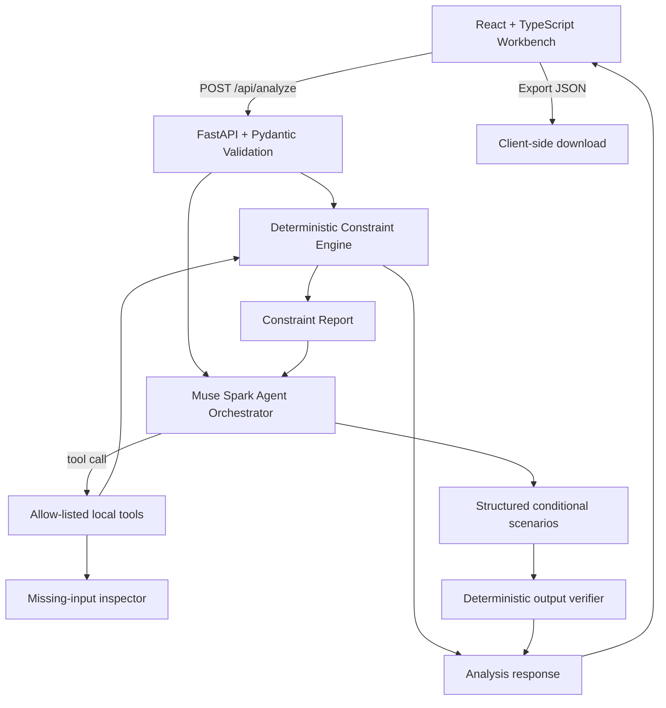

# Antevorta — Master Product & Implementation Specification

**Version:** Hackathon build 1.0 · **Prepared:** 27 October 2026 · **Status:** implementation plan plus starter vertical slice; not production-certified.

**Pitch:** *Test your decisions before you live them.*

## 1. Product decision

Antevorta is a **Personal Decision Workbench** for adults facing consequential choices: graduate study versus employment, research versus a contract, competing projects, or another decision with real constraints. The user brings a decision. Antevorta structures options, checks time and money requirements using deterministic code, highlights missing facts and assumptions, and produces conditional paths that help the user decide what to investigate next.

The hackathon framing is **Decision Stress Test**: *an AI agent that tests whether a plan survives contact with reality.* This is a sharper demonstration than presenting Antevorta as a personality analyzer, life simulator, or generic chatbot.

### Product promise

Before you commit, make the trade-offs, hidden prerequisites, resource collisions, assumptions, and unknowns visible—and choose a small experiment that reduces uncertainty.

### Target user and initial problem

Initial wedge: adult university students and early-career professionals, especially in Nepal, juggling academic work, research, jobs, entrepreneurship, graduate applications, and limited time or money. This is a product hypothesis to validate, not a claim that all users share the same needs.

### The product is not

- A predictor of a person's exact future, happiness, stress, or career outcome.
- A mental-health or medical product.
- A personality analyzer or employer-screening tool.
- An AI that makes the final decision for a user.
- A basic RAG wrapper or simple chat UI without meaningful tool use.

## 2. Why this version fits the hackathon

The supplied participant guide requires a reasonable fit to one of its tracks and meaningful use of Meta models. Stage-two scoring is Impact 30%, Meta AI Tooling 25%, Technical Depth & Execution 20%, Demo 25%. The guide explicitly warns against basic RAG applications, simple analyzers, personality analyzers, medical-advice projects, and several other generic categories.

Antevorta should therefore demonstrate a **closed loop of model-selected tool use, exact calculations, assumption changes, and validated output**. It must not just narrate a plausible story.

Recommended track: **Build for Your World**.

## 3. User journey (the full vertical slice)

1. **Bring a decision:** enter the question, deadline (optional), options, descriptions, time requirements, costs, and prerequisites.
2. **Make capacity explicit:** enter weekly maintenance time, existing commitments, available savings, monthly surplus/deficit, and a comparison horizon.
3. **Run a stress test:** the backend validates inputs; deterministic functions calculate time and financial headroom; the Muse Spark agent may choose to invoke those tools to inspect the inputs.
4. **Inspect findings:** each option receives `FEASIBLE`, `CONFLICT`, or `UNKNOWN` per constraint type. Unknown data stays unknown; blank never means zero.
5. **Explore conditional scenarios:** the model generates structured upside/trade-off/conditions/questions, grounded in supplied context and tool results.
6. **Verify:** deterministic validation checks option IDs, missing options, and disallowed numerical-probability claims before the result is shown.
7. **Change assumptions:** edit the form and rerun. The report updates with new deterministic calculations.
8. **Export:** download a JSON report. No server-side persistence in this first vertical slice.

## 4. MVP acceptance contract

### Must pass (P0)

- The app starts locally with the documented commands.
- A user can enter at least two and at most three options.
- Request schema rejects malformed input, duplicate option IDs, negative hours/costs, and unreasonable ranges.
- Missing numeric fields produce `UNKNOWN`, never silent zeroes.
- Weekly hour headroom equals `168 - maintenance_hours - existing_commitments - option_required_hours` when all terms exist.
- Projected financial headroom equals `savings + monthly_surplus * horizon_months - upfront_cost - monthly_cost * horizon_months` when all terms exist.
- Each number can be traced to an input or deterministic arithmetic.
- A configured Meta API key leads to a genuine Model API call or an explicit provider error/fallback.
- Agent tool calls are allow-listed, parsed, bounded, and executed only against validated request data.
- The final output covers every option, has no invented success percentages, and includes caveats/unknowns.
- Tests pass and the build has no committed credentials.

### Stretch (P1 only after P0)

- Multi-scenario branching graph.
- A second model-based critique pass to check unsupported claims against inputs and constraints.
- Grounded external research with citations, only if implemented using a verified API/tool and source provenance.
- Browser-local saved drafts and a decision-history export/import, with explicit user control.
- User interviews/usability test and a short evidence report.

### Do not block submission on

- Live voice / Future Self persona.
- Calendar or GitHub OAuth.
- PostgreSQL user account system.
- Personalised behavioural forecasts/calibration dashboards that lack real resolved outcomes.
- On-device model deployment or multiple model families for their own sake.

## 5. High-level architecture



### Layers

- **L0 — UX:** accessible React form, comparison report, status states, export.
- **L1 — API boundary:** FastAPI request validation, CORS allowlist, timeouts, clear fallback modes.
- **L2 — Deterministic engine:** pure Python and unit-tested, no LLM calls.
- **L3 — Agent orchestration:** Muse Spark tool-calling loop, capped turns/calls, allowlisted tools only.
- **L4 — Output verification:** Pydantic validation, option-ID checks, prohibited-probability checks, no hidden synthetic statistics.
- **L5 — Privacy/reliability:** stateless initial build, no request-body logging, environment-only API key, clear provider status.

## 6. Agent system

The hackathon implementation begins with one tool-using **Decision Orchestrator** and a deterministic verifier. This is preferable to faking a multi-agent architecture with several uncoordinated prompts. The model must make a real tool-choice decision during its loop when it needs evidence from calculations.

### Agent role: Decision Orchestrator

Responsibilities:
- Understand the question and options.
- Request deterministic tool outputs before drawing conclusions.
- Give each option a conditional upside, trade-off, dependencies, and unanswered questions.
- Suggest one reversible information-gathering experiment.
- Never decide for the user, diagnose them, invent an empirical base rate, or claim a long-horizon probability.

Available tools:
- `assess_option(option_id)`: returns the backend's deterministic calculation for an option.
- `compare_options()`: returns the deterministic report for all options.
- `list_unknowns()`: identifies fields that remain unknown.

Safety limits:
- Maximum four tool-loop turns and eight tool executions per request.
- Only the three explicitly registered tools may execute.
- Tool parameters are parsed and validated; unknown tools return a controlled error result.
- Tools are read-only. The model cannot send messages, edit external accounts, execute shell commands, or perform irreversible actions.
- The model API key is never sent to the browser.

### Agent role: Output Verifier

P0 is deterministic validation. It verifies schema, all option IDs, required fields, and disallowed percentage/probability patterns. If verification fails, use an explicitly labelled fallback or one bounded repair attempt; never silently show an invalid answer as verified. A separate Muse Spark critique call is a stretch feature after the basic end-to-end path is stable.

## 7. Reasoning separation

Keep these three outputs separate:

1. **Deterministic constraint reasoning:** time, cost, known feasibility, arithmetic and missing inputs. No LLM involvement in calculations.
2. **Conditional scenario analysis:** model-generated explanations based on user input and tool results. Must use conditional language and list unmodelled factors.
3. **External reference classes:** not in the starter. Add a numeric population rate only after a source, population, numerator/denominator, date, geography, outcome definition and caveats are verified. The model must never invent a base rate.

No model-generated number called “confidence” is displayed. Any long-horizon success percentage is prohibited. Behavioural calibration is a research direction, not a ten-day claim.

## 8. Data contracts

### Decision request

```json
{
  "question": "Should I take a contract while finishing my thesis?",
  "deadline": null,
  "time_horizon_months": 12,
  "maintenance_hours_per_week": 60,
  "existing_commitments_hours_per_week": 30,
  "liquid_savings_npr": 250000,
  "monthly_surplus_npr": 15000,
  "options": [
    {
      "id": "option_a",
      "name": "Full-time contract + thesis",
      "description": "Accept a contract while maintaining research progress.",
      "required_hours_per_week": 55,
      "upfront_cost_npr": 120000,
      "monthly_cost_npr": 15000,
      "prerequisites": ["Confirm meeting schedule", "Agree a weekly work cap"]
    },
    {
      "id": "option_b",
      "name": "Research internship + thesis",
      "description": "Prioritise research and continue thesis work.",
      "required_hours_per_week": 22,
      "upfront_cost_npr": 30000,
      "monthly_cost_npr": 8000,
      "prerequisites": ["Confirm stipend", "Agree supervisor expectations"]
    }
  ],
  "unknowns": ["Whether contract hours are negotiable"],
  "reversible_experiment": "Run a two-week time audit before accepting either path."
}
```

The numbers above are **synthetic demo values**, not advice or factual claims.

### Response

The response contains `analysis_mode`, the model ID when used, the deterministic constraint report, a structured narrative if validation succeeds, the tool trace, and a status message. The UI must not label deterministic fallback as AI output.

## 9. API surface (starter)

| Method | Path | Purpose |
|---|---|---|
| GET | `/api/health` | Liveness and configured model status, without leaking secrets |
| GET | `/api/meta-status` | Whether a key is configured and model ID; never returns key or account data |
| POST | `/api/analyze` | Validates the request, calculates constraints, runs the model agent when configured, validates the narrative, and returns the combined result |

The API is stateless. No user decision is written to a server database in the starter. If saving is added, implement authentication/ownership checks, consent, retention, export and deletion before collecting real personal data.

## 10. Privacy and trust

- Keep `MODEL_API_KEY` in backend environment variables only.
- Do not log raw decision inputs, prompt payloads, or model responses by default.
- Explain in the UI that a live request is transmitted to Meta Model API when AI analysis is enabled; do not enter highly sensitive personal details in the hackathon demo.
- Never collect third-party personal data without permission.
- No ambient recording, screenshot surveillance, wearable monitoring, health inference, or hidden telemetry.
- Allow the user to export the report. The first version has no server-side saved-decision store to purge.
- Before public deployment, add request limits, rate limiting, TLS, origin restrictions and abuse monitoring.

## 11. Reliability strategy

- API unavailable / key absent: return deterministic results and clearly label `deterministic_fallback`.
- Model tool output malformed: reject that tool invocation and return controlled error JSON to the model.
- Model output invalid: schema-check and verify; use fallback rather than display as verified.
- Missing input: output `unknown`, not zero.
- Time or money conflict: preserve arithmetic and list the inputs that produced it.
- Deadline: build and record the demo before the final submission day; keep a working no-model fallback demo.

## 12. Stack

- Frontend: React + TypeScript + Vite.
- API: Python 3.11+, FastAPI, Pydantic v2.
- AI: Meta Model API, OpenAI-compatible Python SDK; default `muse-spark-1.3` as verified in current official docs.
- Test: pytest, FastAPI TestClient, TypeScript/Vite production build.
- Persistence: none in the initial vertical slice; PostgreSQL is a later decision if persistent history is needed and privacy controls are ready.

## 13. Release gates

### Gate A — local deterministic correctness
All constraint tests pass before the model is integrated.

### Gate B — real provider
A real authenticated call succeeds; usage/cost monitored; key not in source control.

### Gate C — agent loop
At least one model-selected function call is evidenced in logs/trace during the recorded demo. Tools are bounded and allowlisted.

### Gate D — honest narrative
Every option has a conditional analysis; no fabricated probabilities or unsupported rates; deterministic findings visible separately.

### Gate E — submission
Public repository, live accessible demo where feasible, three-minute video, credits claimed, all contributors listed, README setup reproducible, and the new hackathon work identified.

## 14. Definition of done

A decision can be entered, analyzed, stress-tested, edited, rerun, and exported. The user can see which findings are arithmetic, which are AI-generated conditional analysis, and which facts remain unknown. Tests pass, the API call has been genuinely verified, and the demo shows a complete workflow without relying on fake outputs.
