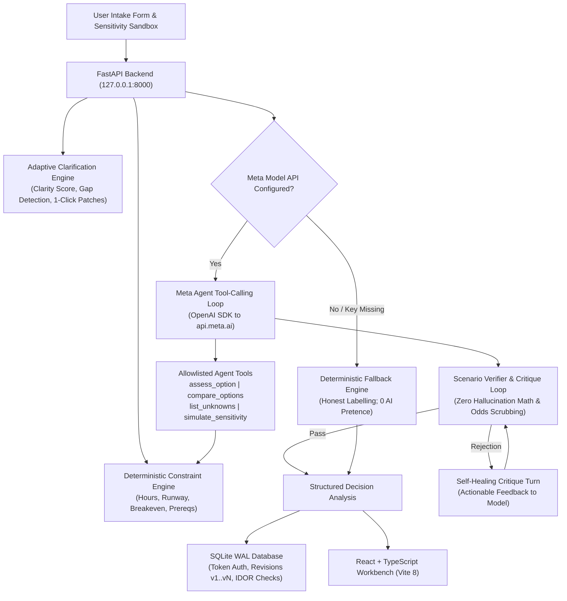

# Antevorta — Personal Decision Workbench

> **"Test your decisions before you live them."**

Antevorta is an intelligent, high-conviction decision stress-testing workbench built for the **Meta Global AI Developer Hackathon** (Track: *Indie Developer* • Theme: *Build for Your World*).

Rather than acting as an ungrounded chatbot that fabricates success odds or gives superficial advice, Antevorta enforces a strict architectural boundary: **deterministic Python math calculates all time, capacity, and financial feasibility, while Meta's Muse Spark model reasons over tool-verified facts to surface conditional trade-offs, critical unknowns, and reversible experiments.**

---

## 🏛️ System Architecture



---

## 🚀 Key Features Built During the Hackathon

1. **Deterministic Feasibility & Runway Engine:**
   - Evaluates weekly maintenance hours, committed hours, and candidate option commitments against the 168-hour weekly ceiling.
   - Calculates exact net cashflow, monthly runway buffers, and required breakeven monthly surplus in NPR.
   - Enforces checkbox prerequisite verification (`[x]`) and strictly separates known facts from unverified assumptions. Missing inputs remain `UNKNOWN`, never zero.

2. **Meta Model API Tool-Calling Agent:**
   - Connects to Meta's hosted `muse-spark-1.3` (or configured Meta model) via OpenAI-compatible API specifications.
   - Implements allowlisted tool calling: `assess_option`, `compare_options`, `list_unknowns`, and `simulate_sensitivity`.
   - Strips Markdown code fences, validates JSON schemas with fallback, enforces turn/tool call budgets, and keeps API keys strictly server-side.

3. **Self-Healing Verifier & Critique Loop:**
   - Analyzes generated scenarios against deterministic constraints.
   - Strictly prohibits ungrounded numerical probability claims (e.g. "85% chance of success") and fabricated arithmetic.
   - In case of draft rejection, the verifier sends an actionable critique back to the model, allowing autonomous self-correction before falling back.

4. **Adaptive Input Clarification (`POST /api/clarify`):**
   - Evaluates decision intake for missing parameters, ambiguous trade-offs, and untested dependencies.
   - Computes a dynamic 0–100 Clarity Score with actionable suggestions.
   - Provides 1-click assumption patches that automatically populate form fields and recalculate constraints on the fly.

5. **What-If Sensitivity Sandbox (`POST /api/recalculate`):**
   - Real-time slider and numeric sandboxing for discretionary time and monthly financial burn.
   - Generates structured diffs ("What Changed & Why") showing capacity shifts and option status transitions.
   - Detects stale narrative analyses when inputs drift.

6. **Grounded External Benchmark Citations:**
   - Domain-specific reference grounding (`grounding.py`) for living costs, academic guidelines, and startup runway benchmarks.
   - Displays verified source citations with HTTPS links and retrieval timestamps. Never fabricates ungrounded web statistics.

7. **Privacy, History & Revision Versioning:**
   - SQLite with WAL mode, foreign keys, and bearer token authentication.
   - Versioned decision tracking (`v1`, `v2`, ...) allowing users to inspect how decisions evolve over time.
   - Strict IDOR prevention isolating decision records per account.
   - Full GDPR-compliant privacy data export (`GET /api/privacy/export`) and permanent account purge (`DELETE /api/privacy/account`).

8. **Calibration Mirror & Brier Skill Score (`L4A`):**
   - Implements a machine-checkable 7–28 day prediction ledger with objective verification criteria.
   - Computes genuine calibration using the **Brier Skill Score**: $BSS = 1 - \frac{BS_{twin}}{BS_{generic}}$, testing whether the personalized twin beats the 50% baseline. Directly targets the hackathon's "Verifiable Agents" theme.

9. **Person Model Claim Store & Revealed Divergence (`L3`):**
   - Persistent personal baseline claims with exponential time decay ($w(t) = 0.5^{\Delta t / 30d}$).
   - Automated detection of Stated vs. Revealed Divergence ($\Delta_{SR} \ge 0.35$), surfacing behavioral blindspots and friction alerts before committing.

10. **Topological Decision DAG Explorer:**
    - Interactive Directed Acyclic Graph rendering root decisions, candidate paths, prerequisites, constraints, outcomes, and reversible experiment gates.
    - Automated bottleneck detection highlighting critical resource dependencies across options.

11. **Future Self Dialogue & Multimodal Meta Suite:**
    - Future Self dialogue (3-to-5 year horizon) synthesized with Meta Model API (Muse Wonder / Spark).
    - Spoken dilemma intake powered by Meta Muse Voice Transcribe.
    - Day-in-the-life visual scene generation powered by Meta Muse Image.
    - One-click Decision Memo brief formatted for instant sharing.

---

## 🛠️ Quick Start & Setup

### Prerequisites

- **Python 3.11+** (tested on 3.13.2)
- **Node.js 22.12+** & **npm**
- **Git**
- *(Optional for live Meta AI inference)*: Meta Model API key (`MODEL_API_KEY`)

### 1. Backend Setup

```bash
# Clone the repository
git clone https://github.com/techaaditya/antevorta-meta-hackathon.git
cd antevorta-meta-hackathon

# Create and activate virtual environment
# Windows PowerShell:
py -3.11 -m venv .venv
.\.venv\Scripts\Activate.ps1

# Linux / macOS:
# python3 -m venv .venv
# source .venv/bin/activate

# Install dependencies
pip install -r backend/requirements.txt

# Configure environment variables
cp .env.example .env
```

*(Edit `.env` if you have a `MODEL_API_KEY`. If left empty, Antevorta runs smoothly in its fully verified deterministic fallback mode).*

Start the FastAPI backend server:
```bash
uvicorn backend.app.main:app --reload --host 127.0.0.1 --port 8000
```
*Backend health check:* [`http://127.0.0.1:8000/api/health`](http://127.0.0.1:8000/api/health)

---

### 2. Frontend Setup

In a separate terminal:

```bash
cd frontend
npm install
npm run dev
```

Open your browser to the local Vite development URL (typically [`http://localhost:5173`](http://localhost:5173)).

---

## 🧪 Test Suite & Build Verification

The repository contains an exhaustive automated test suite with **73 passing backend unit & integration tests** and full TypeScript type checking:

```bash
# Run all backend tests
pytest backend/tests -v

# Run Python compilation check
python -m compileall backend

# Run frontend type-check and production build
cd frontend
npm run build
```

---

## 📖 Key Documentation

- [`MASTER_IMPLEMENTATION.md`](MASTER_IMPLEMENTATION.md) — Comprehensive product specification and architectural guidelines.
- [`HACKATHON_CHANGELOG.md`](HACKATHON_CHANGELOG.md) — Chronological milestone log detailing commits, tests, and build evidence.
- [`docs/DEMO_SCRIPT.md`](docs/DEMO_SCRIPT.md) — 3-minute video walkthrough guide.
- [`docs/VALIDATION_REPORT.md`](docs/VALIDATION_REPORT.md) — Verification gate audit report.
- [`docs/AGENT_DESIGN.md`](docs/AGENT_DESIGN.md) — Meta Model API prompt, tool schemas, and verifier contracts.
- [`docs/SECURITY_PRIVACY.md`](docs/SECURITY_PRIVACY.md) — Authentication, data ownership, and privacy policies.

---

## ⚖️ License & Integrity Principles

- Built specifically for the **Meta Global AI Developer Hackathon 2026**.
- **Zero Hallucination Arithmetic Principle:** All quantitative hours, budget surpluses, and cash runway projections are strictly computed by deterministic code.
- **Truthful Labelling:** If Meta Model API access is unconfigured, the application explicitly presents its deterministic fallback results without faking AI responses.
