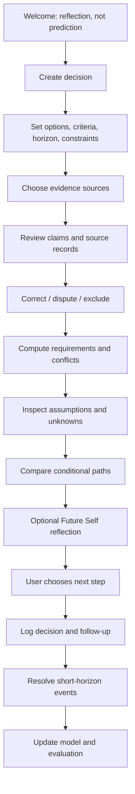
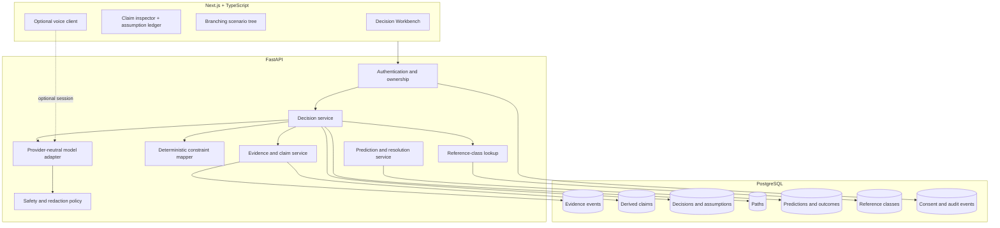

# Personal Decision Twin — Consolidated Master Documentation

## Product strategy, research programme, learning path, architecture, implementation, evaluation, and responsible deployment

**Version:** 1.0 — consolidated synthesis  
**Prepared:** 25 October 2026  
**Working name:** *Antara* / *Decision Workbench* (not cleared for trademark or domain use)  
**Inputs:** Original Future-Self pitch, Gemini Live Agent Challenge starter repository, Future-Self Product Master Documentation, and `PERSONAL-DIGITAL-TWIN-MASTER.md`  
**Status:** Product direction is a proposal; user value, model accuracy, and business viability remain hypotheses to test.

> **Vision:** Help people test their decisions before they live them by building a transparent, evidence-backed model of how they make choices, surfacing real constraints and sourced base rates, and learning from outcomes that can actually be checked.

> **Pitch:** **Test your decisions before you live them.**

> **Non-negotiable rule:** The system may help a person understand themselves, their constraints, and plausible choices. It must not claim to know their future.

## How to use this document

This document unifies the earlier Future-Self Decision Companion product plan with the Personal Digital Twin research and architecture plan. It is not a literal concatenation: where the earlier documents disagree about scope or build order, this version makes one decision and explains it.

Labels: **Source-derived** = present in supplied materials; **Research-backed** = supported by a cited paper/source; **Recommendation** = proposed choice; **Hypothesis** = not yet validated; **Do not claim** = not permitted without further evidence.

Keep this file at the repository root and update it as a living specification. Version the research protocol before collecting outcomes. Model/API names, pricing, provider terms, and laws change; re-check official documentation before implementation or launch.

## Contents

1. [Executive decision](#1-executive-decision)
2. [How the source documents relate](#2-how-the-source-documents-relate)
3. [Unified product definition](#3-unified-product-definition)
4. [What the product is and is not](#4-what-the-product-is-and-is-not)
5. [Users and jobs to be done](#5-users-and-jobs-to-be-done)
6. [Research and competitive landscape](#6-research-and-competitive-landscape)
7. [Product strategy and differentiation](#7-product-strategy-and-differentiation)
8. [Scope and feature roadmap](#8-scope-and-feature-roadmap)
9. [User journeys and product requirements](#9-user-journeys-and-product-requirements)
10. [Person model and evidence system](#10-person-model-and-evidence-system)
11. [Decision modelling and reasoners](#11-decision-modelling-and-reasoners)
12. [Behaviour prediction and calibration](#12-behaviour-prediction-and-calibration)
13. [Reference-class data](#13-reference-class-data)
14. [System architecture](#14-system-architecture)
15. [Technical stack and repository layout](#15-technical-stack-and-repository-layout)
16. [Data model and schema](#16-data-model-and-schema)
17. [API design](#17-api-design)
18. [AI orchestration and prompts](#18-ai-orchestration-and-prompts)
19. [Future Self voice](#19-future-self-voice)
20. [Frontend and UX](#20-frontend-and-ux)
21. [Privacy and security](#21-privacy-and-security)
22. [Safety and responsible use](#22-safety-and-responsible-use)
23. [Research and evaluation](#23-research-and-evaluation)
24. [Learning roadmap](#24-learning-roadmap)
25. [Existing repository audit and rebuild](#25-existing-repository-audit-and-rebuild)
26. [Testing and acceptance criteria](#26-testing-and-acceptance-criteria)
27. [Deployment and operations](#27-deployment-and-operations)
28. [Validation and business model](#28-validation-and-business-model)
29. [Risks and kill criteria](#29-risks-and-kill-criteria)
30. [Implementation roadmap](#30-implementation-roadmap)
31. [Three-minute demo](#31-three-minute-demo)
32. [Open decisions](#32-open-decisions)
33. [Glossary](#33-glossary)
34. [References](#34-references)
35. [Appendices](#35-appendices)

---

# 1. Executive decision

## 1.1 Yes, merge them—but do not build every feature

The files describe complementary layers of one idea:

- The **Future-Self** documents are strongest on the user experience: bring a meaningful decision, explore branching paths, and optionally speak with a simulated older self.
- **PERSONAL-DIGITAL-TWIN-MASTER.md** is strongest on scientific and technical validity: explicit evidence, assumptions, constraints, machine-checkable short-horizon predictions, calibration, and outcome feedback.
- The starter repository is a useful rough feature map, but must be treated as a scaffold to audit—not trusted as working software.

The unified product should be a **Personal Decision Workbench powered by a transparent Personal Decision Model**. Future Self becomes an interaction mode and presentation layer, not the whole product. A branching timeline visualises the decision model; it must not create fake probabilities.

## 1.2 Unified product thesis

A person describes a decision. The system builds a structured model of their goals, constraints, stated preferences, observed follow-through, and unresolved assumptions. It then:

1. Maps what each option requires, conflicts with, and leaves unknown.
2. Cites population base rates only where a relevant source exists.
3. Generates conditional scenarios and, later, a clearly labelled Future Self conversation grounded in approved evidence.
4. Records short-horizon predictions that can be resolved, compares them with generic-model and base-rate baselines, and displays calibration only when evidence supports it.
5. Updates its model transparently and allows the user to inspect, correct, dispute, exclude, export, or delete their information.

This is not a system that simulates a whole life with numerical certainty. It is a tool for making assumptions visible, reasoning about choices, and testing whether a personal model is actually useful.

## 1.3 Key product choices

| Decision | Unified recommendation | Reason |
|---|---|---|
| Product centre | Decision Workbench | Useful without pretending to model the whole world |
| Personalisation | Evidence-backed claims with provenance | Prevents generic narration from masquerading as knowledge of a person |
| Long-horizon paths | Conditional narratives and constraint maps; no invented percentages | Individual life counterfactuals are not directly observable or generally validated |
| Numeric probability | Only for resolvable short-term events after calibration, or sourced reference-class rates | Makes numbers traceable and evaluable |
| Future Self voice | Product vision, but built after a text workflow and isolated audio proof-of-concept | Preserves the memorable interaction without making voice a blocker |
| Branching tree | Keep; render structured nodes and assumptions | Makes options and dependencies inspectable |
| Wearables / burnout prediction | Remove from the first versions | Weak evidence for the proposed claims and high privacy burden |
| Screen/ambient surveillance | Cut | Invasive and unnecessary for the core job |
| Database | PostgreSQL; add pgvector only if retrieval requires it | Relationships, event history, and calibration fit SQL well |
| Framework | Simple services + provider-neutral model adapter first | Easier to learn, test, and debug |
| Research spine | Compare personal model with generic LLM and base-rate baselines | Tests whether personalisation adds value |
| Initial audience | Adult students and early-career people making education/career decisions; validate with interviews | Focused, concrete constraint set |

## 1.4 Recommended MVP

The first complete MVP is a **text-first Decision Workbench with an inspectable personal model**. Build a small voice proof-of-concept early in parallel, but do not let it block the main workflow.

MVP features:

1. Structured decision intake and adaptive clarification.
2. Claim inspector separating what a user said from what their records show.
3. Deterministic constraint/conflict mapper.
4. Three conditional paths, not three predictions.
5. Editable assumption ledger.
6. Decision log and follow-up.
7. Research-track prediction records with machine-checkable resolution criteria.
8. Authentication, consent, export, deletion, and audit trail.

Calendar/GitHub integrations, live voice, advanced calibration dashboards, and external reference-class data are staged additions.

## 1.5 The unified formula

**Decision Workbench (product loop) + Personal Model (evidence) + Calibration Mirror (measurement) + Future Self (optional conversation) + Branching Tree (visual layer).**

This offers a product that can be useful now and a research programme that can prove itself wrong. That is stronger than four shallow features or a beautiful narrative with no evidence behind it.

---

# 2. How the source documents relate

| Source | What it contributes | Preserve | Reframe |
|---|---|---|---|
| Original Future-Self pitch PDF | Digital Mirror, burnout predictor, Future Self, wellbeing guardian, voice and dashboard | Human problem, Future Self interaction, branching tree, empathetic design goal | Burnout predictions, screen scanning, wearable confidence claims, automatic interventions |
| Future-Self-Twin planning document | Feature breakdown and initial architecture | Useful inventory and decomposition | Name, scope, implementation details |
| Gemini Live Agent Challenge repo | Early scaffold, UI ideas, tools, prompts, integrations | Component map, seed demo, separation of prompts/tools | Treat as potentially nonfunctional until audited and tested |
| Future-Self Product Master | Product requirements, UX, voice engineering, security, learning curriculum | User journeys, safe scenarios, voice spike, clean rebuild and learning plan | Make decision modelling and empirical calibration central |
| PERSONAL-DIGITAL-TWIN-MASTER | Research, evidence provenance, constraints, short-term calibration, evaluation and kill criteria | Scientific and data-model foundation | Do not try to build all the research ambitions in the first MVP |

## 2.1 Unified conceptual hierarchy

```text
PERSONAL DECISION WORKBENCH
├── A. PERSONAL MODEL
│   ├── stated goals, values, preferences, fears, constraints
│   ├── revealed behaviour and outcome history
│   ├── provenance, freshness, contradictions, uncertainty
│   └── user correction, dispute, exclusion and deletion
├── B. DECISION ENGINE
│   ├── options and criteria
│   ├── deterministic constraint propagation
│   ├── versioned assumption ledger
│   ├── cited reference-class evidence where available
│   └── named unknowns / unmodelled factors
├── C. CALIBRATION MIRROR
│   ├── short-horizon behavioural predictions
│   ├── machine-checkable resolution criteria
│   ├── base-rate and generic-model baselines
│   └── calibration, error analysis and feedback
└── D. EXPERIENCE LAYER
    ├── decision workbench and claim inspector
    ├── scenario comparison and branching tree
    ├── follow-up/reflection loop
    └── Future Self conversation (text first, voice later)
```

## 2.2 Resolving the roadmap conflict

One document makes voice central; the other excludes it from MVP. These can both be honoured by separating vision from build order:

- **Vision:** voice can become a signature interface.
- **Early technical spike:** test audio capture, session handling, interruption, reconnection, and playback in isolation.
- **First complete MVP:** build a text workflow with manual evidence and deterministic constraints.
- **Polished demo:** add voice after the content is grounded and stable.

This avoids a broken microphone or live API session taking down the whole product.

---

# 3. Unified product definition

## 3.1 Category and working name

**Category:** personal decision-support and behavioural reflection software.

Names to investigate: **Antara**, **Forkpoint**, **Decision Workbench**, **Priorwork**, or a new distinctive name. These are brainstormed candidates, not trademark/domain clearances. Do not publicly name the product *TwinMind*: an existing product already uses that name for AI memory/second-brain functionality.

Avoid claims such as “AI that knows your future”, “digital soul”, “life simulator”, or “burnout detector”. They create inaccurate expectations.

## 3.2 Definitions

- **Personal Decision Model:** a structured, versioned, evidence-backed representation of one user's goals, constraints, expressed preferences, observed behaviour, and uncertainty.
- **Personal Decision Workbench:** the user-facing product built on that model.
- **Future Self:** a simulated reflective persona that explores a conditional scenario; not a copy of the user, not a real future identity, and not a predictor.
- **Calibration Mirror:** the research component that measures short-horizon predictions against resolvable outcomes and baselines.

## 3.3 Core loop

1. Bring a real decision.
2. Clarify options, values, time horizon, resource limits, reversibility, and unknowns.
3. Review the personal model and correct it.
4. Map requirements, conflicts, dependencies, and missing facts.
5. Compare conditional paths.
6. Edit assumptions and see which results change.
7. Choose a decision or reversible experiment—the user decides.
8. Log the decision and follow-up.
9. Resolve checkable outcomes and evaluate the model.

## 3.4 Success definitions

**Product success:** a user enters a confusing decision and leaves with a clearer map of requirements, conflicts, assumptions, unknowns, and a next step they chose.

**Research success:** for pre-defined, machine-checkable short-horizon outcomes, the personalised predictor outperforms a generic LLM and a base-rate baseline in at least some domains, with uncertainty and limitations reported honestly. A negative result is still informative.

---

# 4. What the product is and is not

## 4.1 It is

- A structured mirror of claims and evidence about one user.
- A decision-structuring tool that makes constraints visible.
- A conditional scenario builder, not a life-outcome oracle.
- A place to record intentions and learn from outcomes.
- A research platform for testing whether individual evidence improves behavioural prediction.
- A Future Self reflection experience once the underlying workflow is reliable.

## 4.2 It is not

- A clone, consciousness upload, digital soul, or perfect copy of a person.
- A prediction of the exact future of a particular person five years from now.
- A substitute for clinicians, counsellors, mentors, lawyers, or financial advisers.
- An employee-surveillance product or an eligibility-scoring tool.
- A validated burnout or mental-health detector.
- A system that decides whether someone should quit a degree, move abroad, leave a job, or end a relationship.
- A means to profile unconsenting third parties.

## 4.3 Claims policy

| Claim | Allowed now? | Required evidence before stronger claim |
|---|---|---|
| “Helps organise difficult decisions” | Product intent; validate usability | User research and task testing |
| “Shows conflicts with stated commitments” | Yes, if inputs/rules are visible | Unit and integration tests |
| “Creates plausible future scenarios” | Yes, if clearly conditional | Output review and explicit assumptions |
| “Models what you tend to do” | Only as tentative evidence-linked language | Personal-fidelity evaluation |
| “Predicts your behaviour accurately” | Not as a general claim | Prospective, baseline-comparative, calibrated study |
| “Predicts your career/happiness/stress” | No | Current plan cannot establish individual life-counterfactual accuracy |
| “Detects burnout before you feel it” | No | Dedicated longitudinal/clinical validation and governance; outside scope |
| “Your Future Self knows what will happen” | No | Incorrect product framing |

---

# 5. Users and jobs to be done

## 5.1 Initial segment

Begin with adults—especially students and early-career people—facing education, employment, migration, or project-prioritisation decisions. A possible initial wedge is Nepali university students weighing graduate study, employment, a startup/side project, and existing commitments. This is a segment hypothesis, not a proven market fact.

It is suitable for early tests because options often contain checkable requirements: time, money, deadlines, prerequisites, references, exams, location, and obligations. These can be mapped without pretending to know the long-term outcome.

## 5.2 Jobs to be done

- “Help me find the constraints I have not considered.”
- “Show me whether a plan conflicts with commitments I have already made.”
- “Turn a vague ambition into a testable plan.”
- “Help me compare what I say matters with what my past records show.”
- “Help me test reversible experiments before an irreversible decision.”
- “Help me revisit an earlier decision and learn from what happened.”
- “Let me discuss a possible path with a reflective voice without pretending it is literally my future.”

## 5.3 Discovery interviews

Ask about a recent actual decision, not whether the person likes the futuristic idea:

1. What was the decision and when did you face it?
2. What options did you consider seriously?
3. What information was missing?
4. Which constraints mattered—time, money, location, family, health, credentials, deadlines?
5. What did you choose and why?
6. What did you later learn that you wish you had known earlier?
7. How did you reason through it: people, search, spreadsheets, advisers, or a model?
8. What was hardest: understanding yourself, finding facts, comparing options, or committing?
9. Would you return a week/month later to report what happened? Why?
10. What would you never want this tool to store?

Capture anonymised notes only with consent. Interest during a demo does not prove repeated use or willingness to pay.

## 5.4 Early validation target

Interview 8–12 people before committing to broad features. A smaller sample can be an exploratory pilot if access is limited, but label it accordingly. Look for repeated concrete pain, evidence of current workarounds, and willingness to follow up—not only enthusiasm for voice AI.

---

# 6. Research and competitive landscape

## 6.1 MIT Media Lab “Future You”

MIT's *Future You* is a direct precedent for a personalised future-self reflection experience. It uses a synthetic backstory and an AI-generated future-self persona; the research version also used an age-progressed image. MIT's project page discusses a preregistered study with 188 participants, while a later publication abstract reports a preregistered study with 344 participants and describes reduced anxiety and increased future-self continuity after a brief interaction. These should be treated as different reported study descriptions, not casually combined into one sample.

The central lesson is about **reflection and future-self continuity**, not prediction accuracy. MIT explicitly states that the system cannot predict the specific details of a user's actual future; its purpose is to illustrate plausible pathways. This project should use the same boundary.

Sources: [MIT project page](https://www.media.mit.edu/projects/future-you/overview/) · [publication page](https://www.media.mit.edu/publications/future-you-a-conversation-with-an-ai-generated-future-self-reduces-anxiety-negative-emotions-and-increases-future-self-continuity/).

## 6.2 Generative Agent Simulations of 1,000 People

Park and colleagues studied LLM agents grounded in interviews with 1,052 people, comparing agent responses to a human test-retest consistency baseline. This is important because people themselves are not perfectly self-consistent; the human repeatability baseline is more meaningful than a simplistic “perfect twin” target.

Versions of the paper report results around 82–86% of the two-week human test-retest benchmark for specified survey/interview configurations; the earlier supplied planning document quotes 85%. When reusing a result, cite the exact paper version, configuration, task and metric. These results do not prove accurate prediction of consequential real-world choices; evaluate the intended domain separately.

Sources: [arXiv:2411.10109](https://arxiv.org/abs/2411.10109) · [code](https://github.com/joonspk-research/genagents).

## 6.3 Twin-2K-500

The *Twin-2K-500* dataset covers 2,058 US participants, around 2.42 hours per participant on average, and 500+ questions across four waves. It includes demographic, psychological, personality, cognitive and economic measures; repeated questions support a test-retest baseline.

It is an important offline benchmark for person-model fidelity, but it does not validate forecasts about a specific student's future deadlines or career. The supplied research document cites 71.72% accuracy and 87.67% of human test-retest accuracy; trace those figures to the precise table/evaluation setting and reproduce the paper's split before quoting them as results.

Sources: [paper](https://arxiv.org/abs/2505.17479) · [dataset](https://huggingface.co/datasets/LLM-Digital-Twin/Twin-2K-500).

## 6.4 Centaur and Psych-101

Centaur is a foundation model fine-tuned on Psych-101, a dataset of choices from psychological experiments. The paper reports strong prediction results on held-out experimental tasks. This suggests an ambitious future research direction: behaviour models trained on choice data may provide a base for personalised prediction. But lab choices do not automatically generalise to decisions such as moving abroad or accepting a contract. Do not make this an MVP dependency.

Source: [arXiv:2410.20268](https://arxiv.org/abs/2410.20268).

## 6.5 Competitor/category map

| Product/category | Overlap | Lesson | Potential distinction |
|---|---|---|---|
| TwinMind | Personal memory/context capture | Context is useful; data trust matters | Do not compete on all-day recording; focus on decisions and resolved outcomes |
| Limitless/Rewind-style tools | Ambient memory/search | Context retrieval can help | Avoid screen/audio surveillance |
| Otter, Fireflies, Granola | Meeting transcription and notes | Structure helps retrieval | Not a meeting tool; models choices and outcome feedback |
| Reclaim, Clockwise, Motion | Calendar/focus optimisation | Suggestions can be actionable | Scheduling is secondary, not the product thesis |
| Oura, WHOOP, Garmin, Fitbit, Apple Health | Readiness/wellbeing metrics | Sensor data needs validation | No unsupported burnout prediction |
| MIT Future You | Future-self reflection | Important psychological prior art | Add traceable evidence, constraint mapping, and measurable feedback |
| AI life simulators / branching-tree demos | Alternate-life stories and decision trees | Scenarios are compelling | Do not make fake scores; expose assumptions and constraints |

Verify current features/ownership before public comparison. This table is a landscape sketch, not proof that no competitor has similar research underway.

## 6.6 Research gap

The question is not “can an LLM tell a convincing story about my future self?” Existing projects already explore this. The stronger question is:

> **Does an evidence-backed model of an individual improve short-horizon behavioural prediction over a generic LLM and a simple base-rate predictor, and in which domains does personalisation help?**

Therefore, long-horizon paths remain reflective, while the research spine uses outcomes that can resolve in days/weeks.

---

# 7. Product strategy and differentiation

## 7.1 Three possible framings

### A. Calibration Mirror

**Loop:** record an intention → generate a short-horizon prediction → observe reality → score the prediction → update calibration.

- Strongest research framing; honest and falsifiable.
- Narrower than a full decision product.
- Requires users to return and outcomes to resolve.

### B. Decision Workbench

**Loop:** bring a real decision → clarify options and criteria → map requirements and conflicts → show base rates if available → log the decision → follow up.

- Strongest product framing; useful without prediction.
- The personal model earns its place by surfacing relevant conflicts.
- Follow-up can create continuing value.

### C. Behavioural Sandbox / Future Self

**Loop:** create branching scenarios → explore with a narrative persona → compare paths visually.

- Strong demo and emotional appeal.
- Crowded and least defensible if it is only “LLM writes a story”.

## 7.2 Combined strategy

**Build B, use A as its measurement spine, and borrow C's interface language.** The core is the Decision Workbench; the personal model is evidence-backed; the Calibration Mirror measures what can be tested; Future Self and branching paths make the experience easier to explore. The visual layer must reflect the reasoning, not conceal its weaknesses.

## 7.3 Differentiation hypotheses

1. **Inspectable personal model:** each claim traces to user input or an approved source.
2. **Stated vs revealed separation:** self-description is not silently blended with observed behaviour.
3. **Constraint propagation:** choices are mapped to prerequisites, deadlines, money/time needs, commitments, and conflicts.
4. **Sourced outside view:** base rates include a source, population, time window, sample and caveats—or the UI says data is unavailable.
5. **Outcome feedback:** predictions are scored and future predictions are evaluated against baselines.
6. **Local-first privacy controls:** sensitive information is minimised and optionally never leaves the device.
7. **Grounded Future Self:** the voice persona uses the same evidence and assumptions visible on the decision page.

These are hypotheses. They become differentiators only if users value them and the implementation works.

## 7.4 Naming process

Treat Antara, Forkpoint, Priorwork, Decision Workbench, or other ideas as temporary candidates. Before public use:

1. Search existing apps, companies, GitHub/npm, domains and social handles.
2. Check trademark databases in target markets.
3. Check pronunciation and meaning in Nepali and English.
4. Look for confusingly similar AI decision products.
5. Record the check and date in the decision log.

Avoid *TwinMind* because an existing product already uses the name for AI memory/second-brain functionality. Prefer not to lead with “twin” as the brand/category word.

---

# 8. Scope and feature roadmap

## 8.1 Prioritised feature plan

| Priority | Feature | Definition of done |
|---|---|---|
| P0 | Decision intake | User can enter a question, alternatives, criteria, time horizon, constraints and unknowns |
| P0 | Claim/evidence inspector | Every claim shows source, timestamp, support type, freshness/confidence method and correction controls |
| P0 | Deterministic constraint mapper | Lists requirements, conflicts, resource needs, deadlines and unknowns from structured data |
| P0 | Assumption ledger | User can edit an assumption and re-run dependent analysis |
| P0 | Conditional path comparison | Paths are materially different, grounded, and contain no invented long-horizon probabilities |
| P0 | Decision log and follow-up | User can save the decision, choose a next step and set a follow-up |
| P0 | Auth/access/export/delete | Data is user-scoped; export and deletion have automated tests |
| P0 research track | Prediction records and baseline logging | Short-horizon outcomes have machine-checkable criteria and comparison baselines |
| P1 | Adaptive onboarding interview | Builds a richer model and lets the user correct the summary |
| P1 | Calendar read-only aggregates | Consent-based minimal aggregate context with a tested disconnect flow |
| P1 | GitHub read-only aggregates | Only selected repositories and needed activity aggregates; disconnect works |
| P1 | Follow-up reminders | Explicitly opted-in reminders with easy disable control |
| P1 | Calibration dashboard | Displays reliability metrics only when sample and diagnostics justify them |
| P1 | Future Self text mode | Reflection grounded in selected claims and path conditions |
| P2 | Live Future Self voice | Interruption, stop/mute, reconnection, transcript controls and text fallback work |
| P2 | Reference-class library | Manually curated source-backed base rates relevant to initial users |
| P2 | Local extraction/redaction model | Quality/latency benchmark supports deployment choice |
| P3 | Personalised fine-tuning | Only after enough high-quality consented outcome data and promising ablations |

## 8.2 Explicitly out of scope initially

- Burnout diagnosis/prediction.
- Wearable/biometric ingestion.
- Continuous screen watching, keystroke monitoring, ambient audio capture.
- Automated toxicity detection.
- Employee, admissions, lending or insurance scoring.
- Third-party behaviour/personality prediction.
- Agent-based society, simulated economy, reinforcement learning on the user, 3D walkable world.
- Monte Carlo built from invented distributions.
- LLM-generated five-year success probabilities.
- Custom fine-tuning before baseline evaluation.
- Autonomous calendar changes or notification silencing.

## 8.3 Why no life score in v1

A single score for happiness, fulfilment, stress or future success can imply a measurement that does not exist. Prefer concrete state readouts: hours available, prerequisites met, cost range, days to deadline, known conflicts, sourced base rates and unresolved assumptions. A summary score should not be added unless its data-generating process, user interpretation, validity evidence and failure modes are defined and evaluated.

---

# 9. User journeys and product requirements

## 9.1 Main journey



## 9.2 First-run onboarding

1. Explain what the system does and does not do.
2. Ask the user to choose a real current decision.
3. Ask what outcomes matter to them, without implying a correct ranking.
4. Collect options and time horizon.
5. Collect practical constraints: hours, money range, location, prerequisites, obligations and deadlines.
6. Choose evidence sources. Manual inputs only at first; integrations later.
7. Generate a concise structured summary of what the system understood.
8. Let the user correct it before analysis.
9. Offer a clear “do not retain this session” option and privacy settings.

## 9.3 Decision intake schema

Required fields:

- `title`: short decision name.
- `question`: decision in the user's words.
- `options`: two or more options, with a reversible experiment considered where useful.
- `criteria`: dimensions the user wants to consider.
- `time_horizon`: time period or decision deadline.
- `constraints`: known limits and commitments.
- `unknowns`: facts the user does not know.
- `irreversibility`: low/medium/high, with explanation.
- `evidence_scope`: claim/source categories permitted for this decision.

Optional fields: preferred language; hopes/fears; alternatives already rejected and why; trusted people/professionals to consult; preferred follow-up interval.

## 9.4 Claim inspector requirements

Each displayed claim must have:

- plain-language claim;
- domain (planning, values, learning, career, relationships, project work, etc.);
- support type: `stated`, `revealed`, or `inferred`;
- links to supporting records;
- confidence/freshness method and timestamp;
- contradiction status where applicable;
- “correct”, “dispute”, “exclude from this decision”, and “delete evidence” controls;
- explanation of how this claim affects the current analysis.

Use context-specific language, not fixed identity labels. Prefer “In the last four logged deadlines, three slipped when another project competed for time” over “You are unreliable”.

## 9.5 Scenario path requirements

Each path should show:

- concise title and conditional premise;
- conditions under which it is explored;
- required steps/resources;
- known conflicts with commitments;
- trade-offs against user-selected criteria;
- potential upside and downside;
- assumptions that may change the comparison;
- unknown/unmodelled factors;
- early indicators to monitor;
- reversible experiment or checkpoint where feasible;
- evidence/source references for factual statements.

Never attach a generated success percentage to a long-horizon personal life path.

## 9.6 End-of-session artifact

Offer an exportable artifact (sharing is opt-in) containing decision framing, options, criteria/constraints, evidence used/excluded, requirements/conflicts, assumptions/unknowns, scenario summary, the user's own reflection, chosen next step and follow-up date. The user previews exactly what is included before export.

---

# 10. Person model and evidence system

## 10.1 Store claims, not unsupported personality scores

Do not store `risk_tolerance = 0.8` without definition, evidence, timestamp and uncertainty. Store claims with provenance. Example:

- Predicate: `TENDS_TO`
- Object: “underestimates task duration when several projects compete”
- Domain: `planning`
- Support: observed task estimates/outcomes plus any separately stated self-description
- Confidence: documented estimate method, not an LLM self-rating
- Freshness: time-decay rule
- Contradictions: retained rather than silently discarded

## 10.2 Stated, revealed and inferred

- **Stated:** user directly said “I work best in the morning”.
- **Revealed:** an observation shows “four of six logged tasks were completed before noon”.
- **Inferred:** “Morning may be a productive period for this user”.

Do not turn an inference into a fact. Disagreement between self-description and observation is a finding to surface gently, not a reason to shame the user.

## 10.3 Event sourcing and deletion

Use event-sourced data so belief changes can be audited:

- Evidence events are append-only during normal operations.
- Derived claims are rebuildable from evidence.
- Corrections supersede prior derived claims rather than silently rewriting the history.
- Deletion is an explicit exception: tombstone, remove active references, re-derive the model, and purge identifiable content according to the documented retention/backup policy.
- Model outputs record the claim IDs and evidence references they used.

“Append-only” must not become an excuse to deny a legitimate delete request.

## 10.4 Confidence and decay

Confidence must have a documented interpretation; it must not be an arbitrary LLM self-rating. An initial heuristic can consider evidence count/type, recency, contradiction, source reliability, and user correction, but must not be called statistically calibrated unless validated.

One configurable decay heuristic is:

`current_confidence = stored_confidence * 0.5 ** (age_days / half_life_days)`

This is an engineering choice, not an empirical law. Temporary goals may decay quickly; stable preferences more slowly. Users must be able to inspect and correct claims.

## 10.5 Evidence pipeline


The LLM can extract candidate claims; deterministic code validates schemas, provenance, authorisation and scope. Unvalidated extraction must not become “what the system knows”.

## 10.6 Evidence source roadmap

| Source | Phase | Use | Guardrails |
|---|---|---|---|
| Manual intake | MVP | Goals, options, constraints, deadlines, unknowns | User reviews/edits before analysis |
| Explicit reflection | MVP/P1 | User account of decision and outcome | Consent and retention options |
| GitHub | P1 | Selected repository activity counts/timestamps | Least-privilege scope; avoid private code and full commit messages unless necessary/approved |
| Google Calendar | P1 | Meeting counts, hours, available blocks, fragmentation aggregates | Read-only first; minimise titles and attendee details |
| Documents/resume | Later | User-selected skills/experience | Upload consent, citations, deletion |
| Wearables | Out of scope | No initial ingestion | Revisit only with validated utility and consent |
| Screen/ambient audio | Out of scope | No continuous capture | Not needed for core value |

## 10.7 Data minimisation examples

Use derived aggregates such as “12 meetings in seven days; approximately 8.5 meeting hours; three back-to-back chains” or “four commits across two selected repositories after 22:00 in the past 14 days.” Do not automatically interpret these as stress, burnout, dedication, or future success. These are descriptive facts; interpretations need context and careful language.

---

# 11. Decision modelling and reasoners

## 11.1 Keep three engines separate

### Engine A — Behaviour predictor

Question: “Will this user complete a specific, measurable task by a defined date?”

Output: qualitative label initially; later a calibrated probability only if sufficient resolved data and diagnostic gates are met. Every event needs machine-checkable resolution criteria.

### Engine B — Consequence/constraint mapper

Question: “What does each option require, and which resources, commitments or deadlines conflict with it?”

Output: requirements, constraints, conflicts, unknowns. Use deterministic code over structured data. An LLM may extract the structure and explain it, but must not invent missing constraints.

### Engine C — Reference-class forecaster

Question: “What outcomes have been observed for a relevant population/decision type?”

Output: sourced population-level rate, source date, population/sample definition, caveats and applicability warning. No source means no numeric base rate.

Do not merge these into one opaque score. A population rate is not a personal probability; a short-term completion prediction is not a five-year outcome forecast.

## 11.2 Constraint propagation: build this first

Represent each option using:

- weekly time budget;
- money/cash-flow range;
- geography/travel requirements;
- prerequisites/dependencies;
- deadlines;
- user-described relationships and obligations;
- active projects/commitments;
- reversibility and cost of reversing the choice.

Example: a master's application may require a language exam, applications, transcripts, references and a funding plan. It may conflict with a project milestone or current course load. Admissions, policy, family circumstances and funding remain unmodelled. A low-risk experiment could be to verify programme requirements and estimate weekly preparation time before committing to a full plan.

Compute schedules, missing prerequisites and known conflicts without assigning odds to final life outcomes. Unknown inputs stay unknown.

## 11.3 Assumption ledger

Every assumption has a stable ID, plain-language description, source type (user, external source, or analyst/model), uncertainty explanation, confirmation state, impact if changed, date/version and downstream dependencies. Changing an assumption must rerun deterministic calculations and mark narratives stale until regenerated.

## 11.4 Conditional narrative instead of fake simulation

The generator may describe plausible experiences if a user chooses an option and certain conditions hold. It must use conditional language and explain what could change the outcome. It cannot claim to know future memories, emotions, or events.

## 11.5 Monte Carlo and causal graphs later

Monte Carlo is justified only when inputs have defensible distributions from observed data or sourced rates. Sampling made-up numbers 1,000 times creates no evidence. Causal DAGs may document assumptions; do not perform causal calculations over invented parameters. Do not build a simulated economy or agent-based cast of the user's friends/family for v1.

---

# 12. Behaviour prediction and calibration

## 12.1 Why it is the research spine

A long-horizon question such as “Will I be happy in five years if I move abroad?” is not machine-checkable as a unique counterfactual for one person: only one branch will be observed. “Will the user submit the application by Friday?” can be resolved from a timestamped event or check-in. Short-horizon behaviour is a more honest setting for testing whether a personal model adds value.

## 12.2 Prediction requirements

Each prediction needs:

- an observable event and exact action;
- due date and time zone;
- resolution criteria and permitted source;
- domain and horizon length;
- model version and prompt hash;
- evidence/claim IDs used;
- baseline predictions recorded at creation;
- resolution state, outcome and resolution evidence.

Bad: “The user will become more disciplined.”  
Better: “The user will merge at least one pull request into the selected repository's `main` branch by 23:59 Nepal time on 31 October 2026,” provided the user has explicitly permitted this source and the user/repository mapping is correct.

## 12.3 Baselines

Record at least these three predictions at the same time:

1. **Simple base-rate baseline:** for example, recent personal completion frequency for comparable events, if sample size permits.
2. **Generic-LLM baseline:** the same question to the same general model without personalised claims, using a versioned prompt.
3. **Personalised model:** the model with selected, traceable claims and relevant evidence.

Keep prompts and model versions fixed within an evaluation window where practical. The model that made a prediction must not decide whether it came true.

## 12.4 Probability display policy

An LLM's verbalised “70%” is not inherently calibrated. Do not show raw model probabilities as if they were meaningful personal probabilities.

Recommended operating rule:

- Before enough resolved events exist in a domain, show “still learning” or qualitative bands and explain calibration is not established.
- As a conservative product gate, do not show numerical personalised probabilities until at least 30 resolved observations exist in that domain and a reviewer has inspected the sample mix and calibration diagnostics. **Thirty is a design guardrail, not a universal statistical guarantee.**
- Fit a calibration function only with proper separation of training/calibration/test data and no leakage. Isotonic regression and Platt/logistic calibration are candidates; choose empirically.
- Report uncertainty where feasible. Suppress the result when sample size, domain coverage or diagnostics are inadequate.
- Fit/re-fit calibration only on already-resolved data, never on the outcome being evaluated.

## 12.5 Metrics

| Metric | Use | Caution |
|---|---|---|
| Brier score: `mean((p-y)^2)` | Probability error for binary outcomes; lower is better | Requires valid outcome/probability pairs |
| Brier skill score: `1 - (BS_model / BS_baseline)` | Positive means improvement over baseline | Baseline and sampling uncertainty matter |
| Reliability diagram | Predicted vs observed frequency by bin | Small bins are unstable with limited data |
| Expected calibration error (ECE) | Weighted gap between average prediction and observed frequency | Depends on binning; not proof by itself |
| AUC | Ranking/discrimination | Does not measure calibration and may mislead on small/imbalanced samples |
| Ratio to human test-retest | Twin agreement relative to human repeatability on comparable tasks | Only valid under matched measurement protocols |
| Per-domain Brier skill | Reveals where personalisation helps or fails | Define domains before analysis; avoid cherry-picking |
| Drift over time | Fidelity/forecast quality across weeks/months | Repeated exposure and user change must be considered |

## 12.6 Personal fidelity vs real-world behaviour

A survey benchmark measures whether a model reproduces a user's hypothetical answers, not necessarily how the person behaves. Use held-out questions the model has not seen. Ask participants to repeat a subset after an interval to estimate their own test-retest consistency. Report the model relative to this human baseline; avoid a standalone “86% you” score.

## 12.7 Fine-tuning is a later phase

Per-user LoRA or a Centaur-style model is a possible research path, not an MVP requirement. Start with a prompted model, explicit claims, deterministic rules, and evaluations. Attempt personal fine-tuning only if there are enough consented relevant outcomes, the baseline shows headroom, the compute burden is justified, held-out evaluation is possible, and deletion/governance can be handled responsibly.

---

# 13. Reference-class data

## 13.1 Role of reference classes

Population base rates provide outside-view context. They are not a user's destiny and should not be marketed as personal predictions. Show population, geography, time period, source, sample size where available, and limitations.

## 13.2 Initial data priorities

Start with decision types where credible public information can be attached:

- language-test and application milestones;
- official programme requirements and deadlines;
- graduate employment outcomes when population and methods are clearly defined;
- scholarship/funding award rates if credible applicant/award counts are published;
- costs and time requirements from official providers/programmes;
- education/migration statistics where the reported measure matches the question.

Do not invent “Nepali students like you” statistics from anecdotes. If a suitable rate does not exist, write **No reliable reference-class rate found** and continue with constraint mapping.

## 13.3 Required source fields

Each rate record needs decision type, population definition, outcome definition, rate and numerator/denominator if available, source URL/title, publication and retrieval dates, geography/time period, sample size, caveats, licence/reuse restrictions, review status, reviewer and version.

## 13.4 Display rule

> **Outside-view evidence:** In the cited population, X of N applicants achieved outcome Y during period Z. This is a population statistic, not an estimate of your personal chance. The source may differ from your circumstances because of programme, funding, grades, policy and selection criteria.

The data lookup—not the LLM—must supply the number. If the lookup has no valid rate, the model is prohibited from inventing one.

---

# 14. System architecture

## 14.1 Principle

Keep deterministic logic, model reasoning, and voice separate. Every consequential output should trace to evidence, constraints, assumptions, or sourced outside evidence. AI assists interviewing, extraction, retrieval, and explanation; it does not replace authorisation, storage, calculations or evaluation.

## 14.2 High-level architecture



## 14.3 Service responsibilities

**Frontend:** collect/validate inputs; show evidence scope; render claims, assumptions, scenarios and sources; make uncertainty visible; handle user correction/export/delete; manage microphone state only in the voice phase.

**Backend:** authenticate every request; enforce ownership; validate schemas; store evidence/claims/decisions/assumptions/paths/predictions/outcomes; run deterministic calculations; fetch reviewed reference classes; apply redaction rules; call models through an adapter; schedule resolution/follow-up jobs; support export and deletion.

**Model layer:** ask clarification questions, extract candidate claims, map unstructured information into schemas, narrate conditional scenarios, explain deterministic findings, and reflect on outcomes. It must not control permissions, fabricate rates, or silently change structured facts.

## 14.4 One-decision data flow

1. Client submits typed decision input.
2. Backend authenticates user and validates data.
3. Backend selects only approved claims/aggregates relevant to that decision.
4. Redaction and sensitivity rules run before model calls.
5. Constraint service computes requirements/conflicts/unknowns.
6. Reference-class service returns only reviewed sources.
7. Model gets structured claims, deterministic findings, assumptions, unknowns, sources and output schema.
8. Output is validated; unsupported facts are rejected or marked unknown.
9. Backend stores scenario version with source, claim, assumption, model and prompt references.
10. Client renders result with evidence/assumption explanations.

## 14.5 Scheduled jobs

A scheduled process may check due predictions against permitted sources, store resolution evidence, ask for user confirmation where needed, send opted-in reminders, and recompute summaries. Use a small scheduled worker or hosted cron first. Add Celery/Redis or more infrastructure only when actual workload requires it.

## 14.6 Reliability and fallback

- Text mode must work when voice is down.
- Deterministic constraint results remain available if an LLM times out.
- Invalid model output fails safely.
- Use bounded retries, timeouts, rate limits and circuit breakers where appropriate.
- Demo fixtures must be clearly labelled as synthetic/demo data.
- A prerecorded video can be a backup, but never describe playback as a live model call.

---

# 15. Technical stack and repository layout

## 15.1 Recommended stack

| Layer | Recommendation | Reason |
|---|---|---|
| Frontend | Next.js + React + TypeScript | Product UI and component ecosystem |
| Styling | Tailwind + accessible component primitives | Fast iteration and consistent UX |
| Branching tree | React Flow | Nodes/edges suit scenarios and assumptions |
| Charts | Recharts initially | Avoid custom visualisation work until needed |
| Backend | Python + FastAPI + Pydantic | Clear contracts; strong data/science ecosystem |
| Database | PostgreSQL | Relational data, event history, joins, calibration analytics |
| Vector search | pgvector only if semantic retrieval proves useful | Avoid premature infrastructure |
| Migrations/data access | SQLAlchemy/SQLModel + Alembic | Explicit schema changes |
| Auth | Supabase Auth or another managed provider | Avoid hand-rolling identity security; still test backend ownership |
| Jobs | Hosted cron/simple worker first | Enough for follow-up and outcome resolution initially |
| Model calls | Provider-neutral adapter | Model swaps do not rewrite business logic |
| Local inference | Ollama for development experiments | Useful to test local extraction/redaction |
| Evaluation | Python, pandas/numpy, scikit-learn, statsmodels, pytest | Baselines, calibration, analysis |
| Testing | pytest + frontend test runner + Playwright | Unit, integration and end-to-end tests |
| Deployment | Choose after local end-to-end works | Compare cost, region, data terms, reliability and export options |

## 15.2 Why PostgreSQL, not Neo4j initially

Evidence supports claims; claims inform decisions; decisions have assumptions and scenarios; predictions link to outcomes. SQL naturally represents these relationships and supports transactions and calibration queries. A graph database should be reconsidered only when genuine multi-hop traversal over a large network becomes necessary, not because “digital twin” sounds graph-like.

## 15.3 Capability-based model adapter

Define model calls by capability rather than vendor/model name:

- `interview_turn`
- `extract_claims`
- `generate_scenarios`
- `explain_consequences`
- `reflect_on_outcome`
- `voice_session` (later)

Each adapter needs consistent request/response schemas, timeout/error behaviour, usage metadata where available, data-handling policy and version logging. Choose concrete models only after a small benchmark and current documentation/pricing review.

## 15.4 Suggested repository structure

```text
personal-decision-workbench/
├── README.md
├── MASTER-DOCUMENTATION.md
├── .gitignore
├── .env.example
├── docker-compose.yml                 # optional local Postgres
├── frontend/
│   ├── package.json
│   ├── src/
│   │   ├── app/
│   │   ├── components/{decision,evidence,assumptions,scenarios,calibration}/
│   │   ├── lib/api-client.ts
│   │   ├── lib/auth.ts
│   │   ├── types/
│   │   └── tests/
│   └── e2e/
├── backend/
│   ├── pyproject.toml
│   ├── app/
│   │   ├── main.py
│   │   ├── config.py
│   │   ├── api/ auth/ schemas/ models/ repositories/
│   │   ├── services/{evidence,claims,decisions,constraints,reference_classes,predictions,calibration,safety,deletion}.py
│   │   ├── llm/{interface.py,providers/,prompts/}
│   │   ├── integrations/{github.py,calendar.py}
│   │   └── tests/
├── migrations/
├── research/{protocol.md,benchmark-notes.md,datasets.md,analysis/,results/}
├── scripts/{seed_demo_data.py,evaluate_predictions.py,export_user_data.py}
└── docs/{threat-model.md,data-retention.md,API.md,decisions-log.md}
```

Keep this structure as simple as the codebase requires. Empty abstractions add no value.

---

# 16. Data model and schema

## 16.1 Core entities

- `users`: account identity and preferences.
- `consent_records`: source-specific consent, permitted purpose/scope and revocation timestamp.
- `evidence`: user inputs, integration events, documents, decisions and outcomes; stores sensitivity and provenance.
- `claims`: derived statements about the user with predicate/domain, uncertainty, freshness, contradiction and dispute state.
- `claim_evidence`: links claims to supporting evidence records.
- `decisions`: decision question, options, criteria, status and chosen outcome.
- `assumption_versions`: versioned assumptions and their provenance.
- `scenario_paths`: structured outputs and references to evidence, claims, assumptions, model and prompt version.
- `predictions`: short-horizon, resolvable events and recorded baseline predictions.
- `prediction_outcomes`: outcome resolution and supporting evidence.
- `reference_classes`: sourced population rates and caveats.
- `conversation_sessions`: optional voice/text session metadata and retention state.
- `audit_events`: source access, consent changes, export, deletion and other security-relevant events.

## 16.2 Schema principles

1. Every user-specific record has a user scope. Identity comes from verified authentication, not a client-supplied `user_id`.
2. Derived claims are rebuildable; they are not the only copy of evidence.
3. Each generated scenario has versioned inputs and traceable evidence.
4. Outcome resolution is separate from prediction creation.
5. Provenance must be enough to reproduce a result without logging sensitive prompts in full.
6. Export and deletion are core schema requirements, not future add-ons.

## 16.3 Illustrative PostgreSQL schema

This is a design starter, not a complete production migration. Add appropriate row-level security or equivalent service-layer enforcement, indexes, foreign-key policies, validation, access tests, backup and deletion procedures before storing real user data.

```sql
CREATE EXTENSION IF NOT EXISTS pgcrypto;
-- Enable pgvector only if semantic retrieval needs it.
-- CREATE EXTENSION IF NOT EXISTS vector;

CREATE TABLE users (
  id UUID PRIMARY KEY DEFAULT gen_random_uuid(),
  auth_subject TEXT NOT NULL UNIQUE,
  preferred_language TEXT NOT NULL DEFAULT 'en',
  created_at TIMESTAMPTZ NOT NULL DEFAULT now(),
  deleted_at TIMESTAMPTZ
);

CREATE TABLE consent_records (
  id UUID PRIMARY KEY DEFAULT gen_random_uuid(),
  user_id UUID NOT NULL REFERENCES users(id),
  source TEXT NOT NULL,
  purpose TEXT NOT NULL,
  scope JSONB NOT NULL DEFAULT '{}'::jsonb,
  granted_at TIMESTAMPTZ NOT NULL DEFAULT now(),
  revoked_at TIMESTAMPTZ,
  policy_version TEXT NOT NULL
);

CREATE TABLE evidence (
  id UUID PRIMARY KEY DEFAULT gen_random_uuid(),
  user_id UUID NOT NULL REFERENCES users(id),
  kind TEXT NOT NULL, -- utterance, observation, integration_event, decision_log, outcome, document
  source TEXT NOT NULL,
  occurred_at TIMESTAMPTZ,
  ingested_at TIMESTAMPTZ NOT NULL DEFAULT now(),
  payload JSONB NOT NULL,
  sensitivity SMALLINT NOT NULL DEFAULT 2 CHECK (sensitivity BETWEEN 1 AND 4),
  provenance JSONB NOT NULL DEFAULT '{}'::jsonb,
  tombstoned_at TIMESTAMPTZ,
  purge_after TIMESTAMPTZ
);
CREATE INDEX evidence_user_time_idx ON evidence(user_id, occurred_at DESC);
CREATE INDEX evidence_kind_idx ON evidence(user_id, kind);

CREATE TABLE claims (
  id UUID PRIMARY KEY DEFAULT gen_random_uuid(),
  user_id UUID NOT NULL REFERENCES users(id),
  predicate TEXT NOT NULL, -- VALUES, WANTS, FEARS, TENDS_TO, CONSTRAINED_BY, COMMITTED_TO, BELIEVES
  object TEXT NOT NULL,
  domain TEXT NOT NULL,
  magnitude JSONB,
  confidence REAL CHECK (confidence BETWEEN 0 AND 1),
  confidence_method TEXT NOT NULL,
  half_life_days INTEGER NOT NULL DEFAULT 365 CHECK (half_life_days > 0),
  stated_support REAL NOT NULL DEFAULT 0,
  revealed_support REAL NOT NULL DEFAULT 0,
  inferred_support REAL NOT NULL DEFAULT 0,
  user_disputed BOOLEAN NOT NULL DEFAULT FALSE,
  user_excluded BOOLEAN NOT NULL DEFAULT FALSE,
  created_at TIMESTAMPTZ NOT NULL DEFAULT now(),
  last_updated TIMESTAMPTZ NOT NULL DEFAULT now(),
  superseded_by UUID REFERENCES claims(id)
);
CREATE INDEX claims_user_domain_idx ON claims(user_id, domain);

CREATE TABLE claim_evidence (
  claim_id UUID NOT NULL REFERENCES claims(id),
  evidence_id UUID NOT NULL REFERENCES evidence(id),
  support_type TEXT NOT NULL CHECK (support_type IN ('stated','revealed','inferred')),
  weight REAL NOT NULL,
  PRIMARY KEY (claim_id, evidence_id, support_type)
);

CREATE TABLE decisions (
  id UUID PRIMARY KEY DEFAULT gen_random_uuid(),
  user_id UUID NOT NULL REFERENCES users(id),
  title TEXT NOT NULL,
  question TEXT NOT NULL,
  options JSONB NOT NULL,
  criteria JSONB NOT NULL,
  time_horizon JSONB NOT NULL,
  status TEXT NOT NULL DEFAULT 'draft',
  chosen_option TEXT,
  created_at TIMESTAMPTZ NOT NULL DEFAULT now(),
  decided_at TIMESTAMPTZ,
  archived_at TIMESTAMPTZ
);

CREATE TABLE assumption_versions (
  id UUID PRIMARY KEY DEFAULT gen_random_uuid(),
  decision_id UUID NOT NULL REFERENCES decisions(id),
  version INTEGER NOT NULL,
  assumptions JSONB NOT NULL,
  changed_by TEXT NOT NULL,
  created_at TIMESTAMPTZ NOT NULL DEFAULT now(),
  UNIQUE(decision_id, version)
);

CREATE TABLE scenario_paths (
  id UUID PRIMARY KEY DEFAULT gen_random_uuid(),
  decision_id UUID NOT NULL REFERENCES decisions(id),
  version INTEGER NOT NULL,
  option_id TEXT NOT NULL,
  title TEXT NOT NULL,
  path_json JSONB NOT NULL,
  evidence_ids UUID[] NOT NULL DEFAULT '{}',
  claim_ids UUID[] NOT NULL DEFAULT '{}',
  assumption_version INTEGER NOT NULL,
  model_id TEXT,
  prompt_version TEXT,
  created_at TIMESTAMPTZ NOT NULL DEFAULT now(),
  UNIQUE(decision_id, version, option_id)
);

CREATE TABLE predictions (
  id UUID PRIMARY KEY DEFAULT gen_random_uuid(),
  user_id UUID NOT NULL REFERENCES users(id),
  statement TEXT NOT NULL,
  resolution_criteria TEXT NOT NULL,
  resolution_source TEXT NOT NULL,
  domain TEXT NOT NULL,
  probability_raw REAL CHECK (probability_raw BETWEEN 0 AND 1),
  probability_calibrated REAL CHECK (probability_calibrated BETWEEN 0 AND 1),
  qualitative_band TEXT,
  horizon_days INTEGER NOT NULL CHECK (horizon_days > 0),
  due_at TIMESTAMPTZ NOT NULL,
  model_id TEXT NOT NULL,
  prompt_hash TEXT NOT NULL,
  based_on_claim_ids UUID[] NOT NULL DEFAULT '{}',
  baseline_base_rate REAL CHECK (baseline_base_rate BETWEEN 0 AND 1),
  baseline_generic_model REAL CHECK (baseline_generic_model BETWEEN 0 AND 1),
  created_at TIMESTAMPTZ NOT NULL DEFAULT now(),
  resolved_at TIMESTAMPTZ,
  outcome BOOLEAN,
  resolution_note TEXT,
  resolution_evidence_id UUID REFERENCES evidence(id)
);
CREATE INDEX predictions_user_due_idx ON predictions(user_id, due_at);
CREATE INDEX predictions_domain_idx ON predictions(user_id, domain, resolved_at);

CREATE TABLE reference_classes (
  id UUID PRIMARY KEY DEFAULT gen_random_uuid(),
  decision_type TEXT NOT NULL,
  population_definition TEXT NOT NULL,
  outcome_definition TEXT NOT NULL,
  rate REAL CHECK (rate BETWEEN 0 AND 1),
  numerator BIGINT,
  denominator BIGINT,
  sample_size BIGINT,
  source_url TEXT NOT NULL,
  source_title TEXT NOT NULL,
  source_year INTEGER,
  published_at DATE,
  retrieved_at TIMESTAMPTZ NOT NULL DEFAULT now(),
  caveats TEXT NOT NULL,
  license_note TEXT,
  review_status TEXT NOT NULL DEFAULT 'needs_review',
  version INTEGER NOT NULL DEFAULT 1
);

CREATE TABLE audit_events (
  id UUID PRIMARY KEY DEFAULT gen_random_uuid(),
  user_id UUID REFERENCES users(id),
  event_type TEXT NOT NULL,
  resource_type TEXT,
  resource_id UUID,
  metadata JSONB NOT NULL DEFAULT '{}'::jsonb,
  created_at TIMESTAMPTZ NOT NULL DEFAULT now()
);
```

## 16.4 Implementation warnings

- Do not store OAuth refresh tokens in ordinary JSON columns; use an encrypted secret store/managed integration.
- A UUID is not authorisation. Every read/write still needs ownership checks.
- Arrays of foreign IDs are a convenience; use join tables when relational integrity matters.
- A real deletion contract needs a backup-purge schedule, minimal audit logs, and tests.
- Each prediction must store model/prompt version and baseline details.
- Set retention limits for raw transcripts and integration events.
- The SQL schema is illustrative; run migrations and security tests rather than copy-pasting it unreviewed into production.

---

# 17. API design

Exact paths can evolve. Security and contract guarantees should not.

## 17.1 Decision routes

- `POST /api/decisions` — create a decision.
- `GET /api/decisions` — list current user's decisions.
- `GET /api/decisions/{decision_id}` — retrieve one owned decision.
- `PATCH /api/decisions/{decision_id}` — edit user-controlled fields.
- `POST /api/decisions/{decision_id}/analyse` — compute constraints and generate paths.
- `POST /api/decisions/{decision_id}/assumptions` — create a new assumption version.
- `POST /api/decisions/{decision_id}/choose` — record the user's choice/next step.
- `POST /api/decisions/{decision_id}/follow-up` — submit reflection/outcome.

## 17.2 Evidence and claim routes

- `GET /api/evidence` — list metadata and permitted summaries.
- `POST /api/evidence` — add manual evidence.
- `GET /api/claims` — list claims.
- `POST /api/claims/{claim_id}/dispute` — dispute a claim.
- `POST /api/claims/{claim_id}/exclude` — exclude it from this analysis or future use according to user choice.
- `POST /api/sources/{source}/connect` — begin source connection.
- `POST /api/sources/{source}/disconnect` — revoke/remove connection state.

## 17.3 Prediction routes

- `POST /api/predictions` — create a machine-checkable prediction with baselines.
- `GET /api/predictions` — list current user's predictions/status.
- `POST /api/predictions/{prediction_id}/resolve` — resolve via allowed manual/automated source.
- `GET /api/calibration/summary` — return metrics only when gates are met.

## 17.4 Privacy routes

- `GET /api/privacy/export` — export user data in a documented schema.
- `POST /api/privacy/delete` — begin deletion; step-up confirmation may be required.
- `GET /api/privacy/activity` — show which source was accessed, when and why.
- `POST /api/privacy/consent/{consent_id}/revoke` — revoke one purpose/source consent.

## 17.5 Security rules

- Verify authentication on every protected route.
- Derive `user_id` from verified session; never trust the client to choose the owner.
- Check ownership for all reads, writes and deletes, including nested resources.
- Validate request schemas and reject unexpected sensitive fields where applicable.
- Apply request-size limits, rate limits, timeouts and audit logging.
- Use an explicit CORS origin allowlist; do not combine credentialed requests with wildcard origins.
- Keep model/API secrets server-side. If browser-direct voice is used later, mint short-lived scoped ephemeral credentials server-side.
- Do not log full prompts, transcripts, access tokens or integration payloads by default.

---

# 18. AI orchestration and prompts

## 18.1 Deterministic code vs model behaviour

**Deterministic code owns:** access control, consent, schemas, date/time arithmetic, resource totals, deadline checks, constraint propagation, provenance, outcome resolution, metric computation, probability display gates, export and deletion.

**Models assist with:** adaptive interviews, candidate claim extraction, structuring unstructured information, conditional narrative generation, explanation of deterministic findings and post-outcome reflection.

## 18.2 Capability-based routing

Do not bake one model name into business logic. Define capabilities with input/output limits, latency expectations, schema, allowed sensitivity tier, fallback behaviour, model version and evaluation set. Structured extraction may suit a smaller model; interview quality/complex reasoning may require a stronger model. Sensitive content should be processed locally where practical or excluded from cloud calls under policy. Benchmark candidate models and check current official docs/pricing before choosing.

## 18.3 Scenario generation contract

Supply the model with decision/options, user-selected criteria, approved claims, deterministic requirements/conflicts, cited rates, versioned assumptions, unknowns, and an output schema. The model may not alter user facts or fill missing values. It must identify insufficient information and mark assumptions explicitly.

## 18.4 Core decision-analyst prompt

```text
You are a decision-structuring assistant, not an oracle or professional adviser.
Help the user inspect a decision, compare options, and make assumptions visible.

Rules:
1. Use only supplied, user-approved claims, deterministic findings, and cited sources for factual claims.
2. Distinguish stated information, observed/revealed information, inference, and assumptions.
3. Do not assign numeric probabilities to long-horizon personal life outcomes.
4. Do not invent base rates, source citations, user memories, constraints, or outcomes.
5. If information is missing, list it as unknown and explain why it matters.
6. Describe scenarios conditionally; do not claim to know the user's real future.
7. Surface trade-offs and reversible experiments rather than issuing a directive.
8. Use non-judgmental, context-specific language; do not turn a pattern into a fixed identity trait.
9. End with what is not modelled and what the user may want to verify.
10. Follow the output schema. If inputs are insufficient, ask targeted questions or return a structured insufficiency response.
```

## 18.5 Future Self persona prompt

```text
You are a clearly labelled simulated future-self perspective created to help the user reflect.
You are not literally the user's future, do not have future memories, and cannot know which path will occur.

Speak warmly and thoughtfully without pretending to have privileged knowledge. Ground claims in approved evidence; refer to records or earlier reflections, not lived memories. Ask reflective questions and surface trade-offs. Do not pressure the user into a choice or make medical, legal, or financial determinations. Do not use fabricated certainty, probabilities, or biographical details. If evidence is insufficient, say so. If the user indicates immediate danger or crisis, stop the persona and follow the safety protocol.
```

## 18.6 Prompt versioning and tests

- Store prompts as versioned files/records and hash them for predictions.
- Test prompt changes against the same fixed test set.
- Record model ID, configuration, latency, schema validity and usage metadata; do not log sensitive prompts in normal traces.
- Test for invented sources, unsupported memories, fabricated probabilities, inference presented as fact, omitted constraints, high-stakes directives, and synthetic demo data presented as real.
- Do not call prompt-length changes scientific improvements without an ablation.

---

# 19. Future Self voice

## 19.1 Product role

Voice can make reflection feel conversational, but it is not a prerequisite for correct decision modelling. It should consume the same structured decision context as text and must never become a separate source of ungrounded claims.

## 19.2 Isolated technical spike

Before joining voice to the rest of the product:

1. Start from the current official provider quickstart, not old repository code.
2. Prove microphone permission, input capture, session initiation, output playback, and clean shutdown.
3. Prove barge-in/interruption and cancellation.
4. Test disconnect/reconnect and session expiry.
5. Verify microphone/camera/screen access does not continue outside the explicit session.
6. Add a text fallback.
7. Measure latency and cost on the actual browser/device.

Audio formats, models, SDKs, and session limits change. Check the current official docs when implementing. Do not hard-code retired model names or copy undocumented method signatures.

## 19.3 Voice routing options

- **Backend proxy:** simpler control over routing and tool execution, but adds a relay and connection-state complexity.
- **Browser-direct voice API using ephemeral tokens:** can reduce latency and server audio load, but requires authenticated server-side minting of short-lived scoped credentials and strict browser permission handling.

Choose after a small technical spike. Never place a permanent provider key in browser code. Protected data and tool execution remain on the backend.

## 19.4 Audio acceptance checklist

- [ ] Capture format matches the current API contract.
- [ ] Chunk framing is valid; container-encoded chunks are not treated as raw PCM.
- [ ] Output sample rate/playback pipeline match provider output.
- [ ] Microphone tracks stop on disconnect.
- [ ] Interruptions cancel generation/playback and orphan tasks.
- [ ] Session expiry/resumption is handled.
- [ ] Transcript visibility and retention are user-controlled and explained.
- [ ] Active microphone state is unmistakable.
- [ ] No ambient recording runs silently.
- [ ] Text mode works if the voice provider fails.

## 19.5 Persona boundary

A different voice may make the simulation clearer, but must not imply that the product has become the actual future user. Label the mode as a simulation. Its first interaction should explain that it explores a possibility rather than predicts a future.

---

# 20. Frontend and UX

## 20.1 Core screens

### A. Welcome and trust

Explain the product and state “reflection, not prediction”. Show data use, source consent, export and deletion.

### B. Decision composer

Collect the question, options, criteria, horizon, constraints, unknowns and irreversibility. Remind the user not to add private information about other people without permission.

### C. Personal model / evidence review

Group claims by domain. Show support type, date, confidence/freshness method, linked evidence, contradictions and correction/dispute controls. Make “exclude from this decision” easy.

### D. Constraint and assumption workbench

Show requirements, dependency timeline, resource estimates, conflicts and assumption ledger. When an assumption changes, update deterministic calculations first; then mark generated narratives stale until refreshed.

### E. Scenario comparison

Show three materially different conditional paths, based on user-provided options or a useful reversible experiment—not three stylistic rewrites of one output.

### F. Branching tree

Use nodes/edges for options, milestones, dependencies, decision points and assumptions. Do not put fake probabilities or life-quality scores on the nodes.

### G. Future Self reflection (later)

Ground the text/voice conversation in one selected path. Show the active evidence context and let users challenge it. Clearly label the persona as simulated.

### H. Reflection and follow-up

Capture the user's interpretation, chosen action and follow-up date. Do not grade a decision as “correct” just because the outcome happened to be good.

### I. Calibration (later)

Show numerical metrics only when the data and diagnostics justify it. Otherwise show the sample count and an honest “not enough evidence yet” state.

### J. Privacy and sources

Show connected sources, scopes, last access, retained data, activity log, export, delete, and revocation controls.

## 20.2 Visual direction

The original pitch proposes a vibrant dark dashboard; that is a styling direction, not a requirement. Prioritise readability over a glowing “mental battery” metaphor.

- Calm, high-contrast UI.
- Neutral colour for uncertainty, not red/green judgement of the user's life.
- Clear visual labels for fact, assumption, unknown and generated narrative.
- Source links/chips beside claims.
- Visible provenance without overwhelming the screen.
- Keyboard accessibility, screen-reader labels, responsive mobile layout.

## 20.3 Error states

Design and test: empty decision; insufficient evidence; constraint failure; no rate found; model timeout/invalid schema; expired auth; revoked integration; no events available; small calibration sample; denied microphone permission; voice disconnect; deletion in progress/completed/failed; export unavailable. Preserve user input when possible and explain how to recover safely.

---

# 21. Privacy and security

## 21.1 Threat model

This product may store goals, fears, finances, relationship context, failures to follow through and inferred behavioural patterns. A breach or coercive use could be much more harmful than an ordinary activity-log leak.

Consider attackers and misuse by: external attackers, shared-device users, employers/schools, coercive partners/family, future company operators/acquirers, model providers, insiders with production logs, and anyone who steals an integration token.

## 21.2 Sensitivity tiers

| Tier | Examples | Default processing | Policy |
|---|---|---|---|
| 1 — General | Skills and broad goals user chooses to share | Cloud may be allowed | Minimise and document purpose |
| 2 — Personal | Plans, schedules, project summaries, money ranges | Encrypted storage, minimal model context | Explicit scope/consent |
| 3 — Sensitive | Named relationships, detailed finances, health references, conflicts | Redact/minimise before cloud calls | Strong consent; local redaction where practical |
| 4 — Intimate/user-designated private | Distress content, private reflections, third-party sensitive facts | Device-only/local by default | Do not upload without a separately reviewed, explicit future opt-in and compelling necessity |

Redaction is imperfect; context can re-identify someone. Tier 4 is a boundary, not a claim that redaction solves privacy.

## 21.3 Privacy commitments

- Do not train on personal user data through this product. Accurately describe the chosen provider's processing terms; do not promise controls that its contract does not support.
- Do not sell personal profiles or use them for ad targeting.
- Make integration consent scope-specific and revocable.
- Provide export in a documented open format.
- Implement deletion for raw data, derived claims and dependent outputs, subject to a disclosed backup-retention schedule.
- Keep raw transcripts only when necessary and with clear controls.
- Do not expose individual private records to employers/schools by default.
- Do not repurpose sensitive data without new, meaningful consent.

## 21.4 Security checklist

- [ ] Auth on every protected endpoint.
- [ ] User ID derived from verified session, not request input.
- [ ] Ownership tests for every record/nested resource.
- [ ] Secrets stored outside Git/frontend bundles.
- [ ] Least-privilege OAuth scopes.
- [ ] Explicit CORS allowlist.
- [ ] Rate and request-size limits.
- [ ] Transport encryption and managed at-rest encryption.
- [ ] Sensitive log-field redaction.
- [ ] Dependency/container scanning.
- [ ] Backup and restore tests.
- [ ] Export/delete tests with seeded accounts.
- [ ] Token revocation and source disconnect.
- [ ] Audit log for source access, consent, export and deletion.
- [ ] No analytics that collect decision content by default.

## 21.5 Legal and regulatory review

Before public or international launch, obtain current jurisdiction-specific advice. Nepal's Privacy Act 2075 and associated rules, the Electronic Transactions Act, and GDPR where applicable are relevant starting points, not a complete compliance analysis. Inferences about health or other protected categories require special care. This document is not legal advice.

## 21.6 Deletion and export contract

Deletion workflow:

1. User requests deletion and confirms identity.
2. Stop future ingestion and revoke/delete source credentials where appropriate.
3. Tombstone records and make them inaccessible immediately.
4. Remove dependent claims/scenarios or rebuild them without deleted evidence.
5. Purge identifiable content according to declared backup retention.
6. Keep only a minimal audit record that does not preserve the sensitive content.
7. Notify the user of completion/status.

An export includes evidence/claims/decisions/predictions with a data dictionary and preview of sensitive material before download.

---

# 22. Safety and responsible use

## 22.1 High-stakes decisions

The system can influence education, employment, migration, finances and relationships. Therefore:

- Never direct a user to make a life-altering choice based on one generated result.
- Show assumptions, unmodelled factors, sources and limitations.
- For irreversible decisions, flag irreversibility and consider a cooling-off reminder.
- Suggest reversible experiments where useful, without pushing a specific option.
- Encourage trusted human/professional help when appropriate.

## 22.2 Self-fulfilling prophecy and fatalism

A low prediction may discourage the behaviour it predicts. Avoid fixed-trait language.

Bad: “You are a 30% person; you won't finish this.”  
Better: “In the small set of comparable tasks logged so far, deadlines slipped more often when another project competed for time. This evidence is limited; a protected weekly block may change the conditions.”

Pair concerns with modifiable conditions or questions. Do not portray predictions as destiny.

## 22.3 Distress override

If a user expresses imminent danger or self-harm, stop the Future Self role and normal scenario flow. Use a supportive safety flow, encourage immediate human help and show only region-appropriate resources verified at release time. Do not hard-code unverified helpline information. The system must not diagnose depression, burnout or any other condition. If the team cannot build and test this override, do not expose the feature that needs it.

## 22.4 Third-party information

Statements about parents, partners, managers, classmates or co-founders are the user's context, not validated profiles of those people.

- Do not build a profile of an unconsenting third party.
- Do not predict or optimise persuasion of a named person.
- Default third-party sensitive details to the highest sensitivity tier.
- Let users preview and remove relationship details from exports/shares.

## 22.5 Age and prohibited uses

Recommendation: initial product is 18+ until child-safety implications receive dedicated review. Prohibit employment screening, insurance, lending, admissions and other eligibility decisions. A “twin fidelity” score must never represent a person's worth or competence.

---

# 23. Research and evaluation

## 23.1 Working paper framing

**“Calibrated Personal Behaviour Prediction: Does Modelling the Individual Beat Modelling the Population?”**

The product may be useful even if the research answer is negative. A null result, carefully measured, can establish where personalisation does not add value.

## 23.2 Research questions

- **RQ1:** Does an interview-derived person model predict short-horizon behaviour better than a base-rate predictor and an unpersonalised LLM?
- **RQ2:** In which domains does personalisation help or fail?
- **RQ3:** How much and what kind of data is needed for useful fidelity?
- **RQ4:** Does revealed behaviour improve prediction over stated self-description?
- **RQ5:** How fast does the model drift, and does feedback slow it?
- **RQ6:** Can raw verbalised probabilities be recalibrated, and how much resolved data is needed?
- **RQ7:** Does the Decision Workbench help users notice missing prerequisites/conflicts compared with their usual method? Evaluate this separately from predictive accuracy.

## 23.3 Study 1 — Offline fidelity benchmark

Use Twin-2K-500 to test a baseline before building advanced personalisation. Follow the source paper's data splits and metrics; check for leakage across repeated questions/waves and document dataset licence/handling.

Report the source-defined metric, ratio to human test-retest, task-type breakdown, model/prompt/split/preprocessing versions, and uncertainty where feasible. Do not claim an improvement until the baseline is reproduced fairly.

## 23.4 Study 2 — Personal fidelity pilot

With informed consent from adult participants, use a structured interview to build a model and hold out 60–100 scenario questions. Ask a subset again after a defined interval to estimate test-retest consistency. A very small N=1–5 pilot is a feasibility test, not a general result. Tests on the developer's own profile are debugging, not user-research evidence.

## 23.5 Study 3 — Prospective behavioural calibration

Proposed pilot (subject to ethical review and feasibility):

- A small adult sample, for example N=10–30 as an initial exploratory range.
- 3–5 machine-checkable predictions per participant per week, with 7–28 day horizons.
- Record personal-model, generic LLM, and base-rate predictions at creation time.
- Predefine domains, outcomes, resolution sources, exclusions and analysis.
- Resolve automatically where authorised, otherwise ask the user and retain resolution provenance.
- Report Brier score/skill, reliability plots, calibration, discrimination, missing/unresolved outcomes and per-domain breakdown with uncertainty.

These numbers are design proposals, not automatically sufficient for statistical conclusions. Conduct a power/precision assessment; preregister the confirmatory study (e.g. OSF) before collecting confirmatory data.

## 23.6 Study 4 — Drift

Repeat part of the personal fidelity protocol at roughly one, three and six months. Compare a frozen model with a model updated by new evidence. Measure if updates improve prediction, not just narrative familiarity.

## 23.7 Study 5 — Ablation

Compare progressively richer inputs:

`demographics only → interview → stated goals → 30-day behavioural log → 90-day behavioural log → outcome feedback`

Use fixed held-out events and consistent baselines. The purpose is to find which evidence adds predictive value, not collect as much as possible.

## 23.8 Study 6 — Product utility

Evaluate whether users find missing prerequisites, conflicts and unknowns more often, and whether the output is clear enough to act on. Use task completion, pre/post measures, interviews and blind review where appropriate. “I liked it” is not proof of better decisions. Claims about decision outcomes or mental-health improvement require a stronger study design and appropriate ethics/supervision.

## 23.9 Evaluation non-negotiables

- No silent exception swallowing.
- Store model ID and prompt hash for every prediction.
- Version fixed evaluation sets and results.
- Automated resolution where justified.
- Predictor does not judge its own outcome.
- Baselines recorded at prediction time.
- Leakage checks across users/questions/time windows.
- Unresolved/missing outcomes reported explicitly.
- Subgroup analysis only when sample sizes permit meaningful interpretation.
- Retain null and negative results.

---

# 24. Learning roadmap

Build to learn. Each phase ends with a working artifact, tests and a commit. Do not accept a huge generated implementation that you cannot explain.

## 24.1 Working loop

For each task: **learn one concept → build a small slice → explain it in your own words → test a normal and failure case → commit → review**. Ask an assistant for one concept/file at a time. Run every change and inspect its assumptions.

## 24.2 Phase 0 — Ubuntu Bash, VS Code and Git

**Learn:** files/directories, terminal navigation, Git status/add/commit/branch, environment variables, `.gitignore`, virtual environments, Node/Python versions.

**Build:** clean repo, README, `.env.example`, frontend/backend folders, reproducible setup instructions.

**Exit:** clean clone can be set up without secrets or unexplained local files.

## 24.3 Phase 1 — Web fundamentals

**Learn:** HTML, CSS, JavaScript functions/arrays/objects, forms, events, JSON, HTTP, browser dev tools.

**Build:** static decision form, three scenario cards from local JSON, basic branching tree, empty/error states.

**Exit:** can explain input → object → rendering and how changes affect output.

## 24.4 Phase 2 — TypeScript, React and Next.js

**Learn:** components, props, state, controlled forms, async requests, TypeScript types, server/client distinction, accessibility.

**Build:** typed `DecisionForm`, `EvidenceCard`, `AssumptionEditor`, `ScenarioCard`, and `ScenarioTree` using fake data.

**Exit:** type/schema changes produce errors; loading/success/empty/failure states and component tests exist.

## 24.5 Phase 3 — Python, FastAPI, Pydantic and pytest

**Learn:** modules, functions, type hints, async basics, routes, request validation, exceptions, configuration, pytest.

**Build:** `/health`, `POST /decisions`, `GET /decisions/{id}`, typed schemas, validation tests and an in-memory repository.

**Exit:** invalid requests are rejected cleanly; tests pass from a fresh environment.

## 24.6 Phase 4 — Deterministic decision model

**Learn:** data modelling, constraints, dependency graphs, arithmetic, dates/time zones, invariants.

**Build:** requirements/conflicts/unknowns engine with 10 handcrafted cases. Do not call an LLM for arithmetic or deadline checks.

**Exit:** identical input gives identical deterministic output; missing and contradictory inputs are tested.

## 24.7 Phase 5 — Database and event history

**Learn:** SQL, foreign keys, indexes, transactions, migrations, JSONB, access control.

**Build:** PostgreSQL schema, evidence store, claims/claim-evidence links, decisions, assumption versions and scenario versions. Add migrations and backup/restore instructions.

**Exit:** a decision traces to evidence and assumptions; fresh database migrations work.

## 24.8 Phase 6 — Model APIs and structured output

**Learn:** API keys, usage/token handling, structured JSON, retry/timeouts, prompt injection, PII minimisation, provider terms.

**Build:** one model adapter, claim/scenario schemas, fixture fallback, prompt versioning and invalid-output tests.

**Exit:** invalid JSON never silently reaches UI; unsupported probability fields are rejected; deterministic output survives model failure.

## 24.9 Phase 7 — Evidence/claim inspector

**Learn:** extraction vs fact, provenance, contradictions, decay, correction, event sourcing, retrieval.

**Build:** candidate claims from a short interview, evidence links, stated/revealed/inferred labels, dispute/exclude actions, “why am I seeing this?” explanation.

**Exit:** every claim traces to a permitted source and can be excluded from reasoning.

## 24.10 Phase 8 — Authentication and privacy

**Learn:** sessions/tokens, OAuth scopes, ownership/IDOR, secret storage, CORS, safe logs, deletion/export.

**Build:** managed auth, cross-user negative tests, source consent, activity log, export/delete on test accounts.

**Exit:** a test user cannot access another test user's data even by changing IDs.

## 24.11 Phase 9 — Evaluation and calibration

**Learn:** test-retest reliability, data leakage, proper scoring rules, Brier score, calibration, base rates, preregistration, uncertainty.

**Build:** fixed evaluation set, generic-model and base-rate baselines, outcome resolution flow, versioned metrics script/notebook and report.

**Exit:** metrics are reproducible from saved inputs, model versions, outcomes and code.

## 24.12 Phase 10 — Voice spike

**Learn:** mic lifecycle, audio formats/sample rate, buffering, WebSockets, turn detection, interruption, latency and session continuation.

**Build:** isolated voice app based on the provider's current official quickstart, with connect/disconnect/mute/stop, transcript toggle, interruption, reconnect and text fallback.

**Exit:** repeated sessions do not leak microphone tracks, hang or crash; assumptions are documented.

## 24.13 Phase 11 — Calendar/GitHub integration

**Learn:** OAuth, scopes, pagination/rate limits, user consent, token revocation, aggregate derivation.

**Build:** one integration at a time, produce a date-bounded aggregate, show last sync/scope, implement disconnect and data deletion.

**Exit:** only minimal data is processed, consent is revocable, and raw private content is not sent unnecessarily.

## 24.14 Phase 12 — Deployment and operations

**Learn:** environments, containers, secret injection, HTTPS, backups, alerts, rollback, dependency updates.

**Build:** staging, health check, structured errors, rate limits, restore test, usage monitoring and rollback runbook.

**Exit:** deploy from a clean commit, observe failures, restore data and roll back.

---

# 25. Existing repository audit and rebuild

## 25.1 What the starter repo contributes

Preserve as planning input: separated prompt files, tool decomposition for memory/calendar/GitHub/simulation/visualisation, a seed demo script, present-assistant/Future Self split, frontend component ideas, and deploy automation. None of that proves the code works.

## 25.2 Blockers from the supplied audit to verify

The previous repository review identified these issues as likely blockers; reproduce each against the exact current code and current SDK documentation before making final claims:

- incorrect/non-existent ADK `LiveAgent` API use;
- incorrect `Tool.from_function` construction;
- invented session/audio methods and unsupported constructor arguments;
- obsolete pinned SDK/model versions;
- WebM/Opus chunks treated as raw PCM;
- screen-capture permission requested on every sample instead of managing a user-authorised stream;
- hard-coded “confidence” on hand-tuned cognitive-load formula;
- Firestore client initialisation as an import-time side effect;
- wildcard CORS with credentialed requests;
- missing authentication/ownership checks on personal-data endpoints;
- weak cancellation/session-resumption lifecycle;
- model JSON dependent on prose placeholders rather than strict schemas.

This is a defect register from the provided audit, not a substitute for running tests on the exact code. SDKs change; verify with current official documentation.

## 25.3 Rebuild order

1. Create a clean branch/new repo; retain original as reference.
2. Run the existing code as found, where safe, and record concrete failures.
3. Add environment setup and `.env.example`.
4. Build static text-only UI using sample JSON.
5. Implement and test deterministic constraints in Python.
6. Define Pydantic schemas/API contracts.
7. Add PostgreSQL/migrations.
8. Implement auth and ownership before saving real personal data.
9. Add evidence, claims and provenance.
10. Add scenario generation through the provider adapter.
11. Add baseline/prediction logging and evaluation harness.
12. Prove the isolated voice loop.
13. Connect voice to selected scenario context.
14. Add optional Calendar/GitHub aggregates.
15. Deploy after privacy/security gates pass.

Do not attempt a one-shot generated rewrite. Build small changes that you can run, explain and test.

---

# 26. Testing and acceptance criteria

## 26.1 Unit tests

- Constraint arithmetic, deadline/time-zone calculations.
- Missing/contradictory requirements.
- Claim decay/freshness behaviour.
- Provenance links and excluded claims.
- Reference-class validation.
- Prediction scoring/calibration.
- Schema rejection of unsupported long-horizon probability fields.
- Deletion/retention helper logic.

## 26.2 Integration tests

- Create decision → retrieve approved claims → compute constraints → model fixture → store paths.
- Edit assumption → recalculate dependent results and invalidate stale narrative.
- Revoke integration → future ingestion stops.
- Resolve prediction → store outcome evidence and update allowed metrics.
- Export/delete → dependent data follows declared contract.

## 26.3 Security tests

- User A cannot read User B's decision by guessing ID.
- User A cannot edit/delete User B's evidence, claim or prediction.
- Unauthenticated clients cannot access protected routes.
- Expired/revoked integration tokens are not reused.
- API secrets never appear in frontend bundles or logs.
- Unapproved source content never goes to model APIs.
- Only explicit CORS origins are accepted.

## 26.4 LLM output rubric

Score outputs on: factual grounding; provenance correctness; constraint coverage; scenario diversity; uncertainty transparency; absence of fabricated sources/statistics; no changes to deterministic results; non-fatalistic language; schema adherence; and safety compliance.

Use human review for subjective dimensions and deterministic assertions for schema/provenance. Keep a fixed test set and add cases when failures occur.

## 26.5 MVP acceptance checklist

- [ ] User can complete workflow with manual data only.
- [ ] At least two real options can be modelled; add a reversible experiment where useful.
- [ ] User reviews personal context before it is used.
- [ ] Personal factual claims have evidence pointers.
- [ ] Stated/revealed/inferred remain distinct.
- [ ] Constraints/conflicts use deterministic code where possible.
- [ ] Assumptions are visible/editable.
- [ ] Scenarios name unknowns and remain conditional.
- [ ] No invented five-year probabilities, life scores or burnout scores appear.
- [ ] Invalid model output fails safely.
- [ ] Auth and ownership tests pass.
- [ ] Export/deletion tests pass.
- [ ] Text fallback works if voice is down.
- [ ] Sources can be disconnected/revoked.
- [ ] UI is responsive and keyboard-accessible.
- [ ] Reported research metrics are reproducible.

---

# 27. Deployment and operations

## 27.1 Stages

1. **Local:** fake data, local database, integrations disabled.
2. **Private staging:** test accounts, secret manager, synthetic data and security tests.
3. **Closed pilot:** adult participants, explicit consent, retention policy, delete flow, support contact and incident procedure.
4. **Public beta:** only after security/privacy/safety gates pass.

Do not use actual reflections while basic storage/access/deletion policies are missing.

## 27.2 Environment variables

Use `.env.example` with placeholders only, e.g. `APP_ENV`, `DATABASE_URL`, `AUTH_ISSUER_URL`, `AUTH_AUDIENCE`, `MODEL_PROVIDER`, `MODEL_API_KEY`, `ALLOWED_ORIGINS`, and `DATA_RETENTION_DAYS`. Exact names depend on chosen services. Never commit filled secrets; rotate any credentials accidentally exposed in Git.

## 27.3 Observability

Log operational metadata, not personal content:

- request/correlation ID, route/status, duration;
- model capability/version and schema validation status;
- token/usage metadata where available;
- source connection error class without tokens/payload;
- anonymised exception type;
- deletion/export workflow state.

Do not log full decision questions, relationship descriptions, transcripts, meeting titles, commit messages or raw prompts by default.

## 27.4 Cost control

- Use deterministic calculations for constraints.
- Retrieve only claims relevant to current decision.
- Send aggregates rather than raw Calendar/GitHub data.
- Cache/version outputs only when all input dependencies are unchanged.
- Use smaller models for extraction if quality tests pass.
- Reserve expensive reasoning calls for high-value steps.
- Limit voice session duration and show active session state.
- Track actual usage and rate-limit abuse.
- Keep fixture/demo mode for testing without repeated model calls.

Do not copy old price estimates. Calculate costs with current provider pricing and actual token/audio usage.

## 27.5 Reliability checklist

- [ ] Backup and restore runbook.
- [ ] Health/liveness checks.
- [ ] Error tracking with PII minimisation.
- [ ] Rate/usage alerts.
- [ ] Provider timeout and fallback.
- [ ] Migration/rollback plan.
- [ ] Procedure for deletion failure.
- [ ] Ability to disable voice/integrations independently.
- [ ] Demo backup clearly distinguished from live operation.

---

# 28. Validation and business model

## 28.1 Validate before monetising

1. Discovery interviews.
2. Static/clickable prototype.
3. Wizard-of-Oz test with transparent disclosure if analysis is manually prepared.
4. Working text-first prototype with synthetic data.
5. Closed pilot with user-approved context.
6. Follow-up measurement and product-utility review.
7. Only then test subscription, one-time report or institutional licensing.

The first question is whether people bring a real decision, understand the output and return to report what happened—not whether they find AI futuristic.

## 28.2 Initial wedge hypothesis

A plausible initial niche is students/early-career users weighing study abroad, a job, a master's, a startup or competing project commitments. Many decisions have concrete constraints; a tool without a financial stake in a particular consultancy/programme may be differentiated. Validate user need, trust and source availability before pitching this as established demand.

## 28.3 Business-model hypotheses

Possible later models:

- free basic workflow, paid advanced follow-up/integrations/calibration history;
- paid decision reports or personal exportables;
- university/student counselling licences with hard boundaries that prevent access to individual private records;
- research/grant-supported work on local privacy and low-resource language accessibility.

Prior notes proposed NPR 300–800/month and $8–15/month. These are untested price hypotheses, not recommended launch prices or forecasts. Test willingness to pay and cost-to-serve first.

## 28.4 B2B caution

Institutional buyers may pressure the product to expose individual student/employee data. An organisation should not automatically receive access to a person's private model, predictions, reflections or decisions. Aggregate research requires separate consent and re-identification analysis.

## 28.5 Retention challenge

Important life decisions are infrequent. A one-off future-self story may not produce recurring use. The outcome-feedback loop must offer continuing value without making users feel surveilled or judged. Fiction may be more entertaining than calibration; test whether the honest product is useful enough to retain users.

---

# 29. Risks and kill criteria

## 29.1 Risk register

| Risk | Impact | Mitigation |
|---|---|---|
| Personal model performs no better than generic LLM | Research premise fails | Keep baselines and ablations; pivot value to decision structuring if null |
| Narrative mistaken for prediction | High-stakes decision based on fiction | Conditional framing, no fake probabilities, visible unknowns |
| Model becomes fixed identity label | Fatalism/shame | Contextual wording, dispute control, no trait verdicts |
| Too few resolved predictions | Calibration invalid | Qualitative “learning” state; suppress metrics |
| Low follow-up return | Feedback loop does not compound | Test friction/intervals and opt-in reminders |
| Leakage of held-out data | Invalid evaluation | Split/data leakage tests and versioned harness |
| Sensitive third-party data enters model | Privacy harm | Highest tier by default; no third-party profiling |
| API/model changes break voice | Demo/product failure | Isolated spike, adapter, text fallback and current docs |
| Auth flaw exposes profiles | Severe trust harm | Ownership tests, threat model, external review before public launch |
| Feature buffet | Nothing complete | P0/P1/P2 scope gates; one full loop at a time |
| Visual polish hides invalid logic | Misleading product | Deterministic core, sources and evaluation artefacts first |
| No reliable local base rate | Numeric comparisons limited | Say no rate exists; use constraints/unknowns |

## 29.2 Kill criteria

Decide in advance, before the team becomes too invested:

- If two careful attempts cannot reproduce a Twin-2K-500 baseline under its correct protocol, stop claiming the new model is an improvement; investigate or pivot to constraint/decision value.
- After an adequately sized prospective evaluation, if personal-model Brier skill is non-positive against generic and base-rate baselines across intended domains, do not market personalised prediction as the main differentiator. Publish the null finding honestly.
- If users do not return for outcome follow-up after multiple low-friction tests, reconsider whether the feedback loop belongs in product or research mode.
- If a credible initial reference-class rate cannot be found, never fill the gap with an LLM estimate.
- If a safe distress override cannot be implemented, remove the conversational flow that needs it.
- If privacy promises cannot be implemented technically, change the promise or stop collecting the data.
- If a displayed number cannot be traced to resolved data or a cited source, it must not appear as a probability.

## 29.3 Uncomfortable market truth

The most emotionally powerful demo may be the least honest: an older voice speaking confidently about a future life. A defensible product should prefer a correct deadline conflict or missing prerequisite over vivid fiction presented as certainty.

---

# 30. Implementation roadmap

Assumption: one builder working part-time, with a small team able to parallelise. Timeline is a planning estimate; the research-grade product may take months. A narrow prototype can be shown earlier.

## Phase 0 — Decide and prepare (Week 1)

- Define the thesis and first user/decision.
- Read core papers and note what they do/don't establish.
- Write evaluation protocol before observing results.
- Audit current repo and record what actually runs.
- Create clean repo, environment files and CI.

**Deliverable:** reproducible repo, hypothesis, test cases and defect register.

## Phase 1 — Static Decision Workbench (Weeks 2–3)

- Build decision form with manual input.
- Render scenario cards from local JSON.
- Build a simple branching tree.
- Show assumptions and unknowns.
- Create 10 handcrafted decision cases and test all states.

**Deliverable:** usable prototype with clearly labelled sample/demo data.

## Phase 2 — Deterministic constraints (Weeks 3–5)

- Define typed constraint schemas.
- Implement requirements, resource totals, deadline/conflict checks, missing info.
- Test normal/edge cases.

**Deliverable:** useful constraint report without model calls.

## Phase 3 — API, database, claims, evidence (Weeks 5–8)

- FastAPI routes/Pydantic schemas.
- PostgreSQL/migrations.
- Evidence events and claims store.
- Stated/revealed/inferred provenance.
- Claim correction/dispute/exclude controls.
- Managed auth and ownership checks before real private data.

**Deliverable:** user-owned traceable personal model.

## Phase 4 — Scenario generation and assumptions (Weeks 8–10)

- Model adapter and structured prompts.
- Relevant approved-claim retrieval.
- Output validation and provenance.
- Scenario versions linked to evidence/assumptions/model/prompt.
- Regenerate dependent scenarios after edits.

**Deliverable:** end-to-end conditional decision analysis.

## Phase 5 — Offline research baseline (Weeks 8–12, parallel)

- Reproduce a baseline against Twin-2K-500 or a documented subset.
- Build evaluation harness.
- Compare simple person model with generic baseline.
- Document results, limitations and go/no-go decision.

**Deliverable:** reproducible benchmark report, regardless of result.

## Phase 6 — Follow-up and calibration records (Weeks 10–14)

- Machine-checkable predictions and resolution rules.
- Record generic/base-rate baselines at creation time.
- Resolve outcomes or request user check-in.
- Build metric scripts, calibration tests and “not enough data” UI.

**Deliverable:** complete measurement loop in a controlled pilot.

## Phase 7 — Privacy and closed pilot (Weeks 12–16)

- Threat model and sensitivity tiers.
- Redaction/context minimisation.
- Export/delete, consent revocation, audit log.
- IDOR/security and backup-restore tests.
- Conduct adult user research with appropriate consent.

**Deliverable:** responsible small-scale pilot, not an unreviewed public launch.

## Phase 8 — Future Self conversation (Weeks 14–18)

- Prove official voice quickstart separately.
- Connect to selected path and approved evidence.
- Implement persona boundaries, microphone controls, interruption, reconnect and fallback.
- Test fabricated-memory and certainty failures.

**Deliverable:** clearly labelled reflective voice mode that never blocks text workflow.

## Phase 9 — Optional integrations (Weeks 16–20)

- Add GitHub first for developer users, or Calendar if scheduling constraints are central.
- Use least privilege, aggregates, short date windows and disconnect flows.
- Evaluate whether extra evidence improves utility or prediction metrics.

**Deliverable:** one measured-value integration.

## Phase 10 — Research write-up and release decision (Weeks 20–24+)

- Complete preregistered evaluation as data permit.
- Report nulls, calibration, failure cases and limits.
- Decide research prototype/public beta/hackathon product scope.
- Final brand/privacy/security review.

**Deliverable:** demoable product, reproducible evaluation and honest roadmap.

---

# 31. Three-minute demo

### 0:00–0:20 — Problem

“I have several important opportunities, but each consumes time and attention. A pros-and-cons list doesn't show me which commitments collide, what I am assuming or what I still need to learn.”

### 0:20–0:50 — Enter a decision

Use a consented demo profile. Present two options and one reversible experiment. Show the user selecting criteria and constraints.

### 0:50–1:20 — Reveal evidence and conflicts

Show a stated claim and a separate observed pattern. The deterministic engine reveals a genuine deadline/resource conflict or missing prerequisite. Open the underlying source/assumption.

### 1:20–1:50 — Explore paths

Show conditional scenarios and branching timeline. Change one assumption and demonstrate the constraint map updating. No fake five-year probabilities.

### 1:50–2:20 — Future Self (if stable)

Switch to a clearly labelled simulated future-self reflection. It references approved evidence, asks a useful question, and names what it cannot know. Voice is optional; keep a transcript/text fallback.

### 2:20–2:45 — Learning loop

Log a measurable short-horizon intention and show resolution criteria/baselines. If using seeded data, identify it as demo data. Do not show a statistically meaningful calibration curve before sufficient resolved outcomes.

### 2:45–3:00 — Trust and research

Show provenance, assumptions, export/delete and the research question: does personalisation beat a generic baseline? End: the tool structures decisions; it does not decide a user's life.

---

# 32. Open decisions

1. Primary objective: research/thesis, startup prototype or a specific hackathon?
2. Who is the first adult user with a real decision?
3. Initial domain: education/career, project follow-through or another bounded problem?
4. Can the team reproduce Twin-2K-500 and collect consented outcomes?
5. Who owns user research, UI, backend/data model and evaluation?
6. What brand is available and culturally appropriate?
7. Which auth/database provider meets privacy, cost, export and migration needs?
8. Which voice provider/connection pattern passes the isolated spike?
9. What are raw interview/transcript retention defaults?
10. Which first 10 decision types have credible reference-class sources?
11. What data threshold is required before showing numeric calibration?
12. Which results trigger a pivot, and who has authority to make that call?

---

# 33. Glossary

- **Personal Decision Model:** evidence-backed representation of a user's goals, constraints, claims and behaviour.
- **Digital twin:** an overloaded term; here a computational representation, not consciousness or a literal copy.
- **Evidence event:** timestamped input, source observation, decision or outcome used to support claims.
- **Claim:** structured statement about the user with provenance and uncertainty.
- **Stated preference:** what the user says they want or tend to do.
- **Revealed behaviour:** what a record or user-confirmed outcome shows happened.
- **Inference:** tentative conclusion drawn from evidence, distinct from evidence itself.
- **Constraint propagation:** deterministic propagation of requirements/resource needs/conflicts through an option.
- **Reference class:** defined population/outcome used for an outside-view rate.
- **Base rate:** observed frequency in a specified population; not automatically personal probability.
- **Short-horizon prediction:** specific near-term event with a resolution criterion.
- **Calibration:** agreement between predicted probability and observed event frequency.
- **Brier score:** mean squared error for binary probability forecasts.
- **Brier skill score:** relative improvement over a chosen baseline score.
- **Test-retest reliability:** consistency when a measure is repeated under comparable conditions.
- **Assumption ledger:** versioned list of assumptions affecting analysis.
- **Scenario path:** conditional description of what an option may require or lead to under stated assumptions.
- **Future Self:** simulated reflective persona, not a literal future identity.
- **Prompt hash:** identifier of the exact prompt used.
- **IDOR:** insecure direct object reference; user accesses another user's record by changing an identifier.
- **Event sourcing:** event history from which state can be derived, with explicit deletion/purge mechanisms.

---

# 34. References

Read primary sources, record exact paper versions and page/table references, and never quote a headline metric without its definition and evaluation context.

## 34.1 Core research

1. Park, J. S. et al. (2024; updated versions available), “Generative Agent Simulations of 1,000 People” and updated title variants concerning LLM agents grounded in self-reports. [arXiv:2411.10109](https://arxiv.org/abs/2411.10109). Code: [genagents GitHub](https://github.com/joonspk-research/genagents). Focus: interview design, agent architecture, test-retest baseline, task-specific limitations.
2. Toubia, O. et al. (2025), “Twin-2K-500: A dataset for building digital twins of over 2,000 people based on their answers to over 500 questions.” [Paper](https://arxiv.org/abs/2505.17479) · [dataset](https://huggingface.co/datasets/LLM-Digital-Twin/Twin-2K-500).
3. Binz, M. et al. (2025), “A foundation model to predict and capture human cognition” (Centaur/Psych-101). [arXiv:2410.20268](https://arxiv.org/abs/2410.20268). Focus: distinction between lab choice prediction and real-life personal outcomes.
4. Pataranutaporn, P. et al., “Future You: A conversation with an AI-generated future self reduces anxiety, negative emotions, and increases future self-continuity.” [MIT publication](https://www.media.mit.edu/publications/future-you-a-conversation-with-an-ai-generated-future-self-reduces-anxiety-negative-emotions-and-increases-future-self-continuity/) · [project page](https://www.media.mit.edu/projects/future-you/overview/). Focus: what was measured versus not; psychological outcomes are not proof of future-prediction accuracy.
5. Future-self continuity research associated with Hal Hershfield and related work on connection to future selves, intertemporal choice and long-term behaviour. Start from citations in the MIT papers; verify original sources before quoting.

## 34.2 Engineering references

- [TwinMind official website](https://twinmind.com/) — naming/category check.
- [Google ADK docs](https://google.github.io/adk-docs/) — only if an agent framework is selected after a proof-of-concept; version-sensitive.
- [Gemini API docs](https://ai.google.dev/gemini-api/docs) — current models, structured output and Live API details at implementation time.
- [Vertex AI generative AI docs](https://cloud.google.com/vertex-ai/generative-ai/docs).
- [FastAPI](https://fastapi.tiangolo.com/).
- [Pydantic](https://docs.pydantic.dev/).
- [PostgreSQL](https://www.postgresql.org/docs/).
- [pgvector](https://github.com/pgvector/pgvector) — only if needed.
- [React Flow](https://reactflow.dev/).
- [scikit-learn calibration guide](https://scikit-learn.org/stable/modules/calibration.html).
- [OSF Registries](https://osf.io/registries/) for preregistration.

## 34.3 Commercial sources

Check official pages for TwinMind and relevant scheduling, meeting-memory, and wearable products before presentations. Marketing claims are not scientific evidence; recheck current features, ownership and pricing on the date of publication.

---

# 35. Appendices

## Appendix A — Example structured scenario

```json
{
  "decision_id": "dec_demo_001",
  "version": 1,
  "option_id": "option_contract_first",
  "title": "Accept the contract with protected study time",
  "scenario_type": "conditional_reflection",
  "conditions": [
    "The contract has a written weekly-hour limit",
    "The user protects two study blocks each week",
    "The contract can be reviewed at a defined checkpoint"
  ],
  "requirements": [
    {
      "description": "Confirm deliverables and expected weekly hours",
      "source_type": "user_to_verify",
      "due_at": null
    }
  ],
  "tradeoffs": [
    {
      "criterion": "short_term_income",
      "direction": "potential_upside",
      "explanation": "Income may improve if the agreed terms are met; payment terms still need verification."
    },
    {
      "criterion": "study_progress",
      "direction": "risk",
      "explanation": "Study progress could be squeezed if actual hours exceed the agreement."
    }
  ],
  "assumptions": ["Weekly contract hours stay within the agreed limit"],
  "unknowns": ["Actual workload", "Payment reliability", "Effect on the study deadline"],
  "early_indicators": ["Hours spent per week", "Study milestone completed by checkpoint"],
  "reversible_experiment": "Try four weeks with a written hour cap and a review date.",
  "evidence_refs": [],
  "reference_class_refs": [],
  "disclaimer": "This is a conditional scenario, not a prediction of the user's future."
}
```

Do not add a `long_horizon_probability` field to production schemas. The schema should make unsupported outcome probabilities impossible to express.

## Appendix B — Example claim record

```json
{
  "claim_id": "clm_demo_01",
  "predicate": "TENDS_TO",
  "object": "underestimates task duration when several projects compete",
  "domain": "planning",
  "evidence_types": ["stated", "revealed"],
  "confidence": null,
  "confidence_method": "not_estimated_yet",
  "half_life_days": 180,
  "supporting_evidence": ["ev_demo_21", "ev_demo_28"],
  "contradicting_claims": [],
  "user_disputed": false,
  "user_excluded": false,
  "display_text": "In the logged tasks reviewed so far, estimates were often shorter than actual completion time when several projects overlapped. Evidence is limited."
}
```

Confidence is null intentionally. Do not add a plausible-looking score until there is a defensible method and a clear interpretation.

## Appendix C — Example short-horizon prediction

```json
{
  "prediction_id": "prd_demo_01",
  "statement": "The user will submit the chosen draft by the agreed deadline.",
  "resolution_criteria": "A timestamped submission record or user-confirmed submission exists before the exact due time.",
  "resolution_source": "manual_confirmation",
  "domain": "follow_through",
  "due_at": "2026-11-01T23:59:00+05:45",
  "horizon_days": 7,
  "model_id": "provider/model-version-at-evaluation-time",
  "prompt_hash": "sha256:example-only",
  "based_on_claim_ids": [],
  "baseline_base_rate": null,
  "baseline_generic_model": null,
  "probability_raw": null,
  "probability_calibrated": null,
  "qualitative_band": "not_enough_data",
  "resolved_at": null,
  "outcome": null
}
```

Use manual confirmation only when an objective permitted source is unavailable. Preserve resolution method because self-report can introduce measurement error.

## Appendix D — Reviewer checklist

Before approving an analysis, ask:

- Is the question framed in the user's words?
- Were options and criteria supplied/confirmed by the user?
- Are stated facts distinct from observed patterns and inference?
- Are personal claims linked to approved evidence?
- Are deterministic calculations correct?
- Are sources relevant to the named population/outcome?
- Are population rates distinguished from personal probabilities?
- Are unsupported percentages/confidence values/life scores present?
- Does each path list requirements and conflicts?
- Are unknowns and unmodelled factors clear?
- Does language avoid fatalism and fixed identity labels?
- Does the user remain the decision-maker?
- Is there a reversible experiment or useful next question?
- Can the user correct, dispute, exclude, export or delete the context used?

## Appendix E — Launch gates

**Research**
- [ ] Protocol versioned/preregistered as appropriate.
- [ ] Dataset licence and processing plan reviewed.
- [ ] Baselines reproducible.
- [ ] Held-out data excluded from prompt and calibration fit.
- [ ] Null results and sample limits documented.

**Product**
- [ ] Discovery interviews completed and summarised.
- [ ] Core text workflow works end-to-end.
- [ ] Outputs reviewed on fixed cases.
- [ ] User can correct model/assumptions.
- [ ] Follow-up tested with users.

**Privacy/security**
- [ ] Threat model reviewed.
- [ ] Auth/ownership tests pass.
- [ ] Consent/source scopes are clear and revocable.
- [ ] Logs minimise personal content.
- [ ] Export/delete tested.
- [ ] Secrets and CORS reviewed.
- [ ] Retention policy published and implemented.

**Voice**
- [ ] Current official quickstart confirmed.
- [ ] Mic controls, interruption, disconnect and fallback tested.
- [ ] No permanent key exposed to client.
- [ ] Persona clearly labelled as simulation.
- [ ] Safety override tested.

**Public claims**
- [ ] No claim of five-year personal future prediction.
- [ ] No unvalidated burnout/mental-health claim.
- [ ] Every displayed probability has cited source or evaluation-backed calibration.
- [ ] Metrics state model, dataset, split, sample and limitations.
- [ ] Brand collision check recorded.

## Appendix F — Decision-log template

```markdown
## ADR-001 — Decision title
- Date:
- Status: proposed / accepted / superseded
- Context:
- Options considered:
- Decision:
- Reasons:
- Trade-offs:
- Evidence needed:
- Revisit trigger:
```

## Appendix G — First seven tasks

1. Create a clean branch/new repository and save this as `MASTER-DOCUMENTATION.md`.
2. Record the existing repo's actual state and failures.
3. Build static decision form and three hard-coded scenario objects.
4. Define TypeScript types and matching Pydantic schemas.
5. Build deterministic requirements/conflicts from small test cases.
6. Add tests and fixture fallback before calling an LLM.
7. Connect one model call only after it can pass the same schema and provenance rules.

---

## Final project statement

This project should not attempt to become an all-knowing digital twin. It should become a **transparent instrument for better personal decisions**: a model of the user that can be questioned, a decision engine that makes constraints explicit, a research loop that can be wrong and learn, and a Future Self experience that supports reflection without claiming to see the future.

The strongest version is not the one with the most features. It is the one that can show, for every consequential output, **what evidence it used, what assumptions it made, what it does not know, and how the team will find out if it was wrong.**
