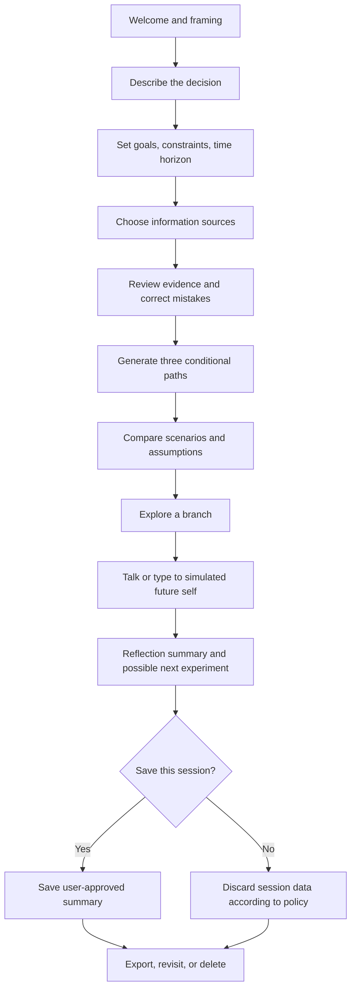
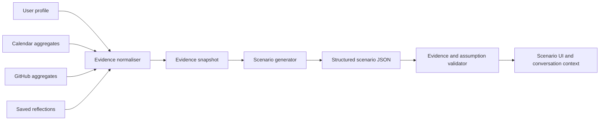
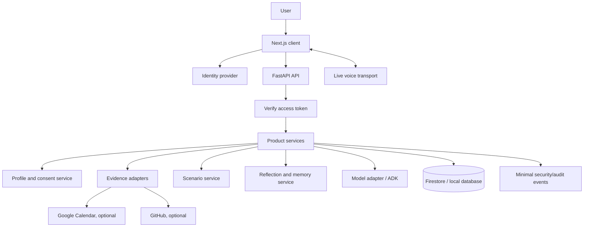

# Future-Self Decision Companion
## Master Product, Research, Learning, and Engineering Documentation

**Document status:** Living specification — v1.0 draft  
**Research verified:** 25 October 2026  
**Working product name:** *Future-Self Decision Companion* (descriptive placeholder; final brand not selected)  
**Original source package:** `GeminiLiveAgentChallenge2026-main.zip`, `Future-Self-Twin — Master Documentation.md`, `TwinMind (1).pdf`  
**Primary build goal:** Learn and build the product deliberately from first principles, rather than treating generated scaffolding as working software.

> **One-sentence product:** A private, voice-enabled reflection tool that helps people explore important decisions by connecting their stated values and goals with a transparent summary of selected past behaviour, then comparing several plausible future paths without pretending to predict the future.

---

## How to use this document

This is the single source of truth for product direction, research, technical decisions, implementation, evaluation, and learning. Keep it in the root of the repository and update it when a decision changes.

- **Source-derived** means the idea appeared in the uploaded pitch, planning document, or repository.
- **Research-backed** means there is a cited paper or official product/documentation source.
- **Recommendation** means a proposed product or engineering decision, not an established fact.
- **Unvalidated hypothesis** means something we must test with users or technical experiments before claiming it as a differentiator.

Model availability, SDKs, pricing, authentication requirements, and competitors change. The date above is the research snapshot, not a guarantee that a model or API will remain available. Re-check the official documentation before implementing each external integration.

## Table of contents

1. [Executive summary](#1-executive-summary)
2. [What the original idea contains](#2-what-the-original-idea-contains)
3. [Product thesis and principles](#3-product-thesis-and-principles)
4. [Problem, users, and jobs to be done](#4-problem-users-and-jobs-to-be-done)
5. [Research and existing solutions](#5-research-and-existing-solutions)
6. [Positioning and differentiation](#6-positioning-and-differentiation)
7. [Scope: what to build first](#7-scope-what-to-build-first)
8. [Product requirements and user journeys](#8-product-requirements-and-user-journeys)
9. [Behavioural evidence and decision modelling](#9-behavioural-evidence-and-decision-modelling)
10. [AI and conversation design](#10-ai-and-conversation-design)
11. [Technical architecture](#11-technical-architecture)
12. [Data model and API contracts](#12-data-model-and-api-contracts)
13. [Frontend and UX specification](#13-frontend-and-ux-specification)
14. [Privacy, security, safety, and responsible use](#14-privacy-security-safety-and-responsible-use)
15. [Repository audit and rebuild plan](#15-repository-audit-and-rebuild-plan)
16. [Learning curriculum: beginner to builder](#16-learning-curriculum-beginner-to-builder)
17. [Implementation roadmap and acceptance criteria](#17-implementation-roadmap-and-acceptance-criteria)
18. [Testing, evaluation, and research methodology](#18-testing-evaluation-and-research-methodology)
19. [Deployment, observability, cost, and operations](#19-deployment-observability-cost-and-operations)
20. [Product validation and business model](#20-product-validation-and-business-model)
21. [Risks and mitigations](#21-risks-and-mitigations)
22. [Demo and communication plan](#22-demo-and-communication-plan)
23. [Decision log and open questions](#23-decision-log-and-open-questions)
24. [Glossary](#24-glossary)
25. [Research and technical references](#25-research-and-technical-references)

---

# 1. Executive summary

## 1.1 The original vision

The original pitch imagines an empathetic digital double that understands a person's professional and personal patterns, helps protect their wellbeing, and enables a conversation with a simulated older version of themselves. Its four pillars are:

1. **Digital Mirror:** build a lightweight portrait from selected activity such as Google Calendar and GitHub.
2. **Cognitive Load / Burnout Predictor:** use activity and potentially physiology to signal overload and suggest recovery.
3. **Future Self Simulator:** compare alternative five-year paths and talk with a simulated future self through voice.
4. **Screen and Wearable Guardian:** inspect live screen context and wearable signals to intervene proactively.

The pitch also proposes a two-voice experience, dark dashboard, life-score ring, cognitive-load chart, branching decision tree, and searchable memory timeline. These concepts are preserved in this document as the long-term idea inventory, but they are not all part of v1.

## 1.2 Recommended product

Build one clear workflow end to end:

1. A user describes a real decision and what matters to them.
2. The product asks a few grounded questions and displays the evidence it is actually using.
3. The product creates three **plausible scenarios**, for example:
   - **Path A:** prioritise the current degree or long-term learning goal.
   - **Path B:** pursue a paid opportunity or short-term obligation.
   - **Path C:** design a time-boxed experiment that preserves optionality.
4. Each path shows assumptions, trade-offs, possible milestones, risks, and what would make the path more or less attractive.
5. The user can explore a branch by text or have a live voice conversation with a clearly labelled simulated future self.
6. The user leaves with a written reflection and one next step that **they choose**.

The product is not an oracle, clinical instrument, productivity surveillance tool, or autonomous life manager. It is an interactive decision-reflection environment.

## 1.3 What makes the idea worth testing

The strongest product hypothesis is that **a future-self conversation becomes more personally useful when it is grounded in user-approved evidence and represented as a set of inspectable alternatives**. That is a hypothesis to validate, not a claim of proven novelty.

Research from MIT's *Future You* project provides a strong prior-art foundation: an AI-generated future-self interaction was studied in a preregistered randomized controlled trial with 188 participants and reported improvements in future-self connection and some short-term emotional measures. The MIT project itself emphasises that the tool is intended to explore plausible futures, not predict the details of a person's real future. This supports the reflection framing; it does **not** establish that this new product works, predicts life outcomes, or improves long-term decisions. See [Research and references](#25-research-and-technical-references).

## 1.4 The most important product decision

Do **not** attempt the four original pillars at once. The initial product should focus on:

- a user-owned decision profile;
- optional, minimal evidence from Calendar and GitHub;
- three scenario paths with explicit assumptions;
- an interactive decision tree;
- voice conversation with a clearly fictional future-self simulation;
- a saved reflection that the user can export or delete.

Defer continuous screen capture, ambient audio collection, wearable integrations, automatic burnout claims, automatic notification silencing, and employer dashboards.

## 1.5 Brand warning

The existing draft calls the project **TwinMind**. An existing product at [twinmind.com](https://twinmind.com/) uses that name for an AI second-brain / memory product. This is a material naming and positioning collision. Do not invest in a public identity, domain, logo, or trademark around *TwinMind* without legal clearance. Use the descriptive working title in this document until availability checks are complete.

---

# 2. What the original idea contains

## 2.1 Feature inventory from the pitch

| Original feature | Purpose in the pitch | Recommendation | Reason |
|---|---|---|---|
| Digital Mirror / twin state | Summarise work rhythms and patterns | Keep as a minimal evidence layer | Needed to make reflections personal and auditable |
| Google Calendar connection | Understand meeting density and free time | Keep, read-only first | Structured, user-authorised evidence; manageable integration |
| GitHub connection | Understand project/commit rhythm | Keep, optional and read-only | Useful for developer users; can expose timestamps and public/private activity, so minimise carefully |
| Cognitive Load Index | Summarise activity and strain | Defer / reframe as descriptive trends | The current code uses arbitrary weights and reports false confidence; no validated prediction model exists |
| Burnout predictor | Predict exhaustion before a person notices | Remove from v1 | Current evidence does not justify the claim; high risk of misleading users |
| Google Calendar focus block | Offer a concrete recovery action | Optional later, explicit confirmation required | Useful action, but auto-scheduling is already a mature category and should not define the product |
| Future Self Simulator | Explore major choices through a simulated future self | Core feature | The clearest emotional product experience and the strongest research connection |
| Interactive decision tree | Make scenarios visible and explorable | Core feature | Turns a narrative into an inspectable decision structure |
| Live voice conversation | Make reflection feel conversational | Core differentiator to test | Technically challenging and must be proven early in a small spike |
| Separate present/future voices | Distinguish assistant from simulation | Keep if the chosen Live API supports desired voices | Must be presented as two modes, not two real identities |
| Screen watcher / toxicity detector | React to difficult screen content or code bugs | Cut from v1 | Privacy-heavy, false-positive prone, OS-specific, and crowded |
| Wearable / HRV connection | Use physiology to calibrate strain | Cut from v1 | Platform and validation complexity; physiology should not be represented as a burnout detector |
| Memory timeline | Recall prior decisions and reflections | Keep only as opt-in session history | Valuable continuity without ambient surveillance |
| Life Score ring | Show a single “mental battery” score | Cut / replace with evidence cards | A single clinical-looking score can overstate precision and increase anxiety |
| Automatically silence notifications | Protect users from interruptions | Future optional local action only | Requires deep OS permissions and is intrusive if automated |
| Age-progressed avatar | Visualise the future self | Defer | Adds model, identity, consent, and image-safety complexity without proving the core loop |

## 2.2 The concept in three layers

**Layer A — Reflection interface:** a decision workspace, branching paths, and text/voice conversation.

**Layer B — Evidence layer:** an optional, transparent collection of small behavioural aggregates and the user's own words, with provenance and date ranges.

**Layer C — Integrations and automation:** read-only Calendar/GitHub first; calendar writes or local privacy mode only after the core product is validated.

Do not start with Layer C. A list of integrations is not a product. Start with the user's decision and the reflection loop, then add the minimum evidence needed to improve it.

## 2.3 Product language

Prefer:

- “explore plausible paths”;
- “reflect on the evidence you chose to share”;
- “a simulated future-self perspective”;
- “assumptions and trade-offs”;
- “a pattern observed in this date range”.

Avoid:

- “predicts your future”;
- “knows what you will become”;
- “detects burnout before you do”;
- “guarantees regret-free decisions”;
- “understands your true personality”;
- “confidence: 82%” unless that value is derived from a defined, validated statistical model and is actually calibrated for the relevant task.

---

# 3. Product thesis and principles

## 3.1 Problem statement

People face consequential decisions while their attention is absorbed by immediate constraints. They may know what they value in the abstract but struggle to imagine how different choices could affect their future routines, relationships, skills, opportunities, and sense of meaning. A generic chatbot can help brainstorm, but it may not connect the conversation to the user's actual history, values, and constraints. A calendar app can show activity, but it does not facilitate reflective dialogue about a multi-year decision.

**Problem to investigate:** people need a structured way to make future consequences more concrete while retaining ownership of the decision.

## 3.2 Product thesis

A useful decision-reflection experience should combine:

1. **Personal relevance:** incorporate information the user supplied or explicitly connected.
2. **Traceability:** show the evidence behind personal observations.
3. **Plurality:** explore multiple plausible paths rather than a single destiny narrative.
4. **Agency:** ask good questions and suggest experiments, not issue life verdicts.
5. **Embodiment:** test whether live voice makes the reflective conversation more natural and memorable than text alone.
6. **Privacy:** do not collect more than the experience needs.
7. **Intellectual honesty:** separate facts, user beliefs, model hypotheses, and unknowns.

## 3.3 Design principles

### Principle 1 — Mirror, not oracle
The system is a thinking partner. It must not claim special access to the future, hidden motives, or a person's “true self”.

### Principle 2 — Evidence before interpretation
Every specific personal claim should be traceable to a source. For example: “Your GitHub account shows 18 commits in that week” is a verifiable observation; “you were avoiding your degree” is an interpretation that requires confirmation and may be wrong.

### Principle 3 — User controls the frame
The user chooses the question, relevant goals, connected data sources, retention, and whether to save a transcript. They can correct the system's profile.

### Principle 4 — Scenarios are conditional
Each path must state its assumptions, controllable choices, outside variables, trade-offs, and unknowns. Do not generate numeric probability percentages by default.

### Principle 5 — Interventions are opt-in
The app may propose a next step, but it does not send messages, change a calendar, cancel a meeting, or expose information without a clear preview and confirmation.

### Principle 6 — Private by default, minimal by design
Do not record ambient audio, capture screens continuously, or ingest entire message bodies just because an API could do it.

### Principle 7 — Build one complete loop
A basic scenario that works end-to-end is better than a dashboard with many placeholder metrics.

## 3.4 Explicit non-goals for v1

- Diagnosing, treating, or screening for mental-health conditions.
- Predicting burnout, depression, job success, relationships, or life outcomes.
- Recommending a single “correct” major life decision.
- Continuous recording or screen surveillance.
- An employer-facing monitoring product.
- Replacing a therapist, clinician, financial adviser, career counsellor, or trusted person.
- Fully autonomous planning or calendar management.
- Building a general-purpose second brain.

---

# 4. Problem, users, and jobs to be done

## 4.1 Initial target user

**Initial segment:** students, early-career professionals, builders, and knowledge workers who are comfortable with digital tools and periodically face trade-offs between learning, paid work, side projects, relationships, and rest.

This segment is a practical starting point, not a final market conclusion. It aligns with the project origin and allows early testing on real but non-clinical decisions. Do not infer that every user in this segment wants an AI companion.

## 4.2 Example user jobs

- “Help me compare a paid contract against finishing a long-term project.”
- “I want to understand why my plans repeatedly get pushed aside.”
- “Help me decide whether to start another side project or finish the ones I have.”
- “I want to consider what a choice might look like in five years, without pretending it is predictable.”
- “I need a structured conversation that challenges my assumptions without telling me what to do.”

## 4.3 Jobs-to-be-done format

When I am facing a consequential choice, I want to explore plausible future paths using my goals and selected real-world context, so that I can notice trade-offs, identify assumptions, and choose a low-regret next step myself.

## 4.4 Key user frustrations to validate

These are research hypotheses, not facts:

- Generic advice feels interchangeable and forgets relevant context.
- People overestimate how much a future routine will resemble the present.
- Long-term effects are hard to visualise when immediate rewards dominate attention.
- Written questionnaires may not capture the full nuance of the decision.
- A single “score” can feel authoritative without being useful.
- Users may reject the product if the required integrations feel invasive.

## 4.5 Early discovery interviews

Before investing in integrations, conduct 8–12 short interviews with potential users. Ask about the last real decision rather than whether they “like the idea”.

Questions:

1. Tell me about a significant decision you made in the last six months.
2. What options did you consider? What information did you use?
3. What made the decision difficult?
4. Did you talk to anyone or use any tools? What was missing?
5. What did you imagine your life would look like if you chose each option?
6. Did you later wish you had considered anything else?
7. Would you prefer written reflection, a conversation, a visual map, or some combination? Why?
8. Which data source would you trust an app to use: manually entered details, calendar aggregates, task history, GitHub aggregates, or none?
9. What would be too personal to collect?
10. What result would make you come back to this tool?

Do not ask participants to disclose sensitive experiences they do not want to share. Record themes, not intimate identifiable details, unless consent and storage arrangements are explicit.

## 4.6 Success definition

The first success criterion is not “users accept the answer”. It is that people can use the experience to:

- articulate the choice and what matters;
- identify at least one assumption they had not noticed;
- compare alternatives more clearly;
- identify an experiment or next step they consider appropriate;
- explain what information the product used and what it did not know.

---

# 5. Research and existing solutions

This section separates research evidence from product comparisons. Competitor features change; links should be rechecked during future product validation.

## 5.1 Direct research precedent: MIT Media Lab's *Future You*

**What it is:** an interactive system that lets a user chat with an AI-generated version of their future self. It uses a user-provided biography/goals to create a plausible backstory and includes an age-progressed avatar.

**Evidence:** the associated research paper reports a preregistered randomized controlled trial with 188 participants and found a positive effect on future-self continuity and some short-term self-reported emotional outcomes. Read the paper itself before making any research claim: [arXiv paper](https://arxiv.org/abs/2405.12514). The [MIT project page](https://www.media.mit.edu/projects/future-you/overview/) states that the system aims to help users explore plausible paths and is not intended to predict specific details of their actual future.

**What it means for this project:**

- Future-self reflection is an established research direction, not an entirely new concept.
- The existing work provides both a research foundation and a baseline user experience to compare against.
- A differentiated implementation must explain how it differs in data grounding, decision structure, user control, evaluation, accessibility, language, or privacy.
- The original study is not evidence that this product will improve a user's actual career outcomes or long-term wellbeing.
- Do not describe the product as “clinically proven” based on this paper.

**Questions to explore:**

1. Can evidence-based personalisation make the conversation feel more relevant than self-report alone?
2. Does a branching scenario map improve comprehension or merely add visual decoration?
3. Does live voice create value over text for this use case, and for which users?
4. Does source transparency increase trust, or does it make the experience feel surveillant?
5. Which outputs are useful after the conversation: a letter, assumptions list, scenario comparison, or experiment plan?

## 5.2 Direct naming/category collision: TwinMind

[TwinMind](https://twinmind.com/) markets an AI second brain that captures and summarises meetings/conversations and builds searchable personal context. The name in the uploaded pitch is therefore not suitable as an unexamined public brand choice.

**Strategic response:** avoid building an ambient-capture “second brain” as the core. It is technically demanding, has a privacy burden, and places the project against mature or funded products. Keep only user-consented session history and explicit reflections in the initial version.

## 5.3 Ambient capture and meeting-memory products

Relevant products to study include:

- [Otter.ai](https://otter.ai/) — meeting transcription, summaries, and searchable conversation records.
- [Fireflies.ai](https://fireflies.ai/) — meeting capture and transcription workflows.
- [Granola](https://www.granola.ai/) — meeting notes and AI-assisted summarisation.
- [Limitless](https://www.limitless.ai/) and related ambient-memory products — investigate current product and ownership status before comparing.
- [TwinMind](https://twinmind.com/) — personal memory/context product.

**Lesson:** “AI that remembers my day” is a crowded value proposition. We should not add ambient capture as a shortcut to personalisation. The product should be useful without collecting everything.

## 5.4 Calendar and focus-management products

[Reclaim.ai](https://reclaim.ai/) and other scheduling products already auto-schedule focus time, habits, and tasks around a calendar. Google Calendar itself supports focus time and scheduling workflows; tools such as Motion and Clockwise have also operated in the calendar-optimisation category.

**Lesson:** calendar blocking is not a strong core differentiator. It can be a carefully consented follow-on action after the user decides what they want to protect.

## 5.5 Wearable readiness, stress, and wellbeing products

Products from Oura, WHOOP, Garmin, Fitbit/Google, and Apple offer various sleep, readiness, recovery, mindfulness, or stress-related features. Their scope and metrics differ and should be checked on their current official pages before writing a comparison matrix.

**Scientific caution:** a 2024 scoping review of wearable technologies for burnout and wellbeing in healthcare professionals included 10 of 505 screened papers. It reported that no physiological measures were reliably associated with burnout or anxiety in the included studies, while heart rate and HRV were associated with acute stress. The review also identified limitations around long-term observations, sample sizes, and measurement/reporting standards. Source: [JMIR review](https://www.jmir.org/2024/1/e50253/).

**Lesson:** do not claim that HRV, sleep data, or screen activity makes burnout prediction accurate. Even if later versions integrate health data, present it as optional context or user-visible trends—not as a diagnosis or certain prediction.

## 5.6 Screen-aware and emotionally responsive agents

The previous project plan identified several relevant examples from the completed Gemini Live Agent Challenge, and Google's official winner summary confirms the competitive pattern:

- **JohnKeats.AI** won Best Technical Execution & Agent Architecture and is described as a voice-first emotional companion that responds to vocal cues.
- **Rayan Memory** won Best Innovation & Thought Leadership and uses passive listening and a 3D memory-palace representation.
- **VibeCat** received an honourable mention for a proactive desktop agent that observes screen context and offers actions with permission.
- **ORION** won the grand prize with a narrow, voice-directed surgical co-pilot use case.

Source: [Google Cloud: winners and highlights](https://cloud.google.com/blog/topics/developers-practitioners/winners-and-highlights-of-the-gemini-live-agent-challenge), published 15 May 2026.

**Lesson:** real-time voice, emotional adaptation, ambient memory, and screen awareness already have strong implementations. A generic “empathetic voice companion” is not enough. The project must stand on its decision-reflection loop, transparency, and evidence-grounded scenario comparison.

## 5.7 Research concepts to learn

### Future-self continuity
The degree to which a person experiences their future self as connected to their present self. Hershfield reviews how perceptions of the future self relate to intertemporal choices: [*Future self-continuity: how conceptions of the future self transform intertemporal choice*](https://doi.org/10.1111/j.1749-6632.2011.06201.x).

### Prospection and scenario planning
The act of imagining possible futures. A generated narrative is a prompt for consideration, not a forecast. Scenarios should be conditional and diverse rather than dressed-up predictions.

### Cognitive bias and decision quality
Relevant concepts include present bias, planning fallacy, sunk-cost fallacy, availability bias, loss aversion, and status-quo bias. These are possible lenses for reflective questions; do not automatically label a user as having a bias from one choice.

### Behavioural measurement
A commit timestamp, calendar event, and self-report answer are not direct measures of motivation, focus, effort quality, or emotional state. They are imperfect indicators with missing context. The system should display that limitation.

### Human-computer interaction
Study whether a user's understanding, agency, and recall improve with voice or visual branching. Do not use emotional intensity as a proxy for product usefulness.

## 5.8 Competitive comparison matrix

| Category | User value | What they already do well | Gap the project might explore | Product implication |
|---|---|---|---|---|
| MIT Future You | Future-self reflection | Research grounding, personal backstory, future-self avatar | Evidence from user-approved historical patterns; interactive path map | Treat as primary research baseline; do not claim first-in-category |
| TwinMind / second brain | Remember conversations and activity | Continuous capture, search, summaries, personal context | Decision support rather than all-day memory | Do not copy ambient capture |
| Otter / Fireflies / Granola | Meeting recall | Transcribe, summarise, retrieve | Not primarily designed for multi-year personal decision reflection | No meeting-notes feature needed |
| Reclaim / calendar optimisers | Protect time and schedule tasks | Calendar automation | Reflect on why a commitment matters before changing schedule | Calendar action is secondary |
| Wearables | Personal health/recovery trends | Dedicated sensors and longitudinal signals | Explain workload context alongside the user's own reflection | No burnout prediction in v1 |
| Screen-aware agents | Desktop assistance | Live visual context and tool use | Deliberate, user-initiated decision scenario exploration | No continuous screen capture |

## 5.9 What remains unknown

The research and competitor review do not yet establish:

- whether target users want a voice-based future-self interaction often enough to sustain usage;
- whether Calendar/GitHub data makes it meaningfully better than an onboarding questionnaire;
- whether the “three paths + branching tree” design improves decision clarity;
- whether users trust a simulated future self or find it uncanny/manipulative;
- a defensible willingness-to-pay level;
- the true uniqueness of the product after a full current market scan.

These are empirical questions for product validation, not marketing copy.

---

# 6. Positioning and differentiation

## 6.1 Draft positioning

For people facing meaningful life or career choices, the product is a private decision-reflection companion that makes different futures easier to examine. Unlike generic chat, it combines the user's selected goals and evidence with structured alternative scenarios and an optional live-voice conversation. It helps the user deliberate; it does not predict or decide for them.

## 6.2 Differentiation hypothesis

The following combination may prove distinctive, but it must be validated:

1. **Evidence cards:** each personal observation includes source, date range, and caveat.
2. **Multiple conditional paths:** paths are built from user-specified options and assumptions, not generated probability scores.
3. **Voice as an interaction mode:** the user can question and challenge a simulated future-self perspective in real time.
4. **Inspectable branching:** users can see how follow-up choices would branch the scenario map.
5. **Reflection continuity:** only user-approved insights and commitments can carry forward into later sessions.
6. **Privacy controls:** no ambient capture, source-by-source revocation, session deletion, export, and optional local processing later.
7. **Local relevance:** an eventual language/localisation track may support Nepali and English use. This is a future research direction, not a promise for MVP.

## 6.3 What is not differentiation

- “We use Gemini” or another model name.
- “We have a voice assistant.”
- A glowing ring or dark dashboard.
- An LLM-generated 5-year story without a deliberate decision workflow.
- Auto-blocking calendar events.
- A made-up “life score” or “burnout risk” number.
- Generic claims of personalisation without showing what data actually changed the answer.

## 6.4 Draft one-line pitch options

- **Evidence-first:** “Explore the life behind your next big decision—with a future-self conversation grounded in the context you choose to share.”
- **Human-first:** “Meet a possible future you, question the path ahead, and leave with a next step you chose.”
- **Technical:** “A privacy-conscious decision simulator that combines user-approved behavioural evidence, structured scenarios, and real-time voice reflection.”

Do not finalise the pitch before basic user interviews.

## 6.5 Naming process

The original name should be treated as blocked pending clearance. Candidate naming territories:

- **Time and perspective:** Longview, Hindsight, Antevorta, Prolepsis.
- **Future / regional language:** Bhavishya or another well-researched local-language name.
- **Choice and branching:** Fork, NextPath, Elsewhere.

These are brainstorming seeds only. Before selecting a name:

1. Search the web, app stores, GitHub, package registries, and relevant domains.
2. Search local and target-market trademark databases.
3. Check pronunciation, spelling, cultural meaning, and transliteration.
4. Avoid names already associated with a nearby product category.
5. Record the clearance date and decision.

---

# 7. Scope: what to build first

## 7.1 MVP definition

The MVP is complete when one user can describe one real decision, review what the system knows, generate multiple paths, explore a branch, have a short live voice conversation, save a reflection if desired, and delete their data.

### P0 — Required for MVP

- Landing / onboarding that clearly frames the system as reflective, not predictive.
- Manual profile: goals, constraints, values, time horizon, and user's own description of the decision.
- Scenario-generation form with structured input.
- Three scenario cards, each with assumptions, trade-offs, upside, downside, uncertainties, milestones, and questions.
- Interactive scenario tree with conditional follow-up branches.
- Text conversation with the simulated future self.
- A basic live voice interaction prototype, integrated only after the Live API spike passes.
- Evidence / assumptions panel that shows which inputs informed each path.
- A final reflection with user-selected next step.
- Authentication before storing personal records.
- User-scoped data access; delete/export capability; safe secret handling.
- Seeded demo mode so development does not require sensitive personal data.

### P1 — Next after MVP is stable

- Google Calendar read-only connection.
- GitHub read-only connection.
- Derived evidence cards, for example “meeting hours by week” or “commits by day/time for repositories you selected”.
- Optional, short session summary saved with explicit consent.
- English-first voice quality improvements and accessibility checks.
- Calendar action draft/preview; writing to the calendar only after explicit approval.
- Session-to-session continuity based on explicitly saved notes.

### P2 — Later experiments

- Nepali-language interaction and mixed Nepali-English support.
- Privacy mode with local processing for selected features.
- Scenario comparison experiments and opt-in user research.
- Optional self-report wellbeing check-ins if justified by user research and reviewed for appropriate instrument use.
- Mobile wrapper or native app only if required for a clear user need.

### Explicitly out of scope for v1

- Wearable/HealthKit/Health Connect ingestion.
- Continuous screen watching, keystroke monitoring, or ambient audio recording.
- Automated toxicity or mental-health diagnosis.
- Any “days until burnout” calculation.
- Employer access to an individual's reflections or personal behavioural data.
- Avatar generation and voice cloning.
- Autonomous cancellation or rearrangement of meetings.
- A complex multi-agent swarm, graph database, vector database, or custom-trained model before a simple baseline is evaluated.

## 7.2 Why start text-first if voice is central?

Voice is one of the riskier parts technically. Build a **small isolated voice spike early**, but keep scenario logic text-first. That gives the project two advantages:

- We discover model/audio/API failures before spending weeks on dashboard polish.
- We can test the product's reasoning and output structure without mixing every failure mode into one component.

The engineering sequence is: validate one raw voice loop, build the product loop with text, then connect live voice to the same conversation/session abstractions.

## 7.3 MVP user story

“As someone weighing whether to accept a contract or focus on a long-term study/project goal, I want to see three plausible ways this decision could play out, discuss the assumptions with a simulated future version of myself, and decide on a small experiment—without the app pretending to know the correct answer.”

## 7.4 MVP acceptance criteria

The MVP is not complete until:

- [ ] A new user can complete the core workflow with manual data only.
- [ ] All three paths are materially different and reflect the user's stated constraints.
- [ ] Every factual personal statement in generated output can be traced to a user input or approved source record.
- [ ] Generated paths label assumptions and uncertainty.
- [ ] No UI element presents generated outcome probabilities as real probabilities.
- [ ] Text mode works even if Live API is unavailable.
- [ ] Voice mode has clear microphone-on state, mute/stop controls, visible transcript if enabled, and interruption behaviour tested.
- [ ] No secret API key is shipped to the browser.
- [ ] All personal API routes enforce authentication and ownership checks.
- [ ] Export and deletion have automated tests and can be demonstrated.
- [ ] There is no continuous screen or ambient audio capture.
- [ ] A fallback demo path is available if network/model access fails.

---

# 8. Product requirements and user journeys

## 8.1 Core flow



## 8.2 First-run onboarding

1. Explain what the product does and what it cannot do.
2. Ask the user to choose whether to continue with manual context only.
3. Ask for their preferred time horizon (for example, 1, 3, or 5 years). Five years is a scenario horizon, not a prediction window.
4. Ask a small number of questions: what decision, which options, what matters, what constraints are non-negotiable, what would make the choice feel successful?
5. Let the user optionally connect Calendar/GitHub in later iterations; explain scope in plain language before OAuth.
6. Preview the kind of data that will be used.
7. Ask before saving the conversation or summary.

Do not make OAuth connection a mandatory onboarding step.

## 8.3 Decision input form

Suggested fields:

| Field | Required? | Why |
|---|---|---|
| Decision question | Yes | Defines what the tool should help with |
| Options under consideration | Yes | Prevents the model from inventing the only choices |
| Time horizon | Yes | Anchors scenarios |
| Goals / values | Yes, can be brief | Allows user-specific evaluation |
| Hard constraints | Optional | Money, time, location, family, education, health, etc. |
| Current commitments | Optional | Makes opportunity cost visible |
| What the user fears losing | Optional | Surfaces trade-offs without assuming pathology |
| What success would look like | Optional | Gives the user a measure to evaluate paths |
| Evidence sources | Optional | User chooses if integrations are connected |
| Desired challenge level | Optional | Gentle reflection vs. more probing questions |

Avoid asking for sensitive information unless clearly necessary. Let the user skip any optional question.

## 8.4 Scenario card requirements

Each generated path must contain:

- Path name and short explanation.
- User-selected option or strategy it explores.
- Assumptions (including assumptions that need user confirmation).
- Near-term actions / experiments.
- Possible milestones by horizon.
- Potential benefits.
- Costs and trade-offs.
- Key risks and external variables.
- Signals to monitor over time.
- “What would change this path?” conditions.
- Open questions for the user.
- Evidence sources that influenced the path.
- A visible statement: “This is a scenario, not a forecast.”

The paths should not be “success / mediocre / failure” by default. That pattern is fatalistic and tends to create a good/bad answer rather than a genuine comparison.

## 8.5 Branching tree requirements

- Each node represents a decision point, assumption, or possible milestone—not a fixed future event.
- Branches should use condition language, e.g. “If you reserve two evenings for the degree project…”
- Users can expand/collapse a node and change a scenario assumption.
- Labels should describe choices and conditions rather than “you will become…” statements.
- Tree visualisation should remain legible with keyboard navigation and on narrow screens.
- Paths must be generated as structured JSON; the frontend must not infer graph topology from prose.
- Branches should not carry probabilities unless there is an explicit, validated model and a strong reason to include them. That is out of scope for v1.

## 8.6 Future-self conversation

The interface must clearly label the persona as a simulation. The future-self voice must not claim to truly be the user, to remember events that are not in evidence, or to know that a generated scenario happened. It can speak in first person within the fictional scenario, but it must use calibrated framing such as “In this version of the future…” or “If this path unfolded…” when discussing events that are not factual.

Users should be able to ask:

- “What did I give up to take this path?”
- “What assumption are we making?”
- “What if the contract ends after three months?”
- “What evidence from my current life makes you raise this concern?”
- “Argue for the other path.”
- “What small experiment could test this before I commit?”

## 8.7 End-of-session artifact

Generate a concise, editable reflection:

1. Decision being considered.
2. Values / constraints that mattered.
3. The three paths considered.
4. One assumption the user wants to test.
5. One action the user selected (or “no action chosen”).
6. What evidence was used.
7. What the product did not know.
8. Optional user note and next review date.

This artifact is more valuable and safer than a confident “recommendation score”.

---

# 9. Behavioural evidence and decision modelling

## 9.1 Evidence sources

### Source A — User-provided context (MVP)

Most reliable for values, intentions, constraints, and interpretation. It is still self-report and can be incomplete or influenced by the moment, so do not treat it as objective ground truth.

### Source B — Google Calendar (P1)

Potential derived features:

- total scheduled meeting hours per week;
- meeting count per week;
- back-to-back meeting chains;
- number and length of uninterrupted free blocks;
- events outside a user-defined working window;
- weekly fragmentation of available time.

Prefer **aggregates**. Avoid sending meeting titles, attendee lists, descriptions, or conference links to the model unless the user explicitly selects specific events and the feature truly requires them. The official Calendar API lists read-only scopes such as `calendar.readonly`; exact scopes and OAuth review requirements must be rechecked at build time. See [Calendar scopes](https://developers.google.com/workspace/calendar/api/auth) and [Events: list](https://developers.google.com/workspace/calendar/api/v3/reference/events/list).

### Source C — GitHub (P1)

Potential derived features for repositories the user selects:

- commits per week / day;
- work timing distribution;
- pull request counts and review timing if user authorises them;
- issue/PR open-to-close patterns;
- weekend activity share;
- project-specific activity gaps.

Limits:

- Commit count is not code quality, productivity, motivation, or skill.
- Private repository metadata is sensitive; do not request access to all repositories by default.
- Commit timestamps are affected by rebases, squash merges, time zones, automation, and work done outside GitHub.
- Commit messages may expose confidential information; prefer counts and timestamps over message text.

Use a fine-grained token / GitHub App with the minimum permissions needed. For most trend summaries, repository metadata and commit timestamps are enough; do not request write permissions. See [GitHub fine-grained token permissions](https://docs.github.com/en/rest/authentication/permissions-required-for-fine-grained-personal-access-tokens).

### Source D — Explicit session reflections (P1)

After a conversation, the user may choose to save a small summary: decision, values, unresolved question, experiment, and review date. This can improve continuity without recording ambient life.

### Not in v1 — physiology, full screens, ambient audio

These sources add privacy, measurement, platform, and safety burdens. They are not prerequisites for this product. Revisit only with a specific research question, explicit informed consent, and evidence that the additional signals improve a user outcome.

## 9.2 Evidence pipeline



The normaliser should be deterministic wherever possible. Model-generated interpretation belongs downstream from factual extraction.

## 9.3 Evidence record format

Each evidence item should include:

```json
{
  "id": "evidence_opaque_id",
  "source": "calendar_aggregate",
  "metric": "scheduled_meeting_hours_per_week",
  "value": 11.5,
  "unit": "hours",
  "window_start": "2026-09-01",
  "window_end": "2026-09-30",
  "method": "sum_duration_of_user-authorised_events",
  "limitations": [
    "Scheduled duration does not measure attention or effort",
    "Events may be missing or duplicated"
  ],
  "created_at": "ISO-8601 timestamp"
}
```

This is illustrative, not an enforced final schema. Store source metadata separately from human-readable interpretation. Do not include attendee names, meeting titles, access tokens, or raw event text in the evidence snapshot.

## 9.4 Evidence versus inference

Use four labels:

- **Observed:** directly calculated from approved source data.
- **User-stated:** expressed by the user.
- **Hypothesis:** a possible interpretation that may be wrong.
- **Unknown:** missing information that may change the result.

Example:

- Observed: “Your selected repository had 24 commits in this date range.”
- User-stated: “You said finishing your degree is a priority.”
- Hypothesis: “This might indicate a trade-off between immediate projects and protected study time.”
- Unknown: “The commit history does not tell us whether the degree work was delayed or whether the projects were required.”

## 9.5 What is a “digital signature” in this project?

The original code uses the term “digital signature” for a behavioural summary. That is confusing because “digital signature” also has a cryptographic meaning. Rename this concept **Personal Context Profile** or **Behavioural Snapshot**.

The profile should be a small structured summary, not a psychological diagnosis. Suggested fields:

- current goals;
- user-stated working preferences;
- chosen source summaries and date ranges;
- repeated user-confirmed themes;
- constraints and preferences;
- unknowns and caveats;
- evidence IDs behind each observation;
- last updated timestamp.

## 9.6 Scenario generation contract

A scenario-generation call should receive:

1. The decision and options provided by the user.
2. The user's stated values and constraints.
3. A minimised evidence snapshot.
4. The time horizon.
5. Explicit rules against unsupported claims and fake probabilities.
6. A schema to ensure outputs can render as cards and graph nodes.

The output should be validated by code. The code should reject a path if it lacks key assumptions, repeats another path, introduces evidence IDs that do not exist, or contains probability fields not allowed by the schema.

## 9.7 How to talk about uncertainty

Use clear qualitative labels: “known from the inputs,” “plausible but uncertain,” and “not enough information.” Avoid using a single numeric confidence score for a narrative. If you introduce quantitative modelling later, document training data, target definition, validation design, calibration, subgroup performance, and failure modes before exposing the score to users.

---

# 10. AI and conversation design

## 10.1 Separate deterministic code from model behaviour

**Code should own:** authentication, authorisation, data extraction, aggregation, schema validation, source IDs, consent state, persistence, deletion, calendar writes, and UI state.

**The model may own:** summarising approved evidence, generating candidate scenarios, asking clarifying questions, comparing trade-offs, and conversing in a simulated future-self voice.

Never ask the model to invent factual metrics, decide whether the user is burned out, or enforce access control.

## 10.2 Recommended model roles

Model IDs below are examples from the currently published Google documentation and must be rechecked before coding. The official deprecation page currently lists `gemini-3.8-live` for Live API and `gemini-3.8-flash` in the current Gemini 3 family with no shutdown date announced on the page as of the research snapshot. That does not guarantee the account, region, or chosen backend has access.

| Task | Candidate | Notes |
|---|---|---|
| Live voice conversation | `gemini-3.8-live` | Confirm availability, terms, voice support, audio formats, and pricing before relying on it |
| Scenario generation | `gemini-3.8-flash` | Structured text reasoning; benchmark cost and output quality |
| Schema repair / lightweight summaries | A current low-cost Flash/Lite model | Select based on measured output validity and price, not brand alone |
| Local processing (future) | A suitable local model/runtime | Treat as a separate privacy-mode experiment; don't promise offline parity |

Official references: [Gemini model deprecations](https://ai.google.dev/gemini-api/docs/deprecations), [Gemini Live API overview](https://docs.cloud.google.com/gemini-enterprise-agent-platform/models/live-api), [ADK Live/voice agents](https://adk-labs.github.io/adk-docs/live/).

Keep model IDs in environment configuration, not scattered in source files. Add a smoke test for each model at setup and before demos. Maintain text mode as a fallback.

## 10.3 Live API audio realities

The official Live API overview currently documents raw 16-bit PCM, 16 kHz, little-endian audio input and raw 16-bit PCM, 24 kHz, little-endian audio output for the relevant interface. Exact SDK payload wrappers must follow the chosen official client/library documentation.

The existing frontend records `audio/webm;codecs=opus` with `MediaRecorder` and forwards chunks as base64. That is not interchangeable with a raw PCM stream. Do not assume chunked WebM blobs can be sent as if each were a PCM audio buffer.

**Learning sequence:**

1. Run the official ADK / Live API starter before building custom audio plumbing.
2. Demonstrate microphone capture and model output in isolation.
3. Understand sample rate, channels, signed 16-bit conversion, frame size, buffering, and output playback.
4. Implement interruption/barge-in and stop/disconnect handling.
5. Connect the working audio interaction to the product's conversation session.
6. Test on multiple browsers and devices, including permission denial and network failure.

For browser-managed audio, learn `AudioContext`, `AudioWorklet`, microphone `getUserMedia`, and playback scheduling. Do not add screen capture to the same pipeline.

## 10.4 Architecture choice for voice

There are two plausible arrangements:

### Option A — ADK/backend-managed live session (recommended learning path)

The frontend talks to FastAPI; the backend uses the current ADK streaming implementation and owns tools. This creates an extra network hop but keeps data access and privileged tool execution server-side. Start here because the official ADK docs provide a development quickstart and custom-server path.

### Option B — Browser connects directly with an ephemeral Live API token

The authenticated backend mints a short-lived ephemeral token; the browser connects directly to the Live API. This may reduce latency and avoid relaying every audio frame through the backend. Ephemeral tokens are a security measure, not a guarantee that a browser-held token is impossible to extract. Sensitive tools and personal data still require a protected backend. Use only after reviewing the current [ephemeral token documentation](https://ai.google.dev/gemini-api/docs/live-api/ephemeral-tokens).

**Decision rule:** build Option A first. Benchmark actual latency and reliability. Move the audio connection client-direct only if the added complexity solves a measured problem.

## 10.5 ADK API rules

Do not code against the invented API names in the repository. Current ADK streaming documentation uses `Runner.run_live()` for a Live API session and `RunConfig` for session-level voice/audio configuration. The exact supported model and configuration options change; copy a minimal current official sample into a scratch project, run it, and only then port the working pattern into the app.

References:

- [ADK Python streaming quickstart](https://adk-labs.github.io/adk-docs/live/get-started/streaming-python/)
- [ADK live configuration](https://github.com/google/adk-docs/blob/main/docs/live/configuration.md)
- [ADK live agent docs](https://adk-labs.github.io/adk-docs/live/)

Never assume a class, method, or argument exists because a generated sample uses its name. Confirm it in the installed package and official reference docs.

## 10.6 Scenario generation prompt requirements

The system prompt for scenario generation should specify:

- You create conditional scenarios, not predictions.
- Use only the supplied evidence and user statements for personal facts.
- Do not infer personality traits or mental state from activity counts.
- Do not create fabricated probabilities, confidence scores, or “days until” claims.
- Preserve alternatives that the user supplied; ask for clarification when essential context is missing.
- Make the scenarios meaningfully different without forcing one to be “good” and one “bad”.
- Identify assumptions, risks, trade-offs, leading indicators, and reversible experiments.
- Include evidence IDs for personal observations.
- Do not diagnose, shame, threaten, manipulate, or use fear to drive action.
- Do not present high-stakes legal, medical, financial, or educational advice as authoritative.
- Output only the requested validated schema.

## 10.7 Future-self voice prompt — safe draft

This is a starter prompt to improve through evaluation, not final policy text:

```text
You are a simulated future-self perspective created to help the user reflect on a decision.
You are an AI-generated scenario, not the user's actual future self and not a source of future facts.

Speak warmly, concretely, and without pretending certainty. Use only facts provided in the current profile, approved evidence, or this conversation. When speaking from inside a hypothetical future path, make the conditional framing clear. Do not invent memories, outcomes, people, or events. Never claim to have literally lived through something that is only generated.

Your job is to help the user examine trade-offs, values, assumptions, and possible consequences. Ask thoughtful questions and sometimes challenge an assumption, but do not issue a verdict or pressure the user toward one option. Offer more than one perspective when useful. Keep the user in charge of the decision.

Do not diagnose mental-health conditions, predict burnout, assign probabilities to a life outcome, or claim to be a therapist. If the user expresses imminent danger or serious self-harm intent, stop the roleplay and respond as the product's safety layer rather than as the fictional future self.

When making a personal observation, reference the source or phrase it as a hypothesis that the user may correct. If information is missing, say what is unknown. At the end, offer one optional reflective question or a small reversible experiment, not a command.
```

### Why this replaces the original prompt

The original prompt says “you are the user,” “you have lived through everything,” and “never break character.” Those rules intentionally blur simulation and reality. That can make the dialogue emotionally vivid, but it also invites fabricated memories, false certainty, and unsafe behaviour during distress. Retain warmth and specificity; remove claims of actual identity and future knowledge.

## 10.8 Conversation management

- Keep the first scenario conversation focused; a 3–5 minute demo path is easier to evaluate than a long, unbounded session.
- Summarise older context instead of resending full transcripts indefinitely.
- Let users interrupt; provide visible stop/mute controls.
- Clearly show when the mic is active and when audio is being sent.
- If session resumption is supported, implement it using the current official guide and test reconnect behaviour.
- Do not log raw audio by default.
- If transcripts are displayed, explain if and when they are stored.
- Offer text mode if the user cannot or does not want to use a microphone.

## 10.9 Tool/function boundaries

Safe read tools (later): `get_calendar_aggregates`, `get_github_aggregates`, `get_user_profile`, `get_saved_reflections`.

Model-computation tools: `generate_scenarios`, `validate_scenario_schema`, `summarise_reflection`.

Privileged write tools (later): `create_calendar_focus_block`, `save_reflection`, `delete_user_data`.

Rules:

- Read tools return small structured records, not large raw histories.
- Write tools require a clear user confirmation step and an idempotency key.
- The model must not choose arbitrary user IDs; identity comes from the authenticated server context.
- Treat event titles, commit messages, user notes, and model output as untrusted text.
- Do not give the model a general-purpose database client.

---

# 11. Technical architecture

## 11.1 Recommended stack

This stack preserves the direction of the existing repository but simplifies the first milestones.

| Layer | Recommended technology | Why |
|---|---|---|
| Frontend | Next.js App Router + React + TypeScript | Existing repository direction; component-based dashboard and API integration |
| Styling | CSS / Tailwind CSS | Use a small design system; don't over-focus on visuals before the core loop works |
| Scenario graph | `@xyflow/react` or a similarly maintained React graph library | Good fit for draggable/expandable decision nodes; choose one and prove accessibility |
| Charts | Recharts only when trends are useful | Avoid decorative dashboards with invented metrics |
| Backend API | Python + FastAPI + Pydantic | Clear API contracts; familiar to a Python/data-science workflow |
| Agent orchestration | Current Google ADK if it simplifies live sessions/tools | Re-implement against real current APIs, not repo's fake API surface |
| Model SDK | Current unified Google GenAI SDK where appropriate | Keep provider access behind a service adapter |
| Authentication | Firebase Authentication or another supported OIDC solution | Use verified identity on every protected request |
| Persistence | Firestore for the initial Google Cloud-aligned prototype | Aligns with existing repo; keep data schema isolated for future portability |
| Local development | SQLite / seed JSON / Firestore emulator where practical | Keep initial learning/testing inexpensive and repeatable |
| Deployment | Cloud Run or comparable managed service | Start only after local tests and security review pass |
| Secrets | Environment variables locally; Secret Manager in deployment | Never commit credentials or expose server keys to the browser |
| Tests | Pytest, frontend unit tests, browser-level end-to-end tests | Test data ownership and scenarios, not just component rendering |

This is a recommendation, not a mandate. Do not introduce Neo4j, a vector database, a message queue, or custom model training until a measurable requirement calls for it. The current MVP does not require RAG: retrieval over a user's short profile and a few approved evidence records can begin with ordinary structured queries.

## 11.2 High-level architecture



The voice transport can be handled through ADK-managed streaming in the initial version. The model itself should not be allowed to bypass the product services or database access controls.

## 11.3 Service boundaries

### Frontend responsibilities

- Collect and validate user inputs before submission.
- Render scenario cards, assumptions, evidence chips, and tree nodes.
- Manage microphone permissions, audio UI state, stop/mute, and connection status.
- Display loading, error, retry, and text fallback states.
- Ask for consent and show privacy controls.
- Never store server secrets.

### API/backend responsibilities

- Verify identity and ownership for all personal records.
- Validate request payloads and enforce limits.
- Provide OAuth connection and source-revocation flows.
- Fetch and aggregate external data with least privilege.
- Build minimised evidence snapshots.
- Call models through a stable adapter.
- Validate structured scenario output and provenance.
- Apply confirmed writes only after explicit user action.
- Implement export, deletion, retention, and audit rules.

### Model responsibilities

- Generate narrative scenarios from validated structured context.
- Ask clarifying questions and discuss trade-offs.
- Produce a reflection in a known schema.
- Never grant permissions or decide ownership.

## 11.4 Data flow for one decision

1. Frontend submits decision text, options, values, constraints, horizon, and chosen sources.
2. Backend authenticates user and validates the request.
3. Source adapters fetch only approved ranges and convert data to aggregates.
4. Backend stores or creates a short-lived evidence snapshot depending on the user's save choice.
5. Scenario service sends the model structured input plus the prompt/schema.
6. Backend validates schema, path diversity, evidence references, and unsupported fields.
7. Frontend renders cards and graph nodes.
8. User chooses a path to discuss via text or voice.
9. At the end, the user may save an explicit summary; no transcript is retained by default unless the product policy and consent say otherwise.

## 11.5 Reliability and fallback architecture

- Text mode is the baseline; voice is an enhancement.
- If scenario generation fails, keep the user's input and offer retry rather than silently fabricating a scenario.
- If GitHub or Calendar is unavailable, continue with manual mode and label the missing source.
- Keep a deterministic demo fixture for repeatable testing; label it clearly as demo data in the UI.
- Add a `DEMO_MODE` flag for a conference demo, but do not use cached dialogue to misrepresent a live call as live. If playback is pre-recorded, label it accordingly.
- Have a recorded demo as a backup, clearly separate from live interaction.

## 11.6 Suggested repository structure

```text
future-self/
  README.md
  MASTER_DOCUMENTATION.md
  DECISIONS.md
  .gitignore
  .env.example
  docs/
    research-notes.md
    product-requirements.md
    privacy-and-threat-model.md
    evaluation-plan.md
  frontend/
    app/
      (marketing)/
      (app)/
      api/                  # only if Next.js BFF routes are intentionally used
    components/
      decisions/
      scenarios/
      voice/
      evidence/
      privacy/
    lib/
      api-client.ts
      auth.ts
      audio/
      schemas/
  backend/
    app/
      main.py
      config.py
      api/
      auth/
      schemas/
      services/
        scenario_service.py
        evidence_service.py
        reflection_service.py
        model_service.py
      integrations/
        calendar.py
        github.py
      repositories/
      safety/
      prompts/
    tests/
  scripts/
    seed_demo_data.py
    smoke_test_models.py
  infra/
    deployment/             # only after deployment model is selected
```

This is a target structure. Move incrementally rather than renaming every file before the first test passes.

---

# 12. Data model and API contracts

## 12.1 Core entities

### UserProfile

- `uid` — identity-provider user ID; backend-derived, never trusted from a request body.
- `display_name` — optional.
- `goals` — user-authored, editable list.
- `values` — user-authored list or short free text.
- `constraints` — optional, sensitive by nature; keep minimal.
- `preferences` — locale, text/voice preference, retention preferences.
- `created_at`, `updated_at`.

### ConsentRecord

- `uid`.
- `source` (manual, calendar, GitHub, voice transcript, saved reflection).
- `purpose`.
- `granted_at`, `revoked_at`.
- `scope_version`.
- `retention_policy_version`.

### EvidenceSnapshot

- opaque `id`, `uid`, `created_at`.
- source types included and date ranges.
- aggregate metrics with units.
- provenance IDs and method descriptions.
- caveats and missing-data flags.
- no access token or unneeded raw event/commit text.

### DecisionSession

- `id`, `uid`, timestamps.
- decision question, choices, horizon.
- user-selected values and constraints.
- evidence snapshot reference (if any).
- schema version and status.
- retention mode: ephemeral / saved.

### ScenarioPath

- `id`, `session_id`, label, summary.
- `starting_choice`.
- `assumptions[]`.
- `milestones[]`.
- `benefits[]`, `tradeoffs[]`, `risks[]`.
- `signals_to_monitor[]`.
- `evidence_refs[]`.
- `unknowns[]`.
- `schema_version`.

### ScenarioNode

- `id`, `session_id`, `path_id`.
- parent node ID (nullable).
- node type: decision / condition / milestone / reflection.
- title and description.
- branch labels and child IDs.
- assumption references.

### ReflectionArtifact

- `id`, `uid`, `session_id`, created timestamp.
- user-approved summary only.
- decision, open question, optional next step and review date.
- source references and user edits.
- retention marker.

### ConversationSession

- `id`, `uid`, related decision session.
- mode: text / live voice.
- started/ended time, status, model/version identifiers.
- transcript retention state.
- if transcript is off, store no transcript text.

### IntegrationConnection

- `uid`, provider, minimal requested scope set.
- encrypted credential reference or token secret reference—not raw credentials in ordinary profile documents.
- created/updated timestamps, last sync, status, revoked timestamp.

## 12.2 Illustrative structured path schema

```json
{
  "schema_version": "1.0",
  "decision_title": "Accept a contract or prioritise a study goal",
  "horizon_years": 5,
  "paths": [
    {
      "id": "path_a",
      "label": "Protect the long-term goal",
      "starting_choice": "Reserve most available time for the study goal",
      "summary": "A scenario where progress is prioritised over short-term income.",
      "assumptions": [
        {"id": "a1", "text": "Basic living costs can be covered", "status": "needs_user_confirmation"}
      ],
      "milestones": [
        {"horizon_months": 3, "description": "Review progress against a defined milestone", "is_prediction": false}
      ],
      "benefits": ["More protected time for the long-term goal"],
      "tradeoffs": ["Less immediate contract income"],
      "risks": ["Unplanned expenses may change feasibility"],
      "signals_to_monitor": ["Monthly progress toward the chosen milestone"],
      "evidence_refs": [],
      "unknowns": ["Actual weekly time requirement"],
      "reflection_questions": ["What would make this path financially sustainable?"]
    }
  ]
}
```

This is a shape illustration only. The final Pydantic schema should enforce required fields, list limits, allowed enums, string lengths, and valid references. It should not include a generated `probability` field.

## 12.3 Proposed API surface

All endpoints except health/limited public content require authentication. Every request must be scoped to the user identity derived by the backend.

| Method | Route | Purpose | Notes |
|---|---|---|---|
| `GET` | `/health` | Health check | No user data |
| `GET` | `/me` | Current user's safe profile | Identity derived from token |
| `PUT` | `/me/profile` | Create/update profile | Validate fields and size |
| `GET` | `/me/consents` | View active consents | Do not expose secrets |
| `POST` | `/decisions` | Create a decision session | Default ephemeral until saved |
| `POST` | `/decisions/{id}/scenarios` | Generate scenarios | User must own session |
| `GET` | `/decisions/{id}` | Fetch session and generated paths | Validate ownership |
| `POST` | `/decisions/{id}/branches` | Expand a selected branch | Bound depth/cost |
| `POST` | `/decisions/{id}/reflection` | Save user-approved summary | Explicit save action |
| `GET` | `/integrations` | List connected sources | Show granted scopes/status |
| `POST` | `/integrations/calendar/connect` | Begin OAuth | Use state/PKCE as required by flow |
| `POST` | `/integrations/github/connect` | Begin connection | Least privilege |
| `DELETE` | `/integrations/{provider}` | Revoke connection and clean tokens | Explain what local aggregates remain |
| `POST` | `/decisions/{id}/voice-session` | Create voice session or temporary token | Follow selected Live API architecture |
| `DELETE` | `/me/data` | Delete account data | Must be authenticated and confirmed |
| `GET` | `/me/export` | Export user data | JSON or ZIP with clear limitations |

Do not implement every endpoint upfront. Create the minimum endpoint for the current learning milestone.

## 12.4 Authentication and authorisation rules

- Verify the identity token server-side on every protected endpoint.
- Never trust `user_id` from the URL/body as the source of identity.
- Check that the requested session, profile, snapshot, scenario, or integration belongs to the authenticated user.
- Use deny-by-default Firestore rules if the browser can access Firestore directly. Prefer server-only access for sensitive model/integration operations.
- If the backend uses a service account that bypasses Firestore security rules, implement equivalent ownership checks in the backend and test them explicitly. Service-account access does not excuse application-level authorisation.
- Limit request sizes, session duration, branches per request, and model output length.
- Apply rate limiting to model-backed endpoints.
- Never return stack traces, secret values, OAuth tokens, or provider responses containing private data to the client.

## 12.5 Deletion contract

Deletion should be implemented and tested as a real workflow, not a README promise. It should cover:

- profile and preferences;
- saved decision sessions and scenarios;
- evidence snapshots and derived aggregates;
- saved reflections and transcript data, if any;
- OAuth credential references and refresh tokens;
- caches and export jobs;
- background tasks and delayed summaries;
- data in model-provider logs to the extent controlled by product configuration and provider terms.

Some provider-side or backup retention may not be instantly deletable; describe those limits honestly. Deletion should revoke future access immediately, queue deletion of stored records idempotently, record only a minimal non-sensitive completion event, and provide a clear success/failure state.

---

# 13. Frontend and UX specification

## 13.1 Core screens

### Screen A — Welcome / trust

- One-sentence value proposition.
- “Reflection, not prediction” explanation.
- Clear data/voice controls.
- Continue in manual mode.

### Screen B — Decision composer

- Main decision text.
- Alternative choices.
- Goals/values and hard constraints.
- Horizon selection.
- Optional evidence-source selector.
- “What would a useful outcome look like?” prompt.

### Screen C — Evidence review

- Compact cards with metric, source, time window, caveat.
- User can remove a source or correct a profile statement.
- Clear distinction between raw-source facts and interpretation.
- No personality or burnout scores.

### Screen D — Scenario comparison

- Three path cards with equally respectful framing.
- Benefits, trade-offs, assumptions, uncertainties.
- “Challenge assumptions” and “Explore this path” actions.
- No red/green “winner” styling.

### Screen E — Interactive decision tree

- Expand/collapse branches.
- Keyboard accessible controls and readable mobile layout.
- Nodes represent choices and conditional milestones.
- A small legend for assumptions, choices, and unknowns.

### Screen F — Future-self conversation

- Clear label: “Simulated future-self perspective”.
- Mic on/off and stop controls.
- Connection indicator and visible fallback.
- Transcript/captions with user control.
- Buttons: “What evidence supports that?”, “Argue the other path”, “What are we assuming?”, “Return to scenarios”.

### Screen G — Reflection

- Editable summary.
- User-selected next experiment or “not ready to choose”.
- Save / export / discard options.
- Sources and caveats.

### Screen H — Privacy controls

- Connected providers and granted access.
- Disconnect individual sources.
- Transcript retention setting.
- Export and delete data.
- Privacy-mode status if implemented.

## 13.2 Visual direction

The original pitch requests a vibrant dark dashboard. Dark mode may remain the initial aesthetic, but visual style must follow usability, not the other way around.

Recommended direction:

- calm, editorial layout with plenty of whitespace;
- one accent colour for active choices, not a colour-coded judgement of a person's life;
- scenario cards with consistent visual weight;
- evidence labels and caveats that are visible but not alarming;
- restrained motion; respect reduced-motion settings;
- avoid glowing rings that imply a physiological or psychometric measurement;
- use typography and labels before ornamental charts.

## 13.3 Accessibility requirements

- Keyboard navigation through all primary actions and tree nodes.
- Visible focus states.
- Captions/transcript for speech if enabled.
- No colour-only distinction between states.
- Support reduced motion.
- Text input alternative to microphone.
- Microphone permissions requested only after a user action.
- Audio can be stopped immediately.
- Explain that spoken data may be processed by a cloud model when applicable.
- Test browser zoom, screen-reader labels, and mobile layouts.

## 13.4 Error states

Design and test these states explicitly:

- model not configured or unavailable;
- rate limit / quota exhausted;
- malformed model JSON;
- token expired;
- microphone permission denied;
- microphone missing or in use;
- audio socket disconnected;
- OAuth scope denied;
- provider API unavailable;
- no data in selected time range;
- user disconnected an integration;
- delete/export failed;
- user leaves mid-session.

An error should never silently convert an unavailable data source into made-up personal evidence.

---

# 14. Privacy, security, safety, and responsible use

## 14.1 Data classification

| Class | Examples | Default treatment |
|---|---|---|
| D0 — Never collect in v1 | Ambient room audio, continuous screen pixels, keystrokes, arbitrary message contents | Excluded from product scope |
| D1 — User-entered personal context | Goals, decision, constraints, reflections | Collect only what the user chooses; allow edit/delete |
| D2 — Derived aggregates | Weekly meeting hours, commit counts, time-range summaries | Store minimally and tie to source/retention policy |
| D3 — Conversation content | Transcript, notes, selected path | Off by default for long-term storage; save only with explicit consent |
| D4 — Credentials/secrets | OAuth refresh tokens, API credentials | Store in a secret store or protected encrypted credential mechanism; never in normal profile fields or logs |
| D5 — Operational metadata | Request IDs, latency, model version, status codes | Keep minimal; avoid decision text and sensitive prompts in logs |

This classification should be implemented in schema, logging, retention, and delete flows—not only stated in the privacy policy.

## 14.2 Privacy baseline

- Collect the minimum inputs needed for the scenario being discussed.
- Calendar and GitHub integrations are opt-in, source-by-source, and revocable.
- Do not ingest entire event descriptions, attendee details, commit messages, or repository contents when aggregate metadata is sufficient.
- Do not store raw audio by default.
- Do not retain full transcripts unless the user explicitly enables saving.
- Do not use personal data to train or fine-tune a model unless a separate, informed opt-in exists and is reviewed before implementation.
- Document what model/provider receives when a voice or reasoning request is made.
- Define retention and backup deletion rules.
- Provide data export and deletion.
- Do not make an “end-to-end encrypted” claim unless the architecture genuinely provides it and the threat model supports the wording.

## 14.3 Security findings in the existing repository

The static source review identified the following serious issues in the uploaded code; they are not merely polish items:

1. **No adequate authentication/ownership enforcement on personal-data endpoints.** The existing REST routes take a `user_id` directly and the WebSocket route similarly trusts a path parameter. This can allow users to impersonate another user or read their data if deployed as written.
2. **Overly permissive CORS configuration.** The code combines a configured origin with `"*"` while enabling credentials. Replace it with an explicit allowlist for known environments.
3. **Secrets and cloud clients require careful lifecycle management.** Firestore clients are instantiated at module import in several modules. Use a deliberate configuration/lifecycle pattern and test cold start behaviour.
4. **Identity is injected as formatted prompt text.** Do not treat the LLM prompt as an access-control mechanism; identity and authorisation belong to server-side request context.
5. **Potential untrusted-data prompt injection.** Calendar text, commit messages, user notes, and other imported content must be marked as untrusted data and must never override system instructions or tool policy.
6. **Unverified model/API surface.** The code imports `LiveAgent`, calls `Tool.from_function`, and uses session methods that do not match the current documented ADK streaming pattern. Rebuild from the official quickstart.
7. **Unreliable load/risk calculations.** The code contains arbitrary weights and hard-coded `confidence: 0.82`, plus invented “days until burnout” values. Remove them, not just rename them.
8. **Import-time side effects and weak operational boundaries.** Avoid database/network operations during module import; separate pure functions, services, and persistence.

This was a code/static audit, not a production penetration test or end-to-end execution certification. The findings should be followed by executable tests and a fresh security review.

## 14.4 Authentication details

Use a supported identity provider and verify all bearer tokens server-side. For Firebase Auth, follow the official [Firestore security rules/auth patterns](https://firebase.google.com/docs/firestore/security/rules-conditions). Remember that server-side service accounts can bypass client rules; backend checks must still enforce ownership.

For Google OAuth, request the narrowest scopes that support the selected feature. Google states that sensitive/restricted scopes may require verification before an app is publicly available; consult the official [sensitive-scope verification guide](https://developers.google.com/identity/protocols/oauth2/production-readiness/sensitive-scope-verification) during launch planning.

## 14.5 Voice safety and disclosure

- Make microphone state obvious.
- The user initiates voice capture; never start recording unexpectedly.
- Provide a hardware/browser-permission fallback and a text-only mode.
- Label the future-self persona as simulated before and during the session.
- Do not imitate or clone a user's voice in v1.
- Do not state generated life outcomes as facts.
- If the user appears distressed, the product should stop fictional roleplay and respond in a grounded, direct support mode.
- Maintain current, verified local support resources if the product will be used in crisis-adjacent contexts. Do not hard-code unverified phone numbers or assume that a single directory covers every jurisdiction.

## 14.6 Safety policy for high-stakes decisions

For decisions involving health, personal safety, immigration, legal action, debt, or major financial risk:

- help clarify the question and identify information to verify;
- state that scenarios are not professional advice;
- encourage consultation with an appropriate qualified person when material;
- avoid definitive instructions based solely on generated content;
- ask before including sensitive context in a saved reflection;
- do not use urgency or fear to compel a path.

## 14.7 Crisis handling

A future-self simulation must never continue acting as if it were the user's real future identity during a serious crisis disclosure. On a detected crisis scenario, the product should:

1. stop roleplay and avoid fictional “I lived through this” claims;
2. respond plainly and compassionately as an AI system;
3. encourage immediate contact with a trusted person or appropriate local emergency/crisis support where warranted;
4. show verified regional resources sourced from a maintained directory, not invented model output;
5. avoid saving sensitive crisis text unless the user has explicitly chosen a policy that permits it and it is appropriate;
6. test false positives and misses before broader release.

The MVP is not a crisis service. This is a minimum guardrail for a reflective conversational product, not a claim that the tool can reliably detect all crises.

## 14.8 Employer and organisational use

The original pitch mentions a corporate-wellness business model. Be careful: individual calendar and behavioural data can become employee surveillance if an employer can access personal reports.

**Recommended stance:** individual-first. If an organisational version is ever explored, employers should not receive individual reflections, transcripts, source data, or personal scenario outputs. Aggregated reporting requires separate consent, a minimum cohort threshold, and a privacy review. Do not promise absolute anonymity without checking the actual data and cohort design.

## 14.9 Threat model checklist

Threats to cover before deployment:

- user A reads user B's session;
- anonymous user calls a protected endpoint;
- expired/revoked tokens remain usable;
- OAuth token leaks in logs;
- malicious event title or commit message attempts prompt injection;
- model output asks backend to perform an unapproved write;
- model returns malformed JSON or oversized output;
- repeated requests exhaust model quota;
- delete operation leaves credentials or transcripts behind;
- accidental retention of raw voice or sensitive content in analytics;
- CORS, CSRF, open redirect, and OAuth state problems;
- untrusted code/data in seeded test fixtures;
- deployment configuration accidentally enables permissive debug settings.

---

# 15. Repository audit and rebuild plan

## 15.1 What was provided

The ZIP contains a `twinmind/` app, an internal `twinmind_complete_guide.md` implementation guide, backend and frontend code, prompts, tool modules, seed data, Dockerfile, and deployment script. The separate master document includes a product critique and a proposed narrower architecture. The PDF contains the original four-pillar concept and hackathon positioning.

## 15.2 Useful ideas to preserve

- Clear separation of tool modules.
- Separate prompt files for the normal assistant and future-self mode.
- A distinct future-self interaction mode.
- Seed demo data for repeatable UI/testing.
- A dashboard split into scenario cards, decision tree, evidence, and session view.
- Deployment automation as a later milestone.

## 15.3 Things not to preserve as-is

- The original `LiveAgent` API usage and `Tool.from_function` wrappers.
- The `gemini-2.0-flash-live-001` model default, whose shutdown is listed in Google's deprecation documentation.
- The old `google-generativeai` / pinned legacy SDK combination without a fresh compatibility review.
- WebM/Opus chunks treated as raw PCM.
- The hard-coded `confidence: 0.82`, burnout scores, and `days_until_threshold` logic.
- Screen capture and toxicity analysis features.
- Claims that the app predicts burnout or life outcomes.
- Open user-ID routes and prompt-injected identity.
- Any deployment claim before a repeatable build, smoke tests, and security checks have passed.

## 15.4 Specific code review notes

| File | Static issue / design concern | Recommended treatment |
|---|---|---|
| `backend/agent.py` | Imports `LiveAgent` and `Tool`; calls non-documented live session methods; no proper auth | Rebuild around a minimal current ADK streaming example and protected services |
| `backend/requirements.txt` | Old versions pinned; old Google generative SDK | Recreate a clean virtual environment; choose compatible current packages from docs and lock exact versions after smoke tests |
| `backend/tools/predict.py` | Arbitrary formula, unsupported burnout output, hard-coded confidence, made-up days-to-threshold | Remove from MVP; replace with transparent descriptive aggregates if there is a real user need |
| `backend/tools/simulate.py` | Prose-instructed JSON with placeholder schema and a generated probability field | Replace with Pydantic/structured output and deterministic validation; remove probabilities |
| `frontend/lib/liveApi.ts` | MediaRecorder WebM/Opus pipeline inconsistent with documented PCM format | Use official example, then implement correct streaming and playback. Do not patch by trial and error |
| `frontend/components/ToxicityRadar.tsx` | Screen/toxicity feature has privacy and false-positive risks | Do not include in v1 |
| `frontend/components/LifeScore.tsx` | A single life/cognitive score suggests unsupported precision | Replace with evidence cards and user-confirmed priorities |
| `frontend/components/CognitiveLoadChart.tsx` | Visualises values that may not be scientifically valid | Defer until a clear descriptive use case and valid inputs exist |
| `frontend/components/FuturePathCards.tsx` | Potentially reusable presentation pattern | Keep concept, rework data contract and language |
| `frontend/components/MemoryTimeline.tsx` | Useful only if records are explicit and user-owned | Keep as opt-in reflection history, not ambient capture log |
| `seed_demo_data.py` | Helpful for deterministic development | Make all data fake and clearly labelled; never mix it with real user records |
| `deploy.sh` | Useful intent, unverified readiness | Treat as a draft; audit permissions, secrets, IAM and rollback before use |
| `twinmind_complete_guide.md` | Large generated implementation guide with code against questionable APIs | Use as an idea/inventory source, not a verified implementation reference |

## 15.5 Clean restart strategy

Do not delete the provided repository before preserving it. Keep the uploaded ZIP as an archive and work in a new working branch/folder. Reuse selected components only after their contracts and tests are rebuilt.

Suggested Git workflow:

1. Create a new repository or branch using the cleared working name.
2. Commit this master document and a short README.
3. Add a minimal frontend with one page.
4. Add a minimal FastAPI health route and test it.
5. Add a schema for a decision session.
6. Add a pure scenario fixture and render it.
7. Add a text model adapter.
8. Add the live voice spike from current official docs.
9. Add authentication before storing real data.
10. Add external integrations only after manual flow works.

Use small commits with one clear purpose. Avoid a giant “generate everything” commit that is hard to debug or learn from.

---

# 16. Learning curriculum: beginner to builder

This plan is designed for learning through implementation. Each phase should produce a working artifact and understanding that can be explained without relying on a code generator. The existing repository does not need to dictate the order.

## 16.1 Working method

For each task, use this loop:

1. **Learn:** read one short resource about the concept.
2. **Build:** implement one small slice yourself.
3. **Explain:** write a few sentences about why the code works.
4. **Test:** run one normal case and at least one failure case.
5. **Commit:** make a small Git commit.
6. **Review:** inspect errors and improve before moving on.

When using an assistant or code generator, ask for one concept or file at a time. Do not accept a large implementation that you cannot run or explain. For each generated code block, ask what it assumes, how it fails, and how it is tested.

## 16.2 Phase 0 — Environment and Git

**Working environment assumption:** use VS Code as the editor and Ubuntu Bash as the primary terminal. Run the commands in the integrated terminal so that the same steps can later be repeated on another machine. Keep frontend and backend terminals separate once both run.

**Learn:** terminal navigation, folders, virtual environments, package managers, Git branches/commits, `.gitignore`, environment variables.

**Tasks:**

- Create a new folder for the project.
- Initialise Git and add a README.
- Create `frontend/` and `backend/` directories.
- Add a `.gitignore` for `.env`, virtual environments, `node_modules`, build outputs, logs, and local data.
- Add `.env.example` files with placeholders only.

**Exit criteria:** project starts from a clean clone without needing a copied `.env` or local secrets in Git.

## 16.3 Phase 1 — Web fundamentals

**Learn:** HTML structure, CSS layout, JavaScript variables/functions/arrays/objects, DOM, `fetch`, JSON, HTTP request/response, browser developer tools.

**Tasks:**

- Build a plain HTML decision form.
- Add client-side validation.
- Render three hard-coded scenario cards from a JavaScript array.
- Make a branch button expand/collapse a child node.
- Call a local API and render its JSON response.

**Exit criteria:** can explain how data moves from input → JavaScript object → request → response → UI.

## 16.4 Phase 2 — TypeScript, React, and Next.js

**Learn:** components, props, state, controlled forms, event handlers, effects, async requests, TypeScript interfaces/types, server/client component distinction, error and loading states.

**Tasks:**

- Convert the scenario cards into typed React components.
- Define TypeScript types matching the scenario schema.
- Create a reusable `EvidenceCard` component with source and date-window labels.
- Build scenario loading, empty, and error states.
- Add a test for one component and one user flow.

**Exit criteria:** adding a scenario field produces a visible type/test failure until the component is updated correctly.

## 16.5 Phase 3 — Python and FastAPI

**Learn:** Python modules, functions, type hints, virtual environments, async basics, HTTP routes, Pydantic validation, exceptions, configuration, pytest.

**Tasks:**

- Create a FastAPI `/health` endpoint.
- Create Pydantic request/response models for a decision session.
- Implement `POST /decisions` with validation and an in-memory development store.
- Add tests for valid input, missing fields, overly long input, and malformed input.
- Move business logic into a service module instead of the route handler.

**Exit criteria:** API returns structured errors and the tests pass from a clean environment.

## 16.6 Phase 4 — Model APIs and structured output

**Learn:** API keys, request/response payloads, token usage, temperature, structured output, schema validation, retry limits, error classes, prompt versioning.

**Tasks:**

- Write a model adapter that accepts structured scenario input.
- Start with a small fixed prompt and one scenario schema.
- Validate model response with Pydantic.
- Add rejection/retry for invalid output; never silently render invalid JSON.
- Add a deterministic fixture path when the model is unavailable.
- Log model ID, prompt version, latency and status without logging sensitive content.

**Exit criteria:** ten repeated test prompts produce valid schema output or a clear failure; unsupported probability fields are rejected.

## 16.7 Phase 5 — Research and scenario design

**Learn:** future-self continuity, scenario planning, cognitive bias, qualitative research, interview notes, hypothesis writing, validity and limitations.

**Tasks:**

- Read the MIT *Future You* paper and take structured notes.
- Write a one-page comparison of our flow against MIT's baseline.
- Conduct 8–12 discovery interviews or an initial smaller pilot.
- Make a set of 15–20 decision test cases (education, career, side project, work-life trade-off, uncertainty).
- Score scenario outputs for diversity, evidence fidelity, and agency-preserving language.

**Exit criteria:** documented research hypotheses and evidence for or against the key value proposition.

## 16.8 Phase 6 — Audio and real-time voice

**Learn:** microphone permission lifecycle, sample rates, PCM, buffering, WebSocket framing, audio playback, VAD/turn detection, barge-in, reconnects, Live API sessions.

**Tasks:**

- Run the official voice quickstart unmodified.
- Build a tiny standalone page or development client that can speak and hear a response.
- Add explicit connect, disconnect, mute, and error states.
- Prove one interruption works.
- Test unsupported browser, denied mic, slow network, and lost connection.
- Add a text transcript fallback.
- Only then connect the voice client to the scenario session.

**Exit criteria:** repeated sessions work without encoding errors, orphan microphone streams, or hanging audio; the demo can switch to text if voice fails.

## 16.9 Phase 7 — Auth, data modelling, and integrations

**Learn:** authentication tokens, OAuth consent, least privilege, IDOR (insecure direct object reference), Firestore rules, token storage, API pagination/rate limits, revocation/deletion.

**Tasks:**

- Add identity verification and ownership checks.
- Add negative tests proving one user cannot access another user's session.
- Add a source-consent record.
- Implement Calendar read-only aggregates using a small date window.
- Implement GitHub aggregates for one selected repository.
- Add disconnect and token revocation flow.
- Store only derived summaries by default.

**Exit criteria:** a user can connect and revoke a source; private data never appears in logs; auth tests pass.

## 16.10 Phase 8 — Safety, security, and launch

**Learn:** threat modelling, dependency pinning, secrets management, deployment configuration, CORS, rate limiting, logging, monitoring, privacy and retention statements, accessibility.

**Tasks:**

- Create a threat model and run through each risk in §14.9.
- Test delete/export and retention behaviour.
- Add rate limits and request-size caps.
- Audit `.env`, browser bundles, deployment variables, IAM, and CORS.
- Run frontend and backend tests in CI.
- Deploy a staging environment before production.
- Complete a human safety review of prompt/output cases.
- Record a clearly labelled fallback demo.

**Exit criteria:** a new developer can set up the project from the README; deployment is repeatable; critical tests and privacy controls pass.

## 16.11 Recommended learning resources

Prefer official tutorials and primary research over random code snippets:

- [MDN Web Docs](https://developer.mozilla.org/) — HTML, CSS, JavaScript, Fetch, Web Audio.
- [TypeScript Handbook](https://www.typescriptlang.org/docs/handbook/intro.html) — types and narrowing.
- [React Learn](https://react.dev/learn) and [Next.js docs](https://nextjs.org/docs) — UI and app architecture.
- [FastAPI tutorial](https://fastapi.tiangolo.com/tutorial/) and [Pydantic docs](https://docs.pydantic.dev/latest/) — API and data validation.
- [Pytest documentation](https://docs.pytest.org/) — test fundamentals.
- [Google ADK live documentation](https://adk-labs.github.io/adk-docs/live/) — current streaming patterns.
- [Gemini Live API documentation](https://docs.cloud.google.com/gemini-enterprise-agent-platform/models/live-api) — live audio and tool capabilities.
- [Google Calendar API](https://developers.google.com/workspace/calendar/api) and [GitHub REST API](https://docs.github.com/en/rest) — integrations.
- [MIT Future You paper](https://arxiv.org/abs/2405.12514) — research foundation.

## 16.12 How we should work together during implementation

For a learning-first build, each coding session should start from the last passing state. The next task should be small enough to complete, run, and understand before moving on. At each milestone, document:

- the concept learned;
- files changed;
- command used to run it;
- the expected output;
- one failure case tested;
- Git commit hash/message;
- anything still uncertain.

This prevents the project from becoming a large generated codebase that looks complete but cannot be debugged.

---

# 17. Implementation roadmap and acceptance criteria

Timelines below are estimates for sequencing, not commitments. Adjust to the actual weekly time available. Do not parallelise too many learning-heavy tasks.

## Phase A — Product definition and name checkpoint

**Deliverables:** updated problem statement, user segment, product name shortlist, 8–12 discovery interviews (or documented recruitment attempts), explicit MVP scope.

**Done when:** the problem, intended user, and core flow fit on one page; users' actual stories are recorded; final name is not committed until clearance checks are done.

## Phase B — Text-only prototype

**Deliverables:** decision form, scenario cards, scenario schema, branching map, sample dataset, core service tests.

**Done when:** the complete flow works with fixture data, no AI calls required; different inputs lead to different scenario outputs; tree labels are conditional, not prophetic.

## Phase C — Model-backed scenarios

**Deliverables:** model adapter, versioned prompt, structured output validator, eval dataset, error handling.

**Done when:** invalid schemas are rejected; no unsupported personal facts are rendered; model outage leaves the user with a clear retry/fallback.

## Phase D — Voice proof of concept

**Deliverables:** separate audio spike, confirmed model/config, working mic/playback, stop/disconnect, interruption test, transcript choice.

**Done when:** voice works in repeated runs and the chosen backend matches current official documentation. Keep it disconnected from actual user data until security is ready.

## Phase E — Integration and privacy layer

**Deliverables:** auth, data ownership, Calendar/GitHub read-only scope, aggregation service, consent UI, revocation and deletion.

**Done when:** negative authorization tests pass and every personal number displayed traces to a deterministic aggregation or an explicit user statement.

## Phase F — Integrated MVP

**Deliverables:** voice conversation inside a selected scenario, reflection summary, opt-in persistence, export/delete, polished UX states.

**Done when:** a first-time tester can complete the workflow without a developer narrating every step.

## Phase G — Evaluation and staging

**Deliverables:** testing results, threat model, accessibility checklist, cost observations, staging deployment, demo fallback.

**Done when:** all P0 criteria pass; no known critical auth/privacy issue remains; failures are documented honestly.

## Phase H — Private beta

**Deliverables:** small opt-in pilot, feedback form, retention review, prioritised backlog.

**Done when:** there is evidence about perceived clarity, trust, and usefulness—not only whether users enjoyed the voice demo.

## 17.1 Suggested milestone order for a solo learner

1. HTML/JS static decision form.
2. Render scenario JSON.
3. Add Next.js and TypeScript.
4. Make a FastAPI health endpoint.
5. Connect frontend to backend.
6. Define a scenario schema and validate it.
7. Add one standard text model call.
8. Run the official Live API audio sample separately.
9. Add voice to the existing flow.
10. Add auth and persistence before real external data.
11. Add GitHub aggregates for one selected repository.
12. Add Calendar aggregates.
13. Add reflection save/export/delete.
14. Test, deploy, and prepare demo.

---

# 18. Testing, evaluation, and research methodology

## 18.1 Test layers

### Unit tests
- schema validation;
- aggregate calculations;
- source-window handling and timezone normalisation;
- evidence reference validation;
- retention and deletion helpers;
- scenario similarity/diversity checks;
- redaction utilities.

### Integration tests
- authenticated profile/session creation;
- model adapter schema path;
- Calendar/GitHub adapter pagination and errors;
- token revocation;
- persisted scenario readback;
- deletion across all collections.

### End-to-end tests
- manual-mode decision session;
- generate scenarios and expand a branch;
- text conversation;
- voice connect/disconnect and fallback;
- export and deletion;
- unauthorised access attempt.

### Adversarial tests
- malicious prompt injection embedded in event title/commit message;
- model invents a fact not found in the evidence snapshot;
- model emits `probability`, `confidence`, or burnout claims;
- two paths are nearly identical;
- model encourages a high-stakes action with certainty;
- user asks whether the future is guaranteed;
- user asks the AI to reveal private records belonging to someone else;
- crisis disclosure arrives during roleplay.

## 18.2 Scenario output evaluation

Create a fixed evaluation set of 20–50 realistic decisions with expected constraints and source evidence. Score each model output on a 1–5 rubric:

| Dimension | Question |
|---|---|
| Relevance | Does it address the actual decision and options? |
| Path diversity | Are the paths meaningfully different? |
| Evidence fidelity | Are personal observations supported by supplied evidence IDs? |
| Assumption transparency | Are assumptions and unknowns explicit? |
| Balance | Does each path include plausible upside and downside? |
| Agency | Does it help the user think instead of issuing a verdict? |
| Non-fatalism | Does it avoid presenting one path as destiny or personal failure? |
| Schema quality | Can the UI render it without repairing prose? |
| Safety | Does it avoid unsupported diagnosis/advice and persona confusion? |
| Local relevance | Does language and framing fit the user's context without stereotype? |

For claims based on data, the target should be **100% supported or clearly labelled as inference** in the evaluation set. Do not use an average score to hide a severe safety failure.

## 18.3 Voice evaluation

Measure:

- time to first audible response;
- interruption success;
- disconnect/reconnect behaviour;
- audio corruption or repeated chunks;
- turn-taking reliability;
- voice/text content consistency;
- user comprehension of the simulation framing;
- user ability to mute/stop;
- rate-limit and quota failure behaviour.

Set thresholds after measuring a baseline on the target devices and network. Latency targets must be explicit and tested, not guessed from marketing language.

## 18.4 User evaluation

Use a small, opt-in study. Compare at least two forms if feasible:

- **Condition A:** text-only scenarios and reflection.
- **Condition B:** the same scenario content plus live future-self voice.

Keep the underlying content as consistent as possible. Ask participants about clarity, perceived relevance, agency, trust, discomfort, and recall. A small product usability test can generate design insights; it cannot establish clinical benefit or causal long-term effects.

Avoid collecting sensitive psychological measures unless there is a clear research question, consent process, and supervision appropriate to the measure.

## 18.5 Product metrics

Track product quality without over-collecting personal content:

- scenario-generation completion rate;
- valid structured-output rate;
- proportion of displayed evidence claims with valid provenance;
- voice session success rate;
- time to first response and interrupted-turn recovery;
- percentage of users who can explain the key trade-off after the session;
- percentage who identify a next step they chose themselves;
- user-reported clarity and trust;
- data deletion success rate;
- integration disconnect success rate;
- cost per completed session.

Do not optimise for session length or emotional dependency. More time with the companion is not automatically a better outcome.

## 18.6 Research log template

For each experiment, record:

- question and hypothesis;
- what changed;
- participants or test cases;
- methodology;
- observed results;
- limitations and possible confounds;
- decision made;
- follow-up experiment;
- whether any marketing claim is justified by the evidence.

---

# 19. Deployment, observability, cost, and operations

## 19.1 Local development

Keep setup reproducible. Use separate environment variables for frontend and backend, a local fixture dataset, a Python virtual environment, and pinned dependency versions once a working set is proven. Do not commit real OAuth credentials or user data.

Suggested local commands will be added only after the actual package files are created and verified. The README must include exact install, run, test, and teardown instructions; do not copy untested commands from the old guide.

## 19.2 Environment configuration

Example variable groups (names are illustrative):

```env
# Backend
APP_ENV=development
FRONTEND_ORIGINS=http://localhost:3000
IDENTITY_PROVIDER=firebase
GOOGLE_CLOUD_PROJECT=replace-me
GOOGLE_APPLICATION_CREDENTIALS=   # use the appropriate local auth flow; never commit a key file
GEMINI_API_KEY=                   # local only; never expose to browser
GEMINI_TEXT_MODEL=gemini-3.8-flash
GEMINI_LIVE_MODEL=gemini-3.8-live
DATABASE_MODE=local
LOG_LEVEL=INFO

# Frontend - public client configuration only
NEXT_PUBLIC_API_BASE_URL=http://localhost:8080
```

Do not assume these exact values will work without checking current API access, project setup, credential mode, and SDK versions. Production secrets belong in an appropriate secrets manager, not container build arguments or public frontend environment variables.

## 19.3 Observability

Log only what is needed to debug service quality:

- request/correlation ID;
- endpoint name;
- status code;
- latency;
- model identifier and prompt version;
- token usage/cost metadata if the provider supplies it;
- generic error class;
- provider integration status.

Avoid logging the decision text, raw evidence, event titles, commit messages, transcript, raw audio, access tokens, or model prompt containing personal context. If detailed logging is temporarily necessary in development, use fake fixtures and ensure it is disabled in production.

## 19.4 Cost management

Do not embed a single token/minute price as a permanent fact. Query the official current pricing page when selecting a model and update a dated cost note.

Use this per-session estimate:

`Estimated session cost = input tokens × input rate + output tokens × output rate + audio input units × audio input rate + audio output units × audio output rate + other service costs`.

Measure actual usage from a set of representative conversations. Track:

- scenario generation calls per decision;
- voice-session duration;
- retries/schema repairs;
- input context size;
- saved data size and scheduled jobs;
- free-tier and quota limits.

Ways to keep early costs low:

- build with static fixtures before calling a model;
- generate paths once per decision and regenerate only after meaningful changes;
- pass aggregates instead of raw histories;
- bound tree depth and response size;
- avoid background model calls until there is a real user need;
- provide rate limiting and manual/fixture mode;
- cache only non-sensitive reusable schemas/configuration, not cross-user personal responses.

## 19.5 Deployment checklist

- [ ] staging environment separate from production;
- [ ] explicit CORS origins;
- [ ] authentication and ownership tests passing;
- [ ] secrets managed outside source code;
- [ ] least-privilege service account;
- [ ] no debug endpoint or interactive docs exposed unintentionally;
- [ ] model rate and request limits configured;
- [ ] logs scrubbed of personal content;
- [ ] deletion and export tested in deployed environment;
- [ ] dependencies pinned and scanned;
- [ ] rollback procedure documented;
- [ ] model availability and region confirmed;
- [ ] privacy notice and support contact are accessible;
- [ ] fallback mode tested;
- [ ] no user data in seeded demo fixtures.

## 19.6 Operational playbook

### Model down or rate-limited
Show an understandable status and offer text or saved draft mode. Do not switch silently to a different provider without disclosure if privacy terms change.

### Integration failure
State which source failed, when it was last refreshed, and let users continue manually. Never fill gaps with invented data.

### Account deletion failure
Stop future processing immediately, show the request state, retry idempotently, and provide a support path. Never claim data is deleted before the deletion process reports completion.

### Model/SDK deprecation
Check official release/deprecation pages regularly; run smoke tests against the candidate replacement and compare output/voice quality before switching.

---

# 20. Product validation and business model

## 20.1 Validation sequence

1. **Problem validation:** interviews about recent decisions.
2. **Concept validation:** low-fidelity cards and a tree; does the structure help?
3. **Value validation:** compare manual context against evidence-grounded context.
4. **Modality validation:** compare text and voice using the same scenarios.
5. **Trust validation:** test what users understand about the data and simulation limits.
6. **Retention validation:** see whether users want to revisit the decision or reflection later.
7. **Payment validation:** only after repeated usefulness appears; test actual willingness to pay, not only compliments.

## 20.2 Business model options to investigate

- Consumer subscription for saved decision history and additional scenario sessions.
- Pay-per-session or a limited free tier, if usage economics support it.
- Student or early-career pricing, if validated with users.
- Sponsored research partnerships with strict data minimisation and informed consent.

Do not introduce corporate wellbeing dashboards based on individual employee data as a shortcut to revenue. Organisational funding may be considered only if it does not require employers to view personal data.

## 20.3 Potential moat and its risks

Potential compounding value may come from a user's own saved decisions, reflections, and follow-through notes over time. This is only a moat if users genuinely value continuity and trust the product enough to return. It is also a privacy liability if it becomes an unbounded repository of intimate personal information.

A responsible design stores intentional summaries rather than ambient life records and makes every retained item inspectable, exportable, and deletable.

## 20.4 Academic research option

A research study could explore whether evidence-grounded scenario reflection affects perceived decision clarity compared with a generic text assistant. For an academic study, define a protocol, outcomes, consent, inclusion criteria, data-retention requirements, and analysis plan before recruiting participants. Obtain the appropriate institutional review/ethics approval where required. Do not label an informal user test a clinical trial.

---

# 21. Risks and mitigations

| Risk | Likelihood / impact | Mitigation / early signal |
|---|---|---|
| Scope expands back to four pillars | High / high | Keep v1 scope visible; reject features that don't improve core loop |
| Product resembles generic roleplay | High / high | Make decision context, sources, path diversity, and assumption inspection central |
| Brand conflicts with TwinMind | High / high | Rename before public identity; do clearance checks |
| Current repository cannot run | High / high | Use it as reference only; rebuild incrementally from official starters |
| Live audio is unstable | Medium-high / high | Isolated spike, text fallback, stop/reconnect tests, fallback video |
| Unsupported personal claims | Medium / high | Evidence IDs, validator, adversarial tests, provenance UI |
| User mistakes scenarios for predictions | Medium / high | Clear framing, conditional language, no fake probabilities, usability tests |
| User relies on output for high-stakes choice | Medium / high | Agency-preserving language, caveats, qualified support referrals where appropriate |
| Private context leaks cross-user | Low-medium / critical | Authentication, ownership checks, tenant isolation tests, least privilege |
| Source text prompt injection | Medium / high | Structured inputs, untrusted-data boundaries, tool allowlist, no prompt-as-auth |
| OAuth scopes slow launch | Medium / medium-high | Manual mode, read-only scopes, start verification early |
| Model prices/model IDs change | Medium / medium | Model adapter, dated pricing checks, smoke tests, fallback |
| Unvalidated wellbeing score increases anxiety | Medium / high | Remove life-score/burnout predictor from MVP |
| Scenario bias or demographic stereotyping | Medium / high | Test cases, challenge diverse assumptions, no inferred personality labels |
| Data deletion incomplete | Low-medium / critical | Deletion inventory, idempotent deletion, integration tests, truthful completion status |
| Audio or transcript retained unexpectedly | Medium / high | Explicit capture state, retention defaults, privacy tests |
| App is visually impressive but not useful | Medium / high | Usability sessions measure clarity and next-step quality, not aesthetic feedback alone |
| Team overworks building a wellbeing tool | Medium / medium | Sustainable milestones, narrow scope, stop rules for failing experiments |

---

# 22. Demo and communication plan

## 22.1 Three-minute demo outline

| Time | Beat | What it must prove |
|---|---|---|
| 0:00–0:20 | State one real decision | Problem feels specific, not abstract |
| 0:20–0:40 | Show the user-approved context/evidence | Personalisation is traceable, not magical |
| 0:40–1:20 | Compare three conditional paths | The tool supports deliberate comparison |
| 1:20–2:10 | Live voice: ask the simulated future self a difficult question; interrupt it once | Voice is interactive, and simulation framing remains clear |
| 2:10–2:35 | Expand a branch in the tree | Trade-offs/assumptions are inspectable |
| 2:35–2:50 | Choose a small next experiment | The user owns the outcome |
| 2:50–3:00 | Show source controls and deletion/export | Privacy is demonstrable, not just claimed |

## 22.2 Demo rules

- Use real evidence only with the account holder's informed permission; otherwise use clearly labelled fake fixtures.
- Do not show private meeting titles, personal messages, private repository names, or sensitive values on a public screen.
- Do not state that the system predicts burnout or what will happen in five years.
- Show a genuine live interaction if calling it live. Label any recorded fallback as a recording.
- Prepare text-mode fallback and a concise prerecorded demo.
- Have one test case ready where a source is missing and the product accurately says so.
- Make the “delete my data” flow real before showing it.

## 22.3 Questions to prepare for

**“Isn't this just an LLM roleplaying?”**  
The model does generate a scenario persona. The product value we are testing is whether the decision workflow—user-selected choices, evidence provenance, assumptions, alternative paths, and a branchable structure—helps people reflect more clearly than generic roleplay. We do not claim prediction accuracy.

**“What proves it knows anything about me?”**  
Show the exact approved evidence, source, date range, calculation method, and caveat. Never use a made-up metric to create a wow moment.

**“How is this different from MIT Future You?”**  
Acknowledge it as direct prior art. Describe our specific hypotheses—selected behavioural aggregates, source transparency, inspectable path branching, and the voice workflow—without claiming the difference is automatically novel or proven superior.

**“What happens if it gives bad advice?”**  
It does not choose a path. It shows assumptions and unknowns, asks questions, offers reversible experiments, and frames outcomes as possibilities. We test high-stakes scenarios and safety failures.

**“How do you predict burnout?”**  
We do not. Burnout prediction is out of scope. The original hand-weighted score was removed because the weights and confidence were not validated.

**“Why collect Calendar/GitHub data?”**  
Only if the user opts in and the data improves a defined reflection task. The MVP works without it. The system uses aggregates where possible.

**“What is the business model?”**  
A hypothesis to validate after repeated user value is established; likely individual subscription or per-session options. We do not monetise individual employee monitoring.

---

# 23. Decision log and open questions

## 23.1 Current decisions

| Decision | Status | Rationale |
|---|---|---|
| Use a descriptive placeholder instead of public `TwinMind` branding | Decided pending final name | Existing product collision at twinmind.com |
| Future-self reflection is the core workflow | Recommended | Most coherent connection between original idea and research precedent |
| No burnout prediction in v1 | Decided | Existing formula is arbitrary; scientific evidence is insufficient for product claim |
| No ambient audio or continuous screen capture in v1 | Decided | Privacy, scope, and competitive burden outweigh early value |
| Manual-only mode must work | Decided | Allows usability testing without OAuth friction or sensitive data |
| Scenarios have assumptions and no generated probabilities | Decided | Prevents fiction from appearing statistically calibrated |
| Current official ADK/Live API examples are the source of truth | Decided | Existing code uses non-working/incompatible API patterns |
| User must own final decision | Decided | Product role is reflective support, not automated life decisions |
| Text mode remains supported | Decided | Accessibility and model/network fallback |

## 23.2 Open decisions

1. Final brand and domain.
2. Whether to use Firebase Auth + Firestore or another database/provider after the first local prototype.
3. Whether ADK-managed voice sessions meet latency/reliability requirements or a client-direct ephemeral-token model is needed.
4. Exact Live API model and text-reasoning model after access/latency/cost smoke tests.
5. Whether evidence-based personalisation materially improves the user experience versus manual user context alone.
6. Whether users want prior reflections saved by default, explicitly saved, or never saved.
7. Which first user group has the strongest recurring problem: students, early-career workers, creators, or general knowledge workers.
8. Whether Nepali-first or bilingual support should be part of a later differentiated research track.

## 23.3 Decision record template

For each material decision, add an entry to `DECISIONS.md`:

```text
ID: ADR-00X
Date:
Decision:
Context:
Options considered:
Evidence/research:
Trade-offs:
Consequences:
Revisit trigger:
```

## 23.4 Immediate next actions

Do these in order; do not jump to screen polish or integrations yet.

1. Keep the uploaded ZIP and documentation as an immutable archive.
2. Decide on the working repository name only after a basic name search; do not use TwinMind publicly.
3. Create a clean repo with this document, README, `.gitignore`, and `DECISIONS.md`.
4. Build a static decision form and three hard-coded scenario cards.
5. Define and validate the scenario schema before calling a model.
6. Run the current official Live API starter in isolation.
7. Test the text-first decision workflow with a few people before adding integrations.

---

# 24. Glossary

- **Future-self continuity:** a person's felt connection with a temporally distant version of themselves.
- **Scenario:** a conditional, plausible account of how a path might unfold under stated assumptions.
- **Forecast/prediction:** a claim about likely future outcomes that requires a defined method and evidence; not the default output of this product.
- **Evidence snapshot:** a compact, time-bounded and source-labelled set of user-approved facts/aggregates.
- **Provenance:** information about where a claim came from and how it was computed.
- **Digital twin:** a broad term for a digital representation of a person/system; avoid implying exactness or predictive fidelity here.
- **Barge-in:** the user's ability to interrupt a voice agent while it is speaking.
- **VAD:** voice activity detection, used to identify speech and turn boundaries.
- **PCM:** pulse-code modulation, a common raw digital audio representation.
- **OAuth scope:** the permission level requested for an external integration.
- **IDOR:** insecure direct object reference; a class of access-control flaw where changing an object identifier can reveal someone else's data.
- **Structured output:** model output conforming to a machine-validated schema rather than free-form prose.
- **Privacy by design:** the system architecture and defaults minimise data and limit use before a privacy policy is written.

---

# 25. Research and technical references

The following are primary papers or official documentation pages used in this specification. Access them directly during implementation; do not rely on stale copied snippets or this document alone for time-sensitive API details.

## 25.1 Future-self and decision research

1. Pataranutaporn et al. (2024), **“Future You: A Conversation with an AI-Generated Future Self Reduces Anxiety, Negative Emotions, and Increases Future Self-Continuity.”** [arXiv:2405.12514](https://arxiv.org/abs/2405.12514).
2. MIT Media Lab, **Future You — project overview and FAQs.** [MIT Media Lab](https://www.media.mit.edu/projects/future-you/overview/).
3. Hershfield, H. E. (2011), **“Future self-continuity: how conceptions of the future self transform intertemporal choice.”** *Annals of the New York Academy of Sciences*. [DOI: 10.1111/j.1749-6632.2011.06201.x](https://doi.org/10.1111/j.1749-6632.2011.06201.x).

## 25.2 Burnout and wearable evidence

4. Barac et al. (2024), **“Wearable Technologies for Detecting Burnout and Well-Being in Health Care Professionals: Scoping Review.”** *Journal of Medical Internet Research*, 26, e50253. [JMIR](https://www.jmir.org/2024/1/e50253/).

## 25.3 Competitor and market references

5. TwinMind product and positioning: [twinmind.com](https://twinmind.com/).
6. Reclaim.ai focus scheduling: [Reclaim.ai](https://reclaim.ai/) and [help article on focus scheduling](https://help.reclaim.ai/en/articles/15280604-reclaim-2-0-faq).
7. Google Cloud, **Gemini Live Agent Challenge — winners and highlights**, 15 May 2026. [Google Cloud Blog](https://cloud.google.com/blog/topics/developers-practitioners/winners-and-highlights-of-the-gemini-live-agent-challenge).
8. Other market examples to recheck: [Otter.ai](https://otter.ai/), [Fireflies.ai](https://fireflies.ai/), [Granola](https://www.granola.ai/), [Oura](https://ouraring.com/), [WHOOP](https://www.whoop.com/).

## 25.4 Current model and agent docs

9. Google AI for Developers, **Gemini API deprecations**. [Official deprecations page](https://ai.google.dev/gemini-api/docs/deprecations).
10. Google Cloud, **Gemini Live API overview**. [Official documentation](https://docs.cloud.google.com/gemini-enterprise-agent-platform/models/live-api).
11. Google AI for Developers, **Live API ephemeral tokens**. [Official documentation](https://ai.google.dev/gemini-api/docs/live-api/ephemeral-tokens).
12. Google ADK, **Live and voice agents**. [ADK docs](https://adk-labs.github.io/adk-docs/live/).
13. Google ADK, **Python streaming quickstart**. [Quickstart](https://adk-labs.github.io/adk-docs/live/get-started/streaming-python/).
14. Google ADK, **Live configuration**. [Configuration guide](https://github.com/google/adk-docs/blob/main/docs/live/configuration.md).

## 25.5 Integration, identity, and security docs

15. Google Calendar API, **Choose Calendar API scopes**. [Official documentation](https://developers.google.com/workspace/calendar/api/auth).
16. Google Calendar API, **Events: list**. [Official reference](https://developers.google.com/workspace/calendar/api/v3/reference/events/list).
17. GitHub REST API, **Fine-grained personal access token permissions**. [Official documentation](https://docs.github.com/en/rest/authentication/permissions-required-for-fine-grained-personal-access-tokens).
18. Google Identity, **Sensitive-scope verification**. [Official documentation](https://developers.google.com/identity/protocols/oauth2/production-readiness/sensitive-scope-verification).
19. Firebase, **Firestore security rules conditions and authentication**. [Official documentation](https://firebase.google.com/docs/firestore/security/rules-conditions).
20. MDN, **Web Audio API / AudioWorklet**. [MDN Web Audio API](https://developer.mozilla.org/en-US/docs/Web/API/Web_Audio_API) and [AudioWorklet](https://developer.mozilla.org/en-US/docs/Web/API/AudioWorklet).
21. FastAPI, **Tutorial**. [FastAPI docs](https://fastapi.tiangolo.com/tutorial/).
22. React, **Learn**. [React docs](https://react.dev/learn).
23. Next.js, **Documentation**. [Next.js docs](https://nextjs.org/docs).

---

## Closing note

The ambition is to build a genuinely useful product, not a dashboard full of impressive-looking but unsupported scores. The project's strongest path is: learn the fundamentals, prove the decision-reflection workflow, validate the scenarios, prove the voice interaction, establish privacy and access controls, and only then add integrations.

**The first milestone is small by design:** build a static decision form that produces three distinct, inspectable scenario cards from a local JSON fixture. Once that is working and understood, take the next step.
