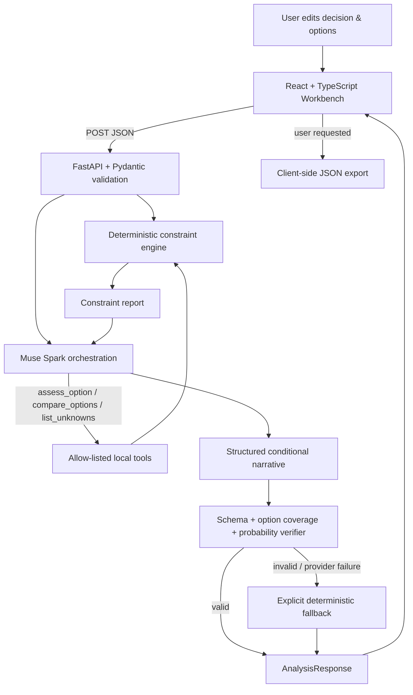

# System Architecture

## Product slice

This hackathon vertical slice is deliberately stateless. It demonstrates a validated decision request, deterministic constraint calculations, a bounded Meta Model API tool-calling loop, checked scenario output, and a UI that exposes the actual execution trace.

## Trust boundaries

1. **Browser**: editable values and report display. The model API key never enters this layer.
2. **API validation**: rejects extra fields, out-of-range numeric inputs, duplicate option IDs/names and malformed requests.
3. **Deterministic engine**: source of truth for time and money calculations. No model calls inside the arithmetic path.
4. **Meta agent**: can call only three local, read-only tools; tool-turns and executions are bounded.
5. **Output verifier**: rejects missing/duplicate option analyses and obvious unsupported numerical-probability claims.
6. **Fallback**: explicit and useful if provider access is absent, errors, skips tools or returns invalid output.

## Data-flow invariants

- No database writes in the hackathon starter.
- Empty numeric input is `null` and remains unknown.
- Values are shown only when entered or calculated from complete inputs.
- No unreviewed external reference-class rates are part of the product slice.
- Tool traces are written by the server based on observed execution, never copied from model prose.
- Narrative strings are not treated as arithmetic or verified population evidence.

## Main modules

| Module | Responsibility | Must not do |
|---|---|---|
| `schemas.py` | Typed input/output contracts and request validation | Add inferred values for missing fields |
| `constraint_engine.py` | Calculate headroom, costs, statuses and missing inputs | Call a model or use probabilistic language |
| `tool_registry.py` | Declare tools and execute an allow-listed local function | Execute shell commands, network calls or arbitrary Python |
| `meta_agent.py` | Bounded Meta tool-call orchestration | Expose keys, bypass tools, or self-assert success without actual tool use |
| `narrative.py` | Fallback narrative and output verification | Invent odds or source rates |
| `main.py` | REST endpoints and safe fallback behavior | Log raw personal requests or provider secrets |
| `frontend/src/App.tsx` | Form, report, live trace, rerun and JSON export | Claim a model ran based only on key configuration |
